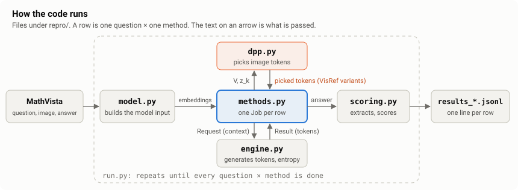

# visref-repro

[한국어 (Korean)](README.ko.md)

Unofficial reproduction of **VisRef** (Ghosal et al., *VisRef: Visual Refocusing while Thinking Improves Test-Time
Scaling in Multi-Modal Large Reasoning Models*, arXiv:2603.00207, CVPR 2026), Appendix Table 6 row *InternVL-1B*:
InternVL3.5-1B on the 1,000 MathVista *testmini* questions. Three methods are compared:

- **ST** (standard thinking): the model thinks once, then answers.
- **TSR** (textual self-reflection): after each thinking step, "Wait, think more" makes the model think again, until
  its answer is certain enough.
- **VisRef**: like TSR, but before each new step a selected part of the image is inserted again.


> **Status (2026-10-25):** the main run and fourteen follow-up experiments (A2–A4, A6–A16) are finished. With the original image
> present, no variant showed a VisRef gain over TSR (A1–A11). With the prompt's image slot holding a blank image, re-inserting
> the question's whole image after the first thinking step raised accuracy by 12.8 pp, while no change was confirmed with another question's image
> (A12, [REPORT, Section 4.16](REPORT.md#416-blank_think-does-a-re-inserted-image-raise-accuracy-when-the-image-slot-is-blank-rule-fixed-before-the-results)):
> re-inserted image tokens can be used when the image information is missing. In the same context, only the tokens chosen by the
> DPP selection raised accuracy by 6.9 pp (99 questions better, 40 worse), but a difference from as many random tokens of the image
> was not confirmed (+2.0 pp, 95% CI −0.9 to +4.8; 84 : 66; A16, [REPORT, Section 4.20](REPORT.md#420-sel_think-with-a-blank-image-slot-do-the-dpp-selected-image-tokens-raise-accuracy-rule-fixed-before-the-results)). A13–A15 (image slot after
> thinking, a 4,096-token step limit, a stopping estimate from free answers) did not change this picture
> ([REPORT, Sections 4.17–4.19](REPORT.md#417-slot_cross-after-generated-thinking-does-the-image-slot-of-the-prompt-still-matter-rule-fixed-before-the-results)).
> What has not been run, and why, is in [REPORT, Section 5.4](REPORT.md#54-experiments-not-run).
> Full report: **[REPORT.md](REPORT.md)**.

## How to read this repository

| | When | Read |
|---|---|---|
| 1 | First: results and main limitations | this README |
| 2 | What was tested and what was concluded | [REPORT.md](REPORT.md): Summary and Section 1.1 (every experiment in one table), then Sections 3–4 (results, causes) and 6 (limitations) |
| 3 | How a setting the paper does not state was chosen | REPORT Sections 2.1 and 2.6; the evidence for each decision: [docs/IMPLEMENTATION_CHOICES.md](docs/IMPLEMENTATION_CHOICES.md) (Korean; start with its summary table) |
| 4 | When and why something was decided | [docs/EXPERIMENT_FLOW.md](docs/EXPERIMENT_FLOW.md) (Korean dated log; start with its stage summary) |
| 5 | Checking a number | [`results/`](results) for the tables, `repro/kaggle/runs/` for the raw outputs, `make check` (see Reproduce) |
| 6 | Checking a quote cited by line number (e.g. `LAY L900` = line 900 of our text copy of the paper) | [docs/SOURCES.md](docs/SOURCES.md) |
| 7 | Running it again or reading the code | [docs/REPRODUCE.md](docs/REPRODUCE.md) and the code map under Reproduce |

Every file location: [REPORT, Section 7](REPORT.md#7-where-to-find-things).

## Results

n = 1,000 questions; each method once per question, with shared seeds and a shared first thinking step. Answers are
extracted by rules, and by an LLM only where the rules fail (36 of 3,000 rows); the LLM's answer counts only if it
appears in the response. Differences are in percentage points (pp) with 95% confidence intervals (CI).


<!-- check:accuracy -->
| accuracy (%) | ST | TSR | VisRef |
|---|---|---|---|
| paper (Table 6) | 46.1 | 48.5 | 52.0 |
| **ours** | **57.8** | **60.1** | **60.0** |
<!-- /check -->

<!-- check:paired -->
| comparison | ours, pp (95% CI) | paper, pp | conclusion |
|---|---|---|---|
| VisRef − ST (main) | +2.2 (+0.3, +4.1) | +5.9 | effect size not reproduced (same direction, different size) |
| VisRef − TSR (main) | −0.1 (−2.0, +1.7) | +3.5 | effect size not reproduced |
| TSR − ST (supplementary) | +2.3 (+0.6, +4.0) | +2.4 | consistent with the paper value |
<!-- /check -->

- **In short:** TSR's gain over ST (+2.3 pp) is compatible with the paper's +2.4, but in our runs part of it probably comes
  from continuing thinking that was cut at the token limit. We did not confirm VisRef's additional gain over TSR in our
  InternVL3.5-1B implementation. VisRef − ST is smaller than in the paper and not significant after the correction for
  two comparisons fixed in advance (Holm p = 0.067).

> **What this run tested**
> - The first thinking step hit the 1,024-token limit in 641 of the 1,000 questions, so most extra steps continue a
>   cut step.
> - After a step that the model closed itself, the stopping entropy was at or above its threshold (0.25) in only 7 of
>   359 TSR checks and 35 of 398 VisRef checks, so the model went on thinking almost only after a cut.
> - The re-inserted image tokens were a median of about one fifth of m, the number the paper re-inserts per step
>   (median 0.199).
> - Among the 713 questions where VisRef stopped after one step, the final answer contains another `</think>` in 352
>   VisRef answers versus 67 ST answers on the same questions.
>
> These limits are why the follow-ups A2–A11 exist. A6 addressed the last two together: m tokens chosen with
> last-layer vectors, wrapped in InternVL's image tags after `</think>`. It gave −1.0 pp (95% CI −3.1 to +1.0) against TSR
> with the same answer prompt, and another `</think>` still appeared in 249 of 1,000 answers (TSR with the same prompt: 107)
> ([REPORT, Section 4.6](REPORT.md#46-visref-imgtag-tagged-image-block-after-think-rule-fixed-before-the-results)).
> A7 made the model think up to 512 more tokens, with or without the selected image, on the 691 questions where both
> methods had stopped after step 1: image − no image was 0.0 pp and −1.74 pp in the two groups tested, so no gain
> ([REPORT, Section 4.7](REPORT.md#47-step1_think-more-thinking-where-both-methods-stopped-rule-fixed-before-the-results)).
> A8 gave the model all image tokens of the question, or none, together with up to 2,048 more thinking tokens on the 297 questions where step 1 was cut and a
> method continued: whole image − no image was −1.80 pp (95% CI −5.95 to +2.36; 31 questions better, 45 worse), so no gain was confirmed
> ([REPORT, Section 4.12](REPORT.md#412-full_think-the-whole-image-and-longer-thinking-after-a-cut-step-1-rule-fixed-before-the-results)).
> A11 took the 334 questions whose first step the model had closed itself and continued thinking for up to four steps, with or without
> the selected image tokens after every step: on the first 112 questions VisRef − TSR and VisRef − answering at once each changed 0 questions
> (0 better, 0 worse; 75.0% in every condition), so a gain was not confirmed there either, and an interim rule fixed in advance stopped the run at 112
> ([REPORT, Section 4.15](REPORT.md#415-closed_multistep-continuing-up-to-4-steps-after-a-first-step-the-model-closed-itself-rule-fixed-before-the-results)).
> Two probability-level tests did not change the picture: with the original image replaced by a blank one, re-inserting the question's image
> brought back part of the probability of the right answer (A9, mostly in free-form questions), and no evidence was seen that removing the thumbnail tile
> makes the probability gain of re-insertion larger (A10) ([REPORT, Sections 4.13 and 4.14](REPORT.md#413-recover_check-does-a-re-inserted-image-carry-information-when-the-image-slot-is-blank-rule-fixed-before-the-results)).
> Splitting three paired runs into 16 fixed groups of questions found no group where VisRef was consistently better
> ([REPORT, Section 4.9](REPORT.md#49-subgroup-reanalysis-of-the-three-paired-runs-grouping-fixed-before-it-was-computed)).


- **How the conclusion is decided:** *consistent* = our 95% CI contains the paper's difference and excludes 0; *not
  reproduced* = our 95% CI excludes the paper's difference; if the CI contains both 0 and the paper's difference, no
  conclusion is drawn. These rules were fixed after we had looked at partial results
  (392 and 759 questions), so for the main run they were not fixed before all results ([REPORT, Section 2.4](REPORT.md#24-when-the-decision-rules-were-fixed)).
- **What 1,000 questions can show:** a paired difference of about 2.6 pp or more (80% power), so a gain of the paper's
  size (+3.5 pp) would have been visible; gains of 1–2 pp cannot be ruled out. Running the same condition again moved
  accuracy by about 0.3–0.5 pp ([REPORT, Section 3.4](REPORT.md#34-what-these-samples-can-detect)).

## Experiments at a glance

**Result experiments** test the paper's claim or look for the reason it was not reproduced (decision rules fixed
before the results). **Setting checks** chose the settings the paper does not state; how each one was chosen, and
whether it comes from the paper, a cited work, official InternVL material or our own choice, is in
[REPORT, Section 2.6](REPORT.md#26-setting-checks-how-the-unstated-settings-were-chosen).

<!-- check:glance -->
| | Question | Changed from the main run (A1) | Questions | Result | Main limitation |
|---|---|---|---|---|---|
| A1 | Does VisRef (selection that stops early at the rank limit) beat TSR? (paper: +3.5 pp) | — (main run; settings in Section 2) | 1,000 | VisRef − TSR: −0.1 pp | only about one fifth of the paper's m image tokens were re-inserted |
| A2 | Does filling the re-inserted image tokens up to m help? | after the selection stops, the injection is filled up to m tokens | 976 | VisRef-fill − TSR: 0.0 pp | the added tokens were nearly unrelated to the thinking |
| A3 | Does re-inserting the image after step 1 help by itself? | after the shared first step only: the answer (at once, or after up to 512 more thinking tokens) comes with or without the selected image tokens | 309 | with − without the image: +1.40 pp, +0.97 pp | only questions where a method continued after step 1 |
| A4 | Does choosing image tokens with the model's last-layer vectors help? | thinking vectors Z for the selection taken from the last layer (A1: input embeddings) | 839 | VisRef-hs − TSR: +0.24 pp | the first step was generated again, so it differs from the main run |
| A5 | Does thinking more after the re-inserted image help? | after the stop decision, up to 512 more thinking tokens after the injected image, then the answer | – | not run (by the rule fixed before A7) | the same question was tested on a subset in A7 |
| A6 | Does a tagged image block after `</think>` (tokens chosen with last-layer vectors) beat TSR with the same answer prompt? | four at once: (1) `` … `</img>` tags with line breaks; (2) block after `</think>` when answering (A1: before it); (3) image vectors V for the selection also from the last layer (Z as in A4); (4) every answer starts after `\nFinal Answer:` | 1,000 | VisRef-imgtag − TSR with answer prompt: −1.0 pp | the four changes are tested only together |
| A7 | Where both methods stopped after step 1, does thinking more with the selected image help? | from the stored first step, up to 512 more thinking tokens with no image, the selected image tokens or as many random image tokens, then a short answer | 691 | image − no image: 0.0 pp (step 1 closed by the model), −1.74 pp (step 1 cut) | only questions where both methods had stopped |
| A8 | Where step 1 was cut and a method continued, does the whole image with up to 2,048 more thinking tokens help? | from the stored first step: the answer at once, up to 2,048 more thinking tokens with no image, or all image tokens of the question and then up to 2,048 more thinking tokens; then a short answer | 297 | whole image − no image: −1.80 pp | only questions whose step 1 was cut and where a method continued; more thinking was forced, no stop decision |
| A9 | When the image slot holds a blank image, does re-inserting the question's image tokens bring back probability of the right answer? | nothing generated: the image in the prompt replaced by a grey blank image; after one short fixed sentence the question's image tokens are re-inserted; the probability of the right answer is read | 199 | the re-inserted image carried information: +0.088 in probability (95% CI +0.042 to +0.136) | a probability, not an accuracy; an artificial context; the recovery came from free-form questions |
| A10 | Without the thumbnail tile, does re-inserting the selected image tokens raise the probability of the right answer more? | the thumbnail tile cut from the input; a new first step, then the selected image tokens re-inserted; the probability of the right answer is read | 160 | gate not passed: difference of the gains +0.006 (95% CI −0.011 to +0.024) | a probability, not an accuracy; one position after step 1 |
| A11 | After a first step the model closed itself, does VisRef beat TSR when thinking continues for up to 4 steps? | from the stored first step: the answer at once, more thinking without image, or with the selected image tokens after every step; up to 4 steps, no stopping entropy; then a short answer | 112 of 334 | VisRef − TSR: 0 better, 0 worse (0.0 pp) | the number of steps was forced; the run stopped at 112 by a rule fixed in advance |
| A12 | When the image slot holds a blank image, does re-inserting the question's image after step 1 raise accuracy through generation? | a new first step with the own or a grey blank image; then more thinking with no image, all of the question's image tokens or another question's | 396 | blank + own image − blank: +12.8 pp | artificial blank-image context; whole image, no selection |
| A13 | After generated thinking, does the image in the prompt's slot still change the probability of the right answer? | probabilities only: image slot (original or blank) crossed with a block after the thinking | 396 | gate not met: +0.022 (needed 0.05) | a probability, not an accuracy |
| A14 | Does a step limit of 4,096 instead of 1,024 tokens change ST accuracy? | the main-run code with both limits on the same questions | 42 | ST 4,096 − 1,024: 0.0 pp | 42 questions |
| A15 | Do self-ended first steps continue if the stopping entropy comes from 16 free answers? | from the stored first step: 16 short and 16 free answers | 126 | undecided: 3 to 94 of 126 continue, 7 to 21 read without the box | our own estimator |
| A16 | When the image slot holds a blank image, do only the DPP-selected image tokens raise accuracy, and more than as many random tokens? | A12's stored blank-image first step; then more thinking with no image, the DPP selection, as many random tokens, the whole image or another question's image, each as a tagged block | 724 | DPP − none: +6.9 pp; DPP − random: +2.0 pp, not confirmed | artificial blank-image context |
<!-- /check -->

## Why our results may differ from the paper

We look for the cause in our implementation first ([REPORT, Section 4.1](REPORT.md#41-cause-analysis-after-the-results)):

- **Fewer image tokens.** We re-insert about one fifth of the paper's m image tokens per step: with text token
  embeddings read as the model's input embeddings (our reading; the paper does not name the layer), the selection kernel
  has rank below m, and the greedy selection the paper cites stops there. A2, A4 and A6 tried ways around it; none showed a detectable gain over TSR.
  Later follow-ups (A11 and the run in progress) select with the last-layer values of the thinking text, as decided on 2026-10-17.
- **Our own settings.** The paper does not state how the stopping entropy is estimated, how the image is inserted,
  the token limits or how answers are extracted; we chose these in small checks ([REPORT, Section 2.6](REPORT.md#26-setting-checks-how-the-unstated-settings-were-chosen)).
  Those checks used questions that are also among the 1,000 evaluated ones.
- **Higher accuracies.** Our accuracies are 8–12 pp above the paper's (57.8 / 60.1 / 60.0 % against 46.1 / 48.5 / 52.0 %), close to the official InternVL3.5-1B score;
  we have not found the reason ([REPORT, Section 4.4](REPORT.md#44-comparison-with-other-numbers-in-the-paper-after-the-results)).
- **One setting.** One model size, one benchmark, one seed.

## Reproduce

Rebuild every table and figure from the saved outputs (CPU only, Python 3.10 or newer, standard library):

```bash
make fetch     # MathVista testmini.json, official extraction prompt and cited code, checked against stored hashes
make check     # re-runs the analyses, rebuilds results/ and the figure, checks the tables in the READMEs and REPORT
```

Regenerating the model outputs on a GPU, the LLM extraction and where every file is:
[docs/REPRODUCE.md](docs/REPRODUCE.md).
The GPU and the generation time of each experiment are in [`results/compute.csv`](results/compute.csv) (REPORT Table 2.5).



## Contributions and AI use

Carried out by AhnJG with AI assistance (Claude models by Anthropic, Codex by OpenAI): AhnJG chose the target, the
evidence rules and the design decisions; Claude wrote most of the code and drafted the analyses and the report.
Details: [REPORT, Section 8](REPORT.md#8-contributions-and-ai-use).

## Citation
See `CITATION.cff`. Please also cite the original paper:
```bibtex
@article{ghosal2026visref,
  title   = {VisRef: Visual Refocusing while Thinking Improves Test-Time Scaling in Multi-Modal Large Reasoning Models},
  author  = {Ghosal, Soumya Suvra and Kim, Youngeun and Li, Zhuowei and Chaudhry, Ritwick and Xu, Linghan and
             Zhang, Hongjing and Zablocki, Jakub and Xing, Yifan and Zhang, Qin},
  journal = {arXiv preprint arXiv:2603.00207},
  year    = {2026}
}
```

## License
Code: MIT (`LICENSE`). Data files derived from MathVista (run outputs, LLM-extraction requests and responses, analysis
JSON, `results/`, reports) are shared under CC BY-SA 4.0, like MathVista; model outputs were produced with
InternVL3.5-1B (Apache-2.0). Other third-party files are not included; `scripts/fetch_sources.py` downloads them.
