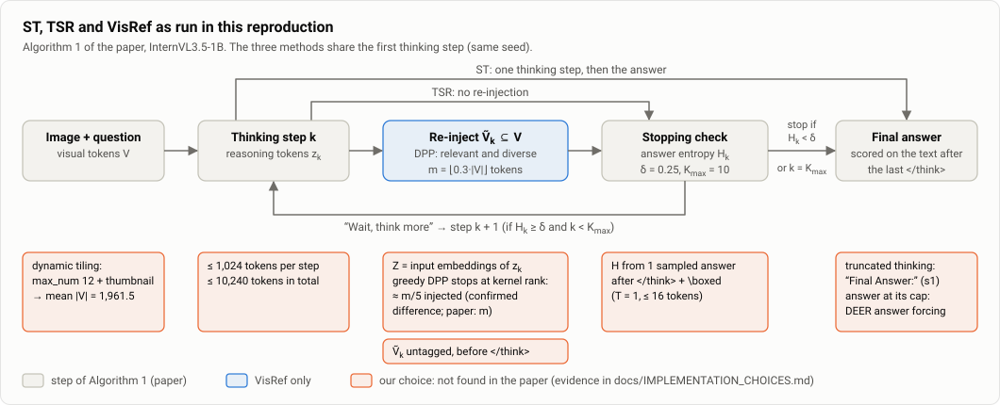
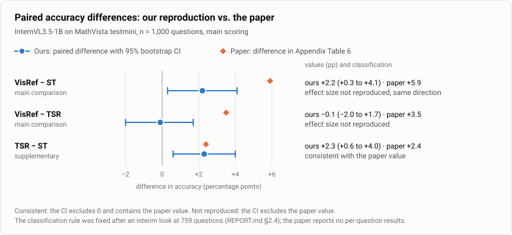

# Reproducibility report: VisRef, Appendix Table 6 row "InternVL-1B" on MathVista testmini

*Unofficial reproduction, MLRC / ReScience style. The main run and three follow-up experiments are finished; the decision rules of the follow-ups were fixed before their results. The original authors have not been contacted yet.*

**Paper.** Ghosal, Kim, Li, Chaudhry, Xu, Zhang, Zablocki, Xing, Zhang. *VisRef: Visual Refocusing while Thinking Improves Test-Time Scaling in Multi-Modal Large Reasoning Models.* arXiv 2603.00207, CVPR 2026. No official code was released (the CVPR 2026 supplementary material was checked).

## Summary

We reimplemented the three methods of Table 6 (standard thinking ST, textual self-reflection TSR, and VisRef) for InternVL3.5-1B and evaluated each once on all 1,000 MathVista testmini questions, with the same questions, the same seeds and a shared first thinking step. Accuracies were ST 57.8, TSR 60.1 and VisRef 60.0 % (paper: 46.1, 48.5, 52.0). The TSR−ST difference (+2.3 pp, 95% CI +0.6 to +4.0) is consistent with the paper's +2.4; this is not proof of equivalence. VisRef−ST was +2.2 pp (CI +0.3 to +4.1): the CI excludes 0 but also the paper's +5.9, and the difference is not significant after the pre-specified Holm correction (p = 0.067). VisRef−TSR was −0.1 pp (CI −2.0 to +1.7), which excludes the paper's +3.5: we did not confirm an additional gain over TSR in our InternVL3.5-1B implementation. Three pre-registered follow-ups (topping up the injection to m tokens, which turned out to add tokens chosen without regard to relevance; re-testing step-1 re-injection in a four-condition design; using the model's last-layer vectors for the thinking text, with which the DPP injected m tokens) did not change this picture. We look for the cause of the missing gain in our implementation first: it has a confirmed procedural difference (about one fifth of the paper's token budget m is injected; injecting m tokens with last-layer vectors did not bring a gain either), many settings we could not find in the paper were chosen by us, our absolute accuracies are 8–12 pp above the paper's, and we cover one model size, one benchmark and one seed.

## 1. Scope of reproducibility

| # | Claim (paper Table 6, 1B row: ST 46.1 / TSR 48.5 / VisRef 52.0) | Paper delta | Role here |
|---|---|---|---|
| C1 | TSR > ST | +2.4 pp | supplementary |
| C2 | VisRef > ST | +5.9 pp | main comparison 1 |
| C3 | VisRef > TSR | +3.5 pp | main comparison 2 |

The paper's headline claim is that VisRef improves over both ST and TSR, so C2 and C3 are the main comparisons. We target the paired differences, not the absolute accuracies: the paper's ST (46.1) is far below the official InternVL3.5-1B MathVista (mini) score of 59.3 (InternVL3.5 report; the report does not say whether that number uses thinking mode), and the paper's 8B ST (68.1) is likewise more than 10 pp below the official 78.4. Table 6 labels the row "InternVL-1B". We use InternVL3.5-1B: the only InternVL generation the paper names is InternVL3.5, it runs its models in thinking mode, it compares the 1B, 2B and 8B models "under the same decoding setup and token budget", and its 8B row equals the InternVL3.5-8B row of Table 1.

## 2. Methodology

### 2.1 Setup

*Figure 1. The loop of Algorithm 1 as implemented here. Grey boxes are steps the paper specifies, the blue box is the step only VisRef has, and orange notes are settings we could not find in the paper (our choices, listed in the table below).*

Source codes: **P** paper; **C** work or code cited by the paper; **O** official InternVL3.5 material (the official model page on Hugging Face, VLMEvalKit); **U** our own choice.

| Item | Value | Source |
|---|---|---|
| Model, data | `OpenGVLab/InternVL3_5-1B` @ `2f71cf52…`; `AI4Math/MathVista` testmini (1,000 q) @ `2b6ad694…` | P (see Section 1) |
| Question order, seeds | Order shuffled with seed 0; generation seed 42, derived per question and shared by the three methods; first thinking step shared (forked) | U |
| Methods | ST; TSR (cue "Wait, think more"); VisRef (greedy MAP DPP over visual tokens) | P; DPP code of Chen et al. 2018 (C) |
| VisRef values | δ = 0.25, m = ⌊0.3·\|V\|⌋, K_max = 10 | P |
| DPP selection size | Greedy stops when the residual gain falls below 1e-9 × max L_ii (termination rule of the cited Chen code), so most steps inject fewer than m tokens. The paper states \|V_k\| = m: **confirmed procedural difference** | C (conflicts with P) |
| Decoding | R1 thinking system prompt, T 0.6, top-k 50, top-p 0.95, fp16, Kaggle 2×T4 | O. Paper used 4×A10G; T4 has no bf16 |
| Software | transformers 4.55.0 (as in the paper); torch from the Kaggle image (recorded per session in `env.json`; paper: 2.7.0) | P / U |
| Token limits | 1,024 per thinking step, 10,240 total thinking, 1,024 answer, 100 for answer forcing | U (1,024 is the model-card example value) |
| Truncated thinking, capped answers | After truncated thinking: `</think>` + `\nFinal Answer:` (s1-style budget forcing). Answer reaching the cap without EOS: `\n**Final Answer**\n\boxed` + ≤100 tokens ("af", DEER-style) | s1 is cited (C) but applying it here is our interpretation; DEER is not cited by the paper (U) |
| Stopping statistic H | Sum of token entropies of one answer sampled after `</think>` + `\n\n\boxed` (T = 1, ≤16 tokens) | Definition (entropy of the answer distribution): P. Estimator: U |
| Reasoning-token representation Z | Input embeddings of the thinking-step tokens | U (no layer found in the paper); last layer: Section 4.5 |
| Injection format | Selected visual embeddings appended without `` tags directly before `</think>`; order z_k → Ṽ_k → H_k → "Wait, think more"; Ṽ_k ⊆ V | Order and subset: P (Alg. 1, Fig. 2). Tags, separators, `</think>` handling, position ids, answer prompt: not found in the paper, U. The junction `[Ṽ_k] </think>` is our own choice |
| Visual tokens | Dynamic tiling, max_num = 12 plus thumbnail tile; mean \|V\| = 1,961.5 | O (official model page); see Section 4.4 |

### 2.2 Scoring

The text after the last `</think>` is scored (the same split rule as VLMEvalKit `SPLIT_THINK`; whether the InternVL3.5 evaluation enabled it is unconfirmed). Answers are extracted by rules (boxed, then "answer is", then last line) and compared with the MathVista normalisation. Rows on which the rules fail (36 of 3,000) go to an LLM fallback (official MathVista extraction prompt, gemini-3.5-flash-lite, fixed before the final extraction). An LLM answer is accepted only if it is grounded in the response text. Empty responses (13) are never sent and count as wrong. Scorer v4 (2026-10-11, after the results) counts an empty multiple-choice extraction as wrong, like the official `--ignore_empty_extractions`; it changes 0 rows of the main scoring. This main scoring (rules plus LLM fallback) was fixed in advance; the other scoring variants in Section 3.2 are sensitivity checks.

### 2.3 Statistics

The unit is the question, compared pairwise. We report paired bootstrap 95% CIs of accuracy differences (2,000 resamples, seed 0), exact McNemar tests, and a Holm correction over the two main comparisons (VisRef−ST, VisRef−TSR). TSR−ST is supplementary and outside the Holm family. Classification against the paper's delta: **"consistent with the paper's value"** means the CI excludes 0 and contains the paper's delta (not proof of equivalence); **"effect size not reproduced"** means the CI excludes the paper's delta. This is not a test of the difference between our result and the paper's: the paper gives no per-question outputs.

### 2.4 Timing of pre-registration

The main comparisons, the tests (McNemar + Holm) and the scoring variants of Section 3.2 were fixed on 2026-10-10 before the final 1,000-question analysis. The choice of main comparisons and tests followed the paper's claim but was made after an interim look at the first 392 questions (sessions 1–4; VisRef−TSR was about +1.0 pp then), so the main run is not a pre-registration in the strict sense. The **CI classification rule was fixed after we had seen the interim result on 759 questions** (sessions 1–7), and the final 1,000 include those 759, so the classification is not confirmatory in the strict sense. The two follow-ups (Sections 4.2 and 4.3) were registered with their decision rules before their results. Scorer v4 was a change after results. Every other analysis is labelled post-hoc and has no multiplicity correction.

### 2.5 Code versions and compute

Three code versions produced the 1,000 questions: `79eef648ebd1` (session 1, 74 questions), `f2422d0e72ff` (sessions 2–4, 318) and `d0095f79e691` (sessions 5–9, 608). The first change removed unused branches (outputs identical on 810 of 810 compared outputs); the second changed only the scorer. All outputs were re-scored with the final scorer and merged. Compute (from the experiment log): the main run took 9 Kaggle sessions on 2×T4 (about 14.9 session-hours); visref_fill one session of about 11.3 h; step1_branch about 2,900 s per GPU for 289 questions plus a 20-question pilot.

## 3. Results

### 3.1 Main result (main scoring, n = 1,000)

*Figure 2. Our paired differences (dot, 95% bootstrap CI) next to the paper's differences (diamond). Drawn by `scripts/make_figures.py` from `results/paired_differences.csv`.*

| Method | Ours % | Paper % | Ours − paper |
|---|---|---|---|
| ST | 57.8 | 46.1 | +11.7 |
| TSR | 60.1 | 48.5 | +11.6 |
| VisRef | 60.0 | 52.0 | +8.0 |

| Comparison | Ours (pp) | 95% CI | Only first / only second correct | McNemar p | Holm p | Paper (pp) | Classification |
|---|---|---|---|---|---|---|---|
| VisRef − ST (main) | +2.2 | +0.3 to +4.1 | 60 / 38 | 0.033 | 0.067 | +5.9 | effect size not reproduced (same direction, smaller) |
| VisRef − TSR (main) | −0.1 | −2.0 to +1.7 | 44 / 45 | 1.000 | 1.000 | +3.5 | effect size not reproduced |
| TSR − ST (suppl.) | +2.3 | +0.6 to +4.0 | 51 / 28 | 0.013 | n/a | +2.4 | consistent with the paper's value |

- VisRef−ST: the unadjusted CI excludes 0, but the difference is not significant after the pre-specified Holm correction (p = 0.067).
- VisRef−TSR: the CI excludes +3.5 but not a small positive gain (up to +1.7 pp). We did not confirm an additional gain over TSR.
- TSR−ST is consistent with +2.4 (not proof of equivalence). Part of our TSR gain is a thinking-budget extension (Section 4.1), so this agreement says little about the mechanism.
- The paired CI half-width is about 1.7–1.9 pp at n = 1,000 (binomial SE of a single accuracy about 1.6 pp).

### 3.2 Sensitivity to answer handling

Scoring variants: *main scoring* as described in Section 2.2; *rules only*: no LLM fallback; *scored before answer forcing*: answers that did not finish and were rescued by answer forcing (af) are re-scored on the text before the forcing, with scorer v4 and v3; *unfinished answers counted wrong*: every row that needed af counts as wrong (a lower bound). Cells give difference in pp with CI.

| Scoring | ST % | TSR % | VisRef % | VisRef − ST | VisRef − TSR | TSR − ST |
|---|---|---|---|---|---|---|
| main scoring: rules + LLM (fixed in advance) | 57.8 | 60.1 | 60.0 | +2.2 (+0.3, +4.1) | −0.1 (−2.0, +1.7) | +2.3 (+0.6, +4.0) |
| rules only, v3 | 57.8 | 60.0 | 60.0 | +2.2 (+0.3, +4.1) | 0.0 (−1.9, +1.8) | +2.2 (+0.4, +3.9) |
| scored before answer forcing, v4 | 55.9 | 58.0 | 58.6 | +2.7 (+0.5, +5.0) | +0.6 (−1.7, +2.9) | +2.1 (+0.1, +4.1) |
| scored before answer forcing, v3 | 56.0 | 58.1 | 58.6 | +2.6 (+0.4, +4.9) | +0.5 (−1.8, +2.8) | +2.1 (+0.1, +4.1) |
| unfinished answers counted wrong | 44.4 | 48.3 | 47.4 | +3.0 (+0.5, +5.5) | −0.9 (−3.3, +1.5) | +3.9 (+2.0, +5.7) |

The CI-based classification is the same under every scoring variant. Significance is not: with unfinished answers counted wrong, VisRef−ST has McNemar 94 : 64 and Holm p = 0.042 (we recomputed this from the merged rows), versus 0.067 under the main scoring. LLM fallback: of 36 rule-failed rows, 30 grounded extractions were used and 6 rejected; 1 label changed from wrong to right (question 341, TSR) and none from right to wrong; 20 control rows on which the rules had succeeded agreed with the LLM extraction.

### 3.3 Run record

| | ST | TSR | VisRef |
|---|---|---|---|
| Runtime errors | 0 | 0 | 0 |
| First thinking step truncated at 1,024 tokens | 641 | 641 | 641 |
| Further step after: truncated / natural `</think>` / EOS | n/a | 1,103 / 7 / 5 | 1,214 / 32 / 15 |
| Final answer ended by EOS | 761 | 813 | 775 |
| Answer hit the cap, af used | 239 | 187 | 225 |
| af itself ended at its 100-token cap | 164 | 118 | 143 |
| LLM extraction used | 11 | 8 | 11 |
| Empty response (counted wrong) | 7 | 4 | 2 |

## 4. Beyond the paper

Everything in this section is **post-hoc unless marked pre-registered**, uses the main scoring, and played no role in the verdicts of Section 3.

### 4.1 Cause analysis (post-hoc)

We could not pin down a single cause. The items below are observations and candidates.

1. **Continuation happens almost only after cap truncation.** After a naturally closed step, the stopping statistic was ≥ δ in only 7 of 359 TSR and 35 of 398 VisRef probes (see the transition counts in Section 3.3). So part of TSR's gain over ST is probably a thinking-budget extension, and VisRef's injection mostly happens at a mid-sentence truncation point. Mean generated tokens per question: ST 1,114, TSR 2,205, VisRef 2,386.
2. **Questions where VisRef stops at step 1 (k = 1, 713 questions).** VisRef differs from ST only by injecting Ṽ_1 before the final answer: VisRef-only correct 15, ST-only correct 14. The extracted answer changed in 1 of 329 questions whose step closed naturally and in 33 of 366 truncated ones. Caveat: k = 1 is defined by the stopping decision after injection, and the TSR k = 1 noise baseline is a different item set, so this group alone cannot identify the cause. As a noise floor: on the 730 questions where TSR stopped at step 1 it answers from the same context and seed as ST, yet the final texts were identical in only 491 and the extracted answers in 714 (16, or 2.2%, differ), which we attribute to fp16 batch-composition noise.
3. **Side effect of the injection.** In the same k = 1 group the final answer contains another `</think>` in 352 of 713 VisRef answers versus 67 of 713 for ST.
4. **Injection amount: confirmed procedural difference.** The median injected/m ratio is 0.199, and 1,895 of 2,261 steps inject fewer than m tokens (median m 537, median injected 129). The cause is the early stop at the kernel rank, which is bounded by the number of distinct reasoning-token embeddings. Section 4.2 tests topping up to m (the top-up turned out to ignore relevance); Section 4.5 tests last-layer Z, which removes this bound (no extra gain).
5. **The stopping statistic H is our estimator.** The paper defines H as the entropy of the answer distribution; the cited Ghosal et al. sample several answers. We use one answer sample, whose summed token entropy equals the answer-distribution entropy on average (chain rule) but is noisy. We started with one sample, tried 10 complete answers per step after reading Ghosal et al. (with the 8B model, a TSR run on 3 development questions took 4,703.9 GPU-seconds), and went back to one sample because, judging from the paper's latency table (Table 5: ST 7.1 s, TSR 7.7 s, VisRef 8.2 s per question, 8B model on one H100), the authors cannot have generated several answers per step (`docs/EXPERIMENT_FLOW.md`, 2026-10-05 to 2026-10-07); multi-sample estimation was not used in the final runs.
6. **Other checks.** Dropping the `Final Answer:` nudge after truncated thinking (150 questions, pre-registered diagnostic) changed accuracy by −2.0 pp (15 vs 18 discordant, McNemar p = 0.73; 95% range about −9.5 to +5.5 pp, normal approximation), so the pre-registered criterion (a drop of 10 pp or more) was not met; 150 questions cannot detect a change of a few pp. An independent review of the injection path by a separate AI-model session found no implementation error in the paths and samples it examined.

### 4.2 visref_fill: topping up the injection to m tokens (pre-registered)

*Design.* Identical to VisRef except that, after the greedy selection stops at the kernel rank, the same greedy continues on L + εI (ε = 1e-6 × mean diagonal) until m tokens are chosen (the leading part is asserted identical to VisRef). *Sample.* All 1,000 questions were submitted; the session ended with 994 rows, and the pre-registered analysis uses the complete prefix of the shuffled order (976 questions). *Rule.* A fill−TSR CI lower bound above 0 would support "too few injected tokens reduced VisRef's gain".

| Method | ST | TSR | VisRef (main run) | VisRef-fill |
|---|---|---|---|---|
| Accuracy % (n = 976) | 57.79 | 60.04 | 59.94 | 60.04 |

| Comparison | Diff (pp) | 95% CI | Only first / only second | McNemar p |
|---|---|---|---|---|
| fill − TSR | 0.00 | −2.15 to +2.36 | 70 / 70 | 1.000 |
| fill − VisRef | +0.10 | −2.15 to +2.36 | 65 / 64 | 1.000 |
| fill − ST | +2.25 | −0.31 to +4.71 | 87 / 65 | 0.088 |

*Result.* This filled variant showed no extra gain; the CI excludes gains larger than about +2.4 pp. The pre-registered reading ("too few injected tokens caused the missing gain" is not supported) is kept as the recorded verdict, but its scope is narrow: filling changes both the amount and, through the ridge term, which tokens are added, so this run does not isolate the effect of the amount. Every step injected exactly m tokens (2,231 steps; the filled tail had a median of 420 tokens). *Strata* (by the first-step end in the main ST run): closed 322 q, fill−TSR −0.62 (−2.48, +1.24); truncated 629 q, +1.75 (−1.43, +5.09); EOS 25 q, −36.0 (−64, −8; 4 vs 13). *Caveats.* The filled tail was not relevance-ordered (median Spearman correlation of tail order with relevance −0.10), and εI also changes the selection, so this tests "more tokens of little relevance", not "top-m by relevance". An earlier relevance-filled variant ran on the first 74 questions only and was dropped. The small EOS stratum is a post-hoc observation: when step 1 ended almost at once, the kernel held few tokens and filling added hundreds. The LLM fallback for this run used a Claude Haiku-class extractor instead of gemini-3.5-flash-lite (a documented deviation); it changed no label. *Dual stopping probe* (recorded by design, decision unchanged; interpretation post-hoc; H recorded with and without Ṽ_k in context): median H − H_noV = 0.0006; the stop/continue decision would differ at 151 of 2,231 steps (6.8%), 110 continuing only with Ṽ_k and 41 only without, 129 of the 151 at truncated steps.

### 4.3 step1_branch: re-injection at step 1 (pre-registered)

*Motivation (post-hoc).* The stored step-1 stopping-probe answers of the main run (1 sample, T = 1) gave VisRef 58.9 vs TSR 57.2 on 1,000 questions (28 vs 11 discordant, McNemar p = 0.0095, CI +0.5 to +3.0). All of the gap lies in the 309 questions where TSR or VisRef continued after step 1 (36.6 vs 31.1); the other 691 had no discordant pair. Their final answers did not differ (42.4 vs 43.0, 30 vs 32 discordant). These exploratory p-values are uncorrected.

*Design (fixed before results).* The 309 questions above (step 1 ended truncated in 297, EOS in 7, closed in 5). All conditions start from the same stored step-1 thinking z_1. **A:** no re-injection, answer immediately (`</think>` + `\n\n\boxed`). **B:** re-inject the DPP-selected Ṽ_1, answer immediately. **C:** no re-injection, up to 512 more free thinking tokens, then answer. **D:** re-injection plus up to 512 free thinking tokens, then answer. Answer = mean of 3 samples at T = 1 (plus one greedy answer), scorer v4. Co-primary comparisons B−A and D−C, paired bootstrap 95% CI (2,000, seed 0), Holm over the two. A comparison counts only if its CI lower bound is above 0.

| Condition | After z_1 | Accuracy %, mean of 3 (T = 1) | Accuracy %, greedy |
|---|---|---|---|
| A | answer immediately | 33.98 | 35.28 |
| B | Ṽ_1, answer immediately | 35.38 | 36.57 |
| C | ≤512 free thinking tokens | 35.28 | 39.81 |
| D | Ṽ_1, ≤512 free thinking tokens | 36.25 | 37.86 |

| Comparison | Diff (pp) | 95% CI | Holm p | Greedy: only first / only second (McNemar p) |
|---|---|---|---|---|
| B − A (co-primary) | +1.40 | −1.19 to +3.99 | 0.658 | 18 / 14 (0.597) |
| D − C (co-primary) | +0.97 | −2.27 to +4.21 | 0.658 | 14 / 20 (0.392) |
| D − B (secondary) | +0.86 | −2.16 to +3.88 | n/a | 20 / 16 (0.618) |
| C − A (secondary) | +1.29 | −1.83 to +4.42 | n/a | 25 / 11 (0.029, uncorrected) |
| (D−C) − (B−A) (secondary) | −0.43 | −4.21 to +3.24 | n/a | n/a |

*Correction (2026-10-12, after publication):* the bootstrap p-values were first computed on float accuracies (thirds), so resample means that are exactly 0 fell into one tail or the other depending on the Python version (p 0.289 / 0.575 and Holm 0.578 on Python ≤ 3.11; 0.281 / 0.583 on 3.12+). The analysis now uses integer counts of correct answers; the bootstrap p is 0.329 / 0.584 (Holm 0.658 for both) on every Python version. The CIs, the other numbers and the verdict are unchanged; the earlier output is kept in `repro/diag/step1_branch_analysis_float_py311.json`.

*Verdict by the pre-registered rule (④): the immediate-answer gain was not reproduced.* The gap seen in the stored probes may have been noise. The pre-registered wording for a null result is that effects of about 5–6 pp or more were not detected (5–6 pp was the planned 80%-power minimum detectable effect); the realised CI upper bounds are about +4 pp. In the free-thinking arms the model closed `</think>` itself in 99 (C) vs 82 (D) of 309 cases, reached the 512 cap in 203 vs 220, and used image-related words in 22.7% vs 31.4% of the free-thinking texts, so re-injection changed what the model wrote about without a detectable change in accuracy. *Reconstruction check:* re-tokenised length matched the main run in 301 of 309 questions and the selection size in 296; restricting to the 293 matching both gives the same conclusion. *Post-hoc, not pre-registered:* D−A is +2.27 pp (95% CI −0.97 to +5.72); under greedy decoding the order was C 39.81 > D 37.86 > B 36.57 > A 35.28, so "D is best" is not robust. *Scale:* the experiment covers only re-injection at step 1 on these 309 questions. If a +3.5 pp gap on 1,000 questions came from these 309 alone it would need about +11 pp within them, while the CI upper bounds correspond to about +1.2 to +1.3 pp on the 1,000-question scale. It says nothing about stopping rules, step lengths, injection format, or steps after the first.

### 4.4 Paper fingerprints (post-hoc)

- **Visual tokens.** The paper reports ∼1,772 visual tokens per image (InternVL-3.5-8B, MathVista; the 1B and 8B models use the same InternViT-300M). Recomputing InternVL's dynamic tiling from the image sizes reproduces our recorded counts on 1,000/1,000 questions. Mean |V|: max_num 12 with thumbnail 1,961.5 (+10.7% vs 1,772); max_num 12 without thumbnail 1,755.6 (−0.9%); max_num 6, 8 or 10 give −24% to −41%. This is compatible with, but does not show, that the authors dropped the thumbnail tile.
- **Answer handling.** Accuracy under four scoring variants against Table 6 (ST / TSR / VisRef, gap = ours − paper): main scoring 57.8 / 60.1 / 60.0 (+11.7 / +11.6 / +8.0); unfinished answers (rows that needed af) counted wrong 44.4 / 48.3 / 47.4 (−1.7 / −0.2 / −4.6); answers forced after cut thinking counted wrong 25.2 / 26.4 / 26.9 (−20.9 / −22.1 / −25.1); both counted wrong 24.4 / 25.3 / 26.3 (−21.7 / −23.2 / −25.7). Only counting unfinished answers wrong lands near the paper's ST and TSR. That is a hypothesis formed after the results and selected among four variants; under it TSR−ST is +3.9, farther from +2.4 than the main scoring's +2.3. VisRef−TSR lies between −0.9 and +1.0 under all four variants, so answer handling alone does not explain a missing +3.5.
- **Thinking volume.** Generated tokens relative to ST: TSR 1.98×, VisRef 2.14×. The paper's latency ratios (Table 5, 8B on H100) are 1.08× and 1.15×. The models differ, so this is only indicative that continuation was rarer in the authors' setup. In ours, 64.1% of ST first steps hit the cap, and 73.0% (TSR) and 71.3% (VisRef) of questions stopped at step 1.

### 4.5 visref_hs: last-layer Z (pre-registered)
*Question.* Does VisRef gain over TSR when the thinking-step vectors Z in the DPP kernel are the model's last-layer hidden states (after the final norm, the vectors that feed the output layer) instead of the input embeddings? With input embeddings the kernel rank is bounded by the number of distinct tokens in a step, so only about one fifth of m is injected (Section 4.1, item 4). Last-layer vectors differ at every position, so the DPP can pick m tokens when a step has at least m tokens. On 2026-10-06 the author had chosen the last hidden state as the first candidate for Z; the code rewritten on 2026-10-07 used input embeddings, and the reason is not recorded (`docs/AI_USE_REFLECTION.md`, Section 1). This experiment was added after the main results.

*Design (fixed before results: [commit ccac0d9](https://github.com/AhnJG/visref-repro/commit/ccac0d9), entry of 2026-10-12 in `docs/EXPERIMENT_FLOW.md`).* Only Z changes; the DPP, the visual vectors V, the injection format, the stopping probe, answer handling, token caps (1,024 per step, 10,240 in total), seeds and question order are those of the main run. All 1,000 questions are queued in the seed-0 order in one Kaggle session (2×T4, timeout 29,000 s); only the complete prefix is analysed, against the main run's ST, TSR and VisRef rows of the same questions. Scoring as in Section 2.2; the rules-only result is reported too. Main comparison hs − TSR (paired bootstrap 95% CI, exact McNemar test): CI lower bound > 0 → extra gain with last-layer Z; CI contains 0 and upper bound ≥ +3.5 pp → undecided; upper bound < +3.5 pp → the paper-size gain (+3.5 pp) is not reproduced with last-layer Z. Fewer than 300 finished questions → reported as underpowered. Run settings: `repro/kaggle/runs/b_main_hs/run_config.json` (its code hashes equal `repro/` at commit ccac0d9). Analysis: `repro/diag/analyze_hs.py`, written and tested before the results.

*Run.* One Kaggle session finished without errors; 839 questions form the complete prefix (300 or more, so no underpowered flag). The code version recorded in every row equals `repro/` at commit ccac0d9.

*Result (839 questions, main scoring).* ST 57.57 / TSR 59.71 / VisRef 59.36 / VisRef-hs 59.95 %. hs − TSR +0.24 pp (95% CI −2.38 to +3.10; 68 vs 66 discordant, McNemar p = 0.93). The upper bound is below +3.5, so by the pre-registered rule the paper-size gain over TSR (+3.5 pp) is not reproduced with last-layer Z; smaller gains are not excluded. Secondary (descriptive): hs − VisRef +0.60 pp (−1.67 to +2.98), hs − ST +2.38 pp (−0.24 to +5.01). Rules only: hs 60.07 %, hs − TSR +0.36 pp (−2.26 to +3.22), same verdict.

*Mechanism (descriptive).* The injection reached m: median injected/m 1.0 (quartiles 0.977 / 1.0 / 1.0), against 0.205 for VisRef with input embeddings on the same questions; 1,130 of the 1,678 steps with at least m tokens injected exactly m. Only a median of 70 picks (13.6% of m) added clear diversity (normalized residual ≥ 0.01), and the later picks were slightly anti-related to relevance (median rank correlation −0.171). A second `</think>` appeared in 395 of 839 final answers (VisRef 392, ST 109, TSR 99). Mean number of steps k: 2.34 (VisRef 2.27, TSR 2.10). The first-step end type agreed with the main run in 763 of 839 questions.

*Deviation from the pre-registration.* At the author's request, the 23 rows the rules could not parse were extracted by a Claude Haiku subagent with the same official MathVista prompt and no ground truth, instead of gemini-3.5-flash-lite (as in the fill run). 21 extractions were used and 2 were empty (rule result kept); the 20 control rows all agreed with the rules. One row changed from correct to wrong (pid 722, whose response ends with "The correct answer should be B) no"). Scoring by rules only gives the same verdict.

*Reading.* Injecting m tokens chosen with last-layer vectors did not bring VisRef a gain over TSR in this implementation. The other differences on our side (injection format and position, the stopping estimate, token limits; Section 4.1) remain untested.

## 5. Discussion

### 5.1 What was easy

- Model, dataset and benchmark are public and could be pinned by revision; the official model page gives the thinking prompt and the sampling parameters.
- Algorithm 1 fixes the loop, the order z_k → Ṽ_k → H_k → cue, and δ, m and K_max; the DPP greedy MAP has public reference code.
- Pairing (common random numbers, shared first step) made differences of 2 pp measurable with 1,000 questions on free-tier GPUs.

### 5.2 What was difficult

We could not find the following in the paper; each was a choice of ours (Section 2.1):

- token budgets per step and in total, and what happens when thinking is truncated or an answer hits the cap;
- answer extraction and scoring (rules, LLM judge, which model);
- the layer of the reasoning-token representation Z (and of V);
- what to do when the DPP kernel rank is below m;
- the stopping-entropy estimator (number of answer samples, temperature, probe prompt, log base);
- the injection format: tags, separators, `</think>` handling, position ids, answer prompt after Ṽ_k;
- the image tiling (thumbnail tile).

We also recorded internal tensions in the paper (for example the latency table versus the token-usage figure; `docs/SPEC_LEDGER.md`, items A-4, A-8 to A-10, C-12) and did not use them as targets.

### 5.3 Communication with original authors

None as of 2026-10-12. Questions we would send:

1. Per-step and total thinking token limits; handling of truncated thinking.
2. How answers that reach the length limit were scored.
3. The answer extraction method (rules or LLM; which model).
4. The estimator of H: samples, temperature, probe prompt, log base.
5. The layer used for Z and V in the DPP kernel.
6. How |Ṽ_k| = m is enforced when the kernel rank is below m.
7. Injection format, separators, `</think>` handling and position ids.
8. Tiling settings (max_num, thumbnail) behind ∼1,772 visual tokens.
9. For 1B: the distribution of the number of steps k and the tokens per trace.
10. Sampling parameters, number of runs and hardware/precision for Table 6.

## 6. Limitations

- One model size (1B), one benchmark (MathVista testmini), one seed and one sample per question; the paper's 2B and 8B rows and other benchmarks were not tested.
- T4 fp16 results depend on batch composition: the same seed can give different outputs (16 of 730 predictions differ between TSR at k = 1 and ST; 874 of 976 first-step end types agree between the fill run and the main run).
- The paper provides no per-question outputs, so the difference between our result and the paper's cannot be tested formally; the CI classification is a coarse check.
- Absolute accuracies are 8–12 pp above the paper's. Candidates (treatment of unfinished answers, thinking budget, extraction, prompt) were not isolated; the closeness of the variant that counts unfinished answers wrong to the paper's ST and TSR is a post-hoc hypothesis.
- Choices of ours (Z layer, H estimator, injection format, token limits) and the confirmed shortfall in injected tokens limit what the null result on VisRef−TSR means; it concerns this implementation only.
- The LLM fallback differs from the official GPT-based extractor; the fill and visref_hs runs used a Claude Haiku subagent instead of the Gemini model of the main run.
- The main comparisons and tests were fixed after an interim look at 392 questions and the CI classification rule after one at 759 (Section 2.4); the post-hoc analyses are exploratory.
- Several analysis and review passes (`repro/audit/`) were done by AI-model sessions, not by human reviewers. Untried ideas, such as a step cap of 4,096 or multi-sample H, were not run; last-layer Z was run as a follow-up (Section 4.5).

## 7. Where to find things

| What | Where (in this repository) |
|---|---|
| Chronological log with pre-registrations and decisions (Korean) | `docs/EXPERIMENT_FLOW.md` |
| Evidence per implementation decision, external-number ledger (Korean) | `docs/SPEC_LEDGER.md` (start at "핵심 판단 요약") |
| Main verdict script and numbers | `repro/diag/final_judgment.py`, `repro/diag/final_judgment.json` |
| Follow-up analyses | `repro/diag/analyze_fill.json`, `repro/diag/step1_branch_analysis.json` (earlier float version: `step1_branch_analysis_float_py311.json`), `repro/diag/paper_fingerprints.json`, `repro/diag/step1_probe_analysis.json`, `repro/diag/analyze_k1_injection.json`, `repro/diag/st_plain_analysis.json`; `repro/diag/analyze_hs.json` (Section 4.5; the script was written before the results) |
| Raw generations, run configs and environments per session | `repro/kaggle/runs/<session>/` (`b_main_s1`–`b_main_s9`, `b_main_fill`, `step1_branch_pilot`, `step1_branch_main`, `diag_st_plain`, `b_main_hs`) |
| Final scored rows (rules + LLM fallback) | `repro/llm/final/merged.jsonl` (fill run: `repro/llm/fill/`, visref_hs: `repro/llm/hs/`) |
| Final tables (CSV/JSON, built from the `repro/diag/*.json` files by `scripts/make_results.py`) | `results/` |
| Figures (results figure drawn by `scripts/make_figures.py`; method diagram drawn by hand) | `figures/` |
| Descriptive per-method report (rule-based scorer v4 only, no LLM fallback) | `repro/reports/b_main_report.html`, `repro/reports/b_main_report.json` |
| Code | `repro/run.py`, `repro/visref/` (engine, methods, DPP, scoring), `repro/diag/step1_branch.py` |
| Reviews and audits | `repro/audit/`, `docs/AUDIT_REPORT_20261007.md`, `docs/REVIEW_20261007.md` |
| Public sources behind the logs' citations (arXiv versions, pages, tables) | `docs/SOURCES.md` |
| Where using AI went wrong in this project and how to prevent it (Korean) | `docs/AI_USE_REFLECTION.md` |
| Reproduction commands | `README.md` |

*Process note.* Implementation, analysis scripts, review passes and the drafting of this report were carried out with AI assistants (Claude models; Codex for content reviews) under the author's direction; what went wrong in that use is summarized in `docs/AI_USE_REFLECTION.md`; decisions marked "사용자 결정" in `docs/EXPERIMENT_FLOW.md` are the author's.
