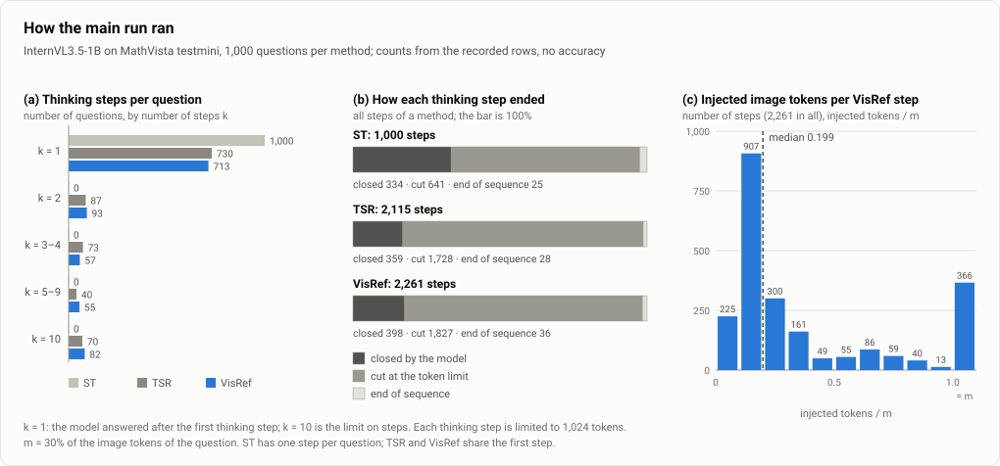

# Reproducibility report: VisRef, Appendix Table 6 row "InternVL-1B" on MathVista testmini

*Unofficial reproduction, MLRC / ReScience style. The main run and nine follow-up experiments are finished; the decision rules of the follow-ups were fixed before their results. A small descriptive diagnostic (does a re-inserted image move the answer probabilities at all? no new thinking is generated) was run on 200 questions after its reading rules were fixed (Section 4.11). A8, A10 and A11 (Sections 4.12, 4.14 and 4.15) did not confirm a gain either, and A9 (Section 4.13) found that re-inserted image tokens carry information when the image slot is blank; the last one (A11) continued thinking for up to four steps after a first step the model had closed itself. No result run is scheduled. The experiments planned so far and not run, and why, are listed in Section 5.4.*

**Paper.** Ghosal, Kim, Li, Chaudhry, Xu, Zhang, Zablocki, Xing, Zhang. *VisRef: Visual Refocusing while Thinking Improves Test-Time Scaling in Multi-Modal Large Reasoning Models.* arXiv 2603.00207, CVPR 2026. No official code was released (the CVPR 2026 supplementary material was checked).

## Summary

We reimplemented the three methods of Table 6 (standard thinking ST, textual self-reflection TSR, and VisRef) for InternVL3.5-1B and evaluated each once on all 1,000 MathVista testmini questions, with the same questions, the same seeds and a shared first thinking step. Accuracies were ST 57.8, TSR 60.1 and VisRef 60.0 % (paper: 46.1, 48.5, 52.0). The TSR−ST difference (+2.3 pp, 95% CI +0.6 to +4.0) is consistent with the paper's +2.4 pp; this is not proof of equivalence. VisRef−ST was +2.2 pp (95% CI +0.3 to +4.1): the CI excludes 0 but also the paper's +5.9 pp, and the difference is not significant after the Holm correction fixed in advance (p = 0.067). VisRef−TSR was −0.1 pp (95% CI −2.0 to +1.7), which excludes the paper's +3.5 pp: we did not confirm an additional gain over TSR in our InternVL3.5-1B implementation. Six of the follow-ups with decision rules fixed before their results (filling the injection up to m tokens, which turned out to add tokens in an order nearly unrelated to relevance; re-testing step-1 re-injection in a four-condition design; using the model's last-layer vectors for the thinking text, with which the DPP injected m tokens; wrapping m tokens chosen with last-layer vectors in InternVL's image tags after `</think>`, which gave −1.0 pp against TSR with the same answer prompt, 95% CI −3.1 to +1.0; letting the model think up to 512 more tokens with the selected image on the 691 questions where both methods had stopped after step 1, which gave 0.0 pp and −1.74 pp in the two groups tested; and giving the model all image tokens of the question together with up to 2,048 more thinking tokens on the 297 questions where step 1 was cut and a method continued, which gave −1.80 pp against the same thinking without the image, 95% CI −5.95 to +2.36, with 31 questions better and 45 worse) did not change this picture, and a split of three paired runs into 16 fixed groups of questions found no group where VisRef was consistently better. All of these runs share one operating regime: every thinking step is cut at 1,024 tokens, and H is measured on one short answer after `\boxed`. In this regime the model went on thinking after a step it had closed itself in only 4 (TSR) and 5 (VisRef) of 334 questions, and 1,186 of the 1,261 later VisRef steps were cut at the limit again (TSR: 1,087 of 1,115). So the paper's situation, a finished step after which the model is still uncertain, looks at the image again and thinks more, was almost never tested, and the null result on VisRef−TSR concerns this regime. A later test forced the closed-step situation: on the first 112 of the 334 questions whose first step the model had closed itself, thinking was continued for up to 4 steps whatever the stopping entropy said (an interim rule fixed in advance ended the run at 112, Section 4.15); VisRef, TSR and answering at once agreed on the correctness of the short answer at every one of the 448 answers (0 questions better, 0 worse, 75.0 % in every condition), so a gain was not confirmed there either, and nothing is known about the 222 questions that were not run. What the data support is that a gain of the paper's size (+3.5 pp over TSR) was not seen in any of these variants; gains of 1–2 pp cannot be ruled out, because 1,000 paired questions can detect about 2.6 pp or more (Section 3.4). Our absolute accuracies are 8–12 pp above the paper's (ST 57.8 / TSR 60.1 / VisRef 60.0 % against 46.1 / 48.5 / 52.0 %), and the reason is not known. We look for the cause of the missing gain in our implementation first: it has a confirmed procedural difference (about one fifth of the paper's token budget m is injected; injecting m tokens with last-layer vectors brought no detectable gain either), many settings we could not find in the paper were chosen by us, and we cover one model size, one benchmark and one seed.

Four follow-ups of 2026-10-24 add to this picture (Sections 4.16–4.19). With the prompt's image slot holding a grey blank image, re-inserting all of the question's image tokens after the first thinking step raised accuracy by 12.8 pp (95% CI +8.8 to +16.8; 77 questions better, 22 worse), while no accuracy change was confirmed with another question's image (−0.1 pp, 95% CI −2.1 to +1.9; A12): re-inserted image tokens can be used by the generation when the image information is missing. After generated thinking, replacing the image in the prompt's slot by a blank one hardly changed the probability of the right answer (A13; the gate fixed in advance was not met). Raising the step limit from 1,024 to 4,096 tokens did not change ST accuracy on 42 questions (A14; 4 better, 4 worse). Estimating the stopping entropy from 16 free answers left the stopping decision undecided by the rule fixed in advance; an exploratory re-reading suggests that roughly 6–17 % of self-ended first steps would continue, against 2.4 % with the stored H (A15). Taken together, what the data support is: (1) with the original image present, no variant showed a VisRef gain over TSR; (2) when the image information is missing, a re-inserted image is used and raises accuracy; (3) there is no evidence that the DPP selection beats as many random image tokens. A run comparing the DPP selection with random tokens in the blank-slot context is in progress (plan of 2026-10-24 in `docs/EXPERIMENT_FLOW.md`).

## 1. Scope of reproducibility

| # | Claim (paper Table 6, 1B row: ST 46.1 / TSR 48.5 / VisRef 52.0) | Paper delta | Role here |
|---|---|---|---|
| C1 | TSR > ST | +2.4 pp | supplementary |
| C2 | VisRef > ST | +5.9 pp | main comparison 1 |
| C3 | VisRef > TSR | +3.5 pp | main comparison 2 |

The paper's headline claim is that VisRef improves over both ST and TSR, so C2 and C3 are the main comparisons. We target the paired differences, not the absolute accuracies: the paper's ST (46.1) is far below the official InternVL3.5-1B MathVista (mini) score of 59.3 (InternVL3.5 report, Table 3; the report says its Section 3 results were obtained without test-time scaling, which it defines to include the thinking mode, so this is most likely a non-thinking score; which evaluation setting produced it is not confirmed), and the paper's 8B ST (68.1) is also more than 10 pp below the official 78.4. Table 6 labels the row "InternVL-1B". We use InternVL3.5-1B: the only InternVL generation the paper names is InternVL3.5, it runs its models in thinking mode, it compares the 1B, 2B and 8B models "under the same decoding setup and token budget", and its 8B row equals the InternVL3.5-8B row of Table 1.

### 1.1 Experiments at a glance

The work has two kinds of experiment. **Result experiments** (A1–A15) test the paper's claim or look for the reason it was not reproduced; their decision rules were fixed before their results (for A1 with the limitation described in Section 2.4), and the conclusions come from them. **Setting checks** (B1–B8, [Section 2.6](#26-setting-checks-how-the-unstated-settings-were-chosen)) are small runs that chose settings the paper does not state, such as how to compute the stopping signal or how to re-insert the image. They gave no conclusions, but the settings they chose shape every result. The follow-ups A2–A11 are exploratory: each has its own rule fixed before its results, but there is no correction across them. A single confirmatory run with the setting closest to the paper's had been planned; it has not been run, because none of the follow-ups found a condition in which it could show a gain ([Section 5.4](#54-experiments-not-run)).

<!-- check:glance -->
| | Question | Changed from the main run (A1) | Questions | Result | Paper | Main limitation | Section |
|---|---|---|---|---|---|---|---|
| A1 | Does VisRef (rank-limited selection) beat TSR and ST? | — (main run; settings in Section 2) | 1,000 | VisRef − TSR: −0.1 pp | +3.5 pp | only about one fifth of the paper's m image tokens were re-inserted | [3.1](#31-main-result-main-scoring-n--1000) |
| A2 | Does filling the re-inserted image tokens up to m help? | after the selection stops, the injection is filled up to m tokens | 976 | VisRef-fill − TSR: 0.0 pp | – | the added tokens were nearly unrelated to the thinking | [4.2](#42-visref-fill-filling-the-injection-up-to-m-tokens-rule-fixed-before-the-results) |
| A3 | Does re-inserting the image after step 1 help by itself? | after the shared first step only: the answer (at once, or after up to 512 more thinking tokens) comes with or without the selected image tokens | 309 | with − without the image: +1.40 pp (answer at once), +0.97 pp (answer after more thinking) | – | only the questions where a method continued after step 1 | [4.3](#43-step1_branch-re-injection-at-step-1-rule-fixed-before-the-results) |
| A4 | Does choosing image tokens with the model's last-layer vectors help? | thinking vectors Z for the selection taken from the last layer (A1: input embeddings) | 839 | VisRef-hs − TSR: +0.24 pp | – | the first step was generated again (193 of 839 match the main run) | [4.5](#45-visref-hs-last-layer-z-rule-fixed-before-the-results) |
| A5 | Does thinking more after the re-inserted image help? | after the stop decision, up to 512 more thinking tokens after the injected image, then the answer | – | not run (by the rule fixed before A7) | – | the same question was tested on a subset in A7 | [5.4](#54-experiments-not-run) |
| A6 | Does a tagged image block after `</think>` (tokens chosen with last-layer vectors) beat TSR with the same answer prompt? | four at once: (1) `` … `</img>` tags with line breaks; (2) block after `</think>` when answering (A1: before it); (3) image vectors V for the selection also from the last layer (Z as in A4); (4) every answer starts after `\nFinal Answer:` | 1,000 | VisRef-imgtag − TSR with answer prompt: −1.0 pp | +3.5 pp | the four changes are tested only together; run on a different GPU, so compared only within the run | [4.6](#46-visref-imgtag-tagged-image-block-after-think-rule-fixed-before-the-results) |
| A7 | Where both methods stopped after step 1, does thinking more with the selected image help? | from the stored first step, up to 512 more thinking tokens with no image (C), the selected image tokens (D) or as many random image tokens (R), then a short answer | 691 | D − C: 0.0 pp (step 1 closed by the model), −1.74 pp (step 1 cut) | – | only questions where both methods had stopped; more thinking rarely changed the answer | [4.7](#47-step1_think-more-thinking-where-both-methods-stopped-rule-fixed-before-the-results) |
| A8 | Where step 1 was cut and a method continued, does the whole image with up to 2,048 more thinking tokens help? | from the stored first step: the answer at once (A0); up to 2,048 more thinking tokens with no image (C); all image tokens of the question, then up to 2,048 more thinking tokens (F); then a short answer | 297 | F − C: −1.80 pp | – | only questions whose step 1 was cut and where a method continued; more thinking was forced, no stop decision | [4.12](#412-full_think-the-whole-image-and-longer-thinking-after-a-cut-step-1-rule-fixed-before-the-results) |
| A9 | When the image slot of the prompt holds a blank image, does re-inserting the question's image tokens bring back probability of the right answer? | nothing is generated: the original image is replaced by a grey blank image of the same size (or by another question's image); after one short fixed sentence the question's image tokens are re-inserted and the probability of the right answer string is read | 199 | the re-inserted image carried information: blank + own image − blank +0.088 in probability (95% CI +0.042 to +0.136); original image − blank +0.207 | – | a probability, not an accuracy; an artificial context (one fixed sentence, no further thinking, no image tags); the recovery came from free-form questions (+0.205; multiple choice −0.006) | [4.13](#413-recover_check-does-a-re-inserted-image-carry-information-when-the-image-slot-is-blank-rule-fixed-before-the-results) |
| A10 | Without the thumbnail tile, does re-inserting the selected image tokens raise the probability of the right answer, and by more than with it? | the thumbnail tile (the last 256 image tokens) is cut from the input; for each input a new first step is generated and the selected image tokens are re-inserted after it; the probability of the right answer string is read | 160 (the multi-tile images among the 200 of Section 4.11) | gate not passed: gain without the thumbnail +0.003 in probability (95% CI −0.007 to +0.014); difference to the gain with the thumbnail +0.006 (−0.011 to +0.024) | – | a probability, not an accuracy; one position after the first step; the short answer right after step 1 was 5.0 pp lower without the thumbnail (95% CI −11.5 to +1.5), a size this sample cannot separate from 0 | [4.14](#414-thumb_gate-does-removing-the-thumbnail-tile-change-what-re-inserted-image-tokens-add-rule-fixed-before-the-results) |
| A11 | After a first step the model closed itself, does VisRef beat TSR when thinking is forced to continue for up to 4 steps? | from the stored first step: the answer at once (S); more thinking without image (T, TSR); more thinking with the selected image tokens re-inserted after every step (V, VisRef); up to 4 steps in total, no stopping entropy; then a short answer | 112 of 334 (interim stop) | V − T: 0 questions better, 0 worse (0.0 pp); V − S: 0 better, 0 worse; accuracy 75.0 % in all four conditions | +3.5 pp | the number of steps was forced, not driven by uncertainty; the other 222 questions were not run; short answers; no random-token condition | [4.15](#415-closed_multistep-continuing-up-to-4-steps-after-a-first-step-the-model-closed-itself-rule-fixed-before-the-results) |
| A12 | When the image slot of the prompt holds a blank image, does re-inserting the question's image after step 1 raise accuracy through generation? | a new first step from the prompt with its own image or with a grey blank image; then up to 1,024 more thinking tokens with no image, all of the question's image tokens or another question's image tokens; short answers | 396 | blank + own image − blank: +12.8 pp; − another question's image: +12.9 pp | – | artificial blank-image context; whole image, no selection | [4.16](#416-blank_think-does-a-re-inserted-image-raise-accuracy-when-the-image-slot-is-blank-rule-fixed-before-the-results) |
| A13 | After generated thinking, does the image in the prompt's slot still change the probability of the right answer? | probabilities only: the same blank-image first step, then the image slot (original or blank) crossed with a block after the thinking (none, the image, a blank image) | 396 | gate not met: slot original − blank +0.022 (needed 0.05) | – | a probability, not an accuracy; artificial context | [4.17](#417-slot_cross-after-generated-thinking-does-the-image-slot-of-the-prompt-still-matter-rule-fixed-before-the-results) |
| A14 | Does a step limit of 4,096 instead of 1,024 tokens change ST accuracy? | the main-run code with the step limit 1,024 and 4,096 on the same questions | 42 | ST 4,096 − 1,024: 0.0 pp (4 better, 4 worse) | – | 42 questions, low power | [4.18](#418-cap_pair-does-the-step-limit-change-st-accuracy-rule-fixed-before-the-results) |
| A15 | Do self-ended first steps continue if the stopping entropy is estimated from the values of 16 free answers? | from the stored first step: 16 short and 16 free answers; the stopping decision of several estimators | 126 | undecided: continuing 3 (2.4 %) to 94 of 126 depending on invalid answers; read without the box 7 to 21 (exploratory) | – | our own estimator; 30 % of free answers had no box | [4.19](#419-stop_form-would-another-stopping-entropy-estimate-make-self-ended-first-steps-continue-rule-fixed-before-the-results) |
<!-- /check -->

| | Setting to decide | What we chose | Evidence | Where the setting comes from |
|---|---|---|---|---|
| B1 | When to stop thinking | the entropy of one short answer in `\boxed{…}` | 4 checks, 10–60 questions each | paper: the stopping rule cited work (Ghosal et al.): several answers ours: one answer |
| B2 | How to re-insert the image tokens | without InternVL's image tags, right before `</think>` | 2 checks, 10 and 30 questions | paper: the order of the steps official (InternVL): the image tags ours: leaving them out |
| B3 | Thinking length limit, and how to get an answer after a cut | 1,024 tokens per step, 10,240 in total; a prompt for the answer | 5 checks, 18–150 questions | official (InternVL): 1,024 is its example value cited work (s1): the answer prompt related work (DEER, not cited): the last-resort answer |
| B4 | How many image tokens to pick | as many as the selection can pick, usually fewer than m | 74 questions and a calculation check | paper: m tokens cited code (Chen et al. 2018): stops when no more can be picked → **conflict; we follow the code** |
| B5 | How to extract and score answers | rules first; an LLM only where the rules fail | a pre-check on 49 rows | official (VLMEvalKit): which text is scored official (MathVista): the extraction prompt ours: which LLM, the grounding check |
| B6 | Do the same inputs give the same outputs? | compare on the same questions from the same first step | 730–1,000 questions | ours |
| B7 | Where to put a tagged image block, and how to start the answer (exploratory, after the main run) | after `</think>` when answering, inside the thinking when continuing; every answer after `\nFinal Answer:` | 2 trial runs, 10 questions each | official (InternVL): the image tags cited code (s1): the answer prompt ours: the position, and using the prompt for every answer |
| B8 | Can the tagged block stay inside the thinking when answering, too (format check, after A6) | not adopted: the answer format broke more often than with TSR | 200 questions, rule fixed before the run | ours |

The raw outputs of every check are in `repro/kaggle/runs/` (B8: also `repro/colab/runs/`), except for the 10-answer check of B1 (8B model, earlier code) and the official-setting run of B3.

**The setting checks used evaluation questions.** They ran on part of a 100-question development split drawn from MathVista testmini and on the first questions of the main run's order. All of these questions are also among the 1,000 evaluated questions (`docs/EXPERIMENT_FLOW.md`, the opening entry and the entry of 2026-10-07 on the lean code), so the settings may be tuned to them to some degree. Most settings were chosen from stopping rates and broken answer formats, and several checks stated in advance that accuracy would not be used for the decision. The questions used by the setting-check runs (the run folders named in Section 2.6; 222 distinct questions, counting all 30 planned questions of `smoke2`, 6 of which have no recorded answer) are listed in `results/setting_check_questions.csv`; the earlier development split of the old code is not part of this repository.

### 1.2 Terms

| Term | Meaning |
|---|---|
| ST (standard thinking) | The model thinks once and answers. The baseline. |
| TSR (textual self-reflection) | When a thinking step ends, "Wait, think more" is appended and the model thinks again. The image is not shown again. |
| VisRef (code `visref_raw_rank`) | Like TSR, but just before each continuation a selected part of the image is inserted again. The paper's method, here with the selection stopping where the kernel rank ends ("rank-limited": usually fewer than m tokens, Section 4.1). |
| VisRef-fill (`visref_fill`) | VisRef with the selection filled up to m tokens (Section 4.2). |
| VisRef-hs (`visref_hs`) | VisRef with the model's last-layer vectors for the thinking text (Section 4.5). |
| VisRef-imgtag (`visref_imgtag`) | VisRef with the selected tokens wrapped in image tags, placed after `</think>` when answering and inside the thinking when continuing, and last-layer vectors for both text and image (B7, A6). |
| TSR with answer prompt (`tsr_answer_prompt`) | TSR in which every answer starts after `\nFinal Answer:`; the comparison partner of VisRef-imgtag. |
| answer forcing | When an answer reaches the length limit, `\n**Final Answer**\n\boxed` is appended and up to 100 more tokens are allowed. |
| thinking step | One stretch of thinking, until the model closes it (`</think>`) or hits the length limit. TSR and VisRef can run several steps. |
| token | The unit the model reads and writes, roughly a piece of a word. |
| image tokens | The pieces the model cuts an image into (visual tokens); 1,961.5 per question on average here. |
| m | The number of image tokens the paper re-inserts at each step: 30% of all image tokens of the question. |
| DPP selection | The calculation that picks image tokens that are relevant to the current thinking and do not repeat each other; we follow the code the paper cites. |
| stopping entropy H | How uncertain the answer would be if the model answered now. Thinking stops when H is below 0.25. |
| sampled answer | A short answer the model writes after `</think>` and `\n\n\boxed` only to compute the stopping entropy; it is then discarded and is not the final answer. |
| pp | Percentage points: the difference between two accuracies (60.0% − 57.8% = 2.2 pp). |
| 95% CI | A range built so that, over repeated experiments, 95% of such ranges contain the true difference. If it contains 0, we cannot say there is a difference. |
| paired comparison | Two methods compared on the same questions, which removes differences in question difficulty. |
| decision rule fixed before the results | The rule for reading a result was written down before the result was seen. |
| raw outputs | The text the model generated and the scored rows, from which anyone can recompute the numbers. |

## 2. Methodology

### 2.1 Setup

*Figure 1. The loop of Algorithm 1 as implemented here. Grey boxes are steps the paper specifies, the blue box is the step only VisRef has, and orange notes are settings we could not find in the paper (our choices, listed in the table below).*

| Item | Value | Where it comes from |
|---|---|---|
| Model, data | `OpenGVLab/InternVL3_5-1B` @ `2f71cf52…`; `AI4Math/MathVista` testmini (1,000 questions) @ `2b6ad694…` | The paper (see Section 1) |
| Question order, seeds | Order shuffled with seed 0; generation seed 42, derived per question and shared by the three methods; first thinking step shared (copied) | Our own choice |
| Methods | ST; TSR (cue "Wait, think more"); VisRef (greedy MAP DPP over visual tokens) | The paper; the selection follows the DPP code of Chen et al. 2018, which the paper cites |
| VisRef values | δ = 0.25, m = ⌊0.3·\|V\|⌋, K_max = 10 | The paper |
| DPP selection size | Greedy stops when the residual gain falls below 1e-9 × max L_ii (the cited Chen code stops at an absolute threshold, 1e-10; the relative threshold is our choice), so most steps inject fewer than m tokens. The paper states \|V_k\| = m: **confirmed procedural difference** | The code the paper cites (Chen et al. 2018); this conflicts with the paper's text |
| Decoding | R1 thinking system prompt, T 0.6, top-k 50, top-p 0.95, fp16, Kaggle 2×T4 | Official InternVL3.5 material (the official model page on Hugging Face and VLMEvalKit). Hardware: the paper used 4×A10G; T4 has no bf16, so we use fp16 |
| Software | transformers 4.55.0 (as in the paper); torch from the Kaggle image (recorded per session in `env.json`; paper: 2.7.0) | transformers version: the paper. torch version: our environment (Kaggle image) |
| Token limits | 1,024 per thinking step, 10,240 total thinking, 1,024 answer, 100 for answer forcing | Our own choice (1,024 is the example value on the official model page) |
| Truncated thinking, capped answers | After truncated thinking: `</think>` + `\nFinal Answer:` (s1-style budget forcing). Answer reaching the cap without EOS: `\n**Final Answer**\n\boxed` + ≤100 tokens (answer forcing as in DEER) | Truncated thinking: the s1 method, which the paper cites; applying it here is our interpretation. Capped answers: DEER, which the paper does not cite (our own choice) |
| Stopping statistic H | Sum of token entropies of one answer sampled after `</think>` + `\n\n\boxed` (T = 1, ≤16 tokens) | Definition (entropy of the answer distribution): the paper. How it is estimated: our own choice |
| Reasoning-token representation Z | Input embeddings of the thinking-step tokens | Our own choice (the paper names no layer); a last-layer variant is in Section 4.5 |
| Injection format | Selected visual embeddings appended without `` tags directly before `</think>`; order z_k → Ṽ_k → H_k → "Wait, think more"; Ṽ_k ⊆ V | Order and subset: the paper (Algorithm 1, Figure 2). Tags, separators, `</think>` handling, position ids and answer prompt were not found in the paper, so they are our own choice, including the order `[Ṽ_k] </think>` |
| Visual tokens | Dynamic tiling, max_num = 12 plus thumbnail tile; mean \|V\| = 1,961.5 | Official InternVL3.5 material (the official model page); see Section 4.4 |

### 2.2 Scoring

The text after the last `</think>` is scored (the same split rule as VLMEvalKit `SPLIT_THINK`; whether the InternVL3.5 evaluation enabled it is unconfirmed). Answers are extracted by rules (boxed, then "answer is", then last line) and compared with the MathVista normalisation. Rows on which the rules fail (36 of 3,000) go to an LLM fallback (official MathVista extraction prompt, gemini-3.5-flash-lite, fixed before the final extraction). An LLM answer is accepted only if it is grounded in the response text. Empty responses (13) are never sent and count as wrong. Scorer v4 (2026-10-11, after the results) counts an empty multiple-choice extraction as wrong, like the official `--ignore_empty_extractions`; it changes 0 rows of the main scoring. This main scoring (rules plus LLM fallback) was fixed in advance; the other scoring variants in Section 3.2 are sensitivity checks.

### 2.3 Statistics

The unit is the question, compared pairwise. We report paired bootstrap 95% CIs of accuracy differences (2,000 resamples, seed 0), exact McNemar tests, and a Holm correction over the two main comparisons (VisRef−ST, VisRef−TSR). TSR−ST is supplementary and outside the Holm family. Classification against the paper's delta: **"consistent with the paper's value"** means the CI excludes 0 and contains the paper's delta (not proof of equivalence); **"effect size not reproduced"** means the CI excludes the paper's delta. If the CI contains both 0 and the paper's delta, no conclusion is drawn (this case does not occur in Section 3). This is not a test of the difference between our result and the paper's: the paper gives no per-question outputs.

### 2.4 When the decision rules were fixed

The main comparisons, the tests (McNemar + Holm) and the scoring variants of Section 3.2 were fixed on 2026-10-10 before the final 1,000-question analysis. The choice of main comparisons and tests followed the paper's claim but was made after we looked at partial results for the first 392 questions (sessions 1–4; VisRef−TSR was about +1.0 pp then), so the decision rules of the main run were not fixed before all results in the strict sense. The **CI classification rule was fixed after we had seen the partial result on 759 questions** (sessions 1–7), and the final 1,000 include those 759, so the classification is not confirmatory in the strict sense. For the nine follow-ups (Sections 4.2, 4.3, 4.5, 4.6, 4.7 and 4.12 to 4.15) and the format check B8 the decision rules were written down before their results. For A3, A4 and A6 to A11 the commit with the rule is earlier than the commit with the result (A8: rule in commit c355a9e, results in commit 298bf7e; A9: 0b203eb and 94a11e8; A10: 9093031 and 1081a32; A11: b5affbe and 30d0a14). For A2 the rule and the result entered the public repository together in its first commit (`2d9ddad`), so git cannot show their order; in the experiment log the rule entry comes before the result entry. The grouping and the candidate rule of the subgroup reanalysis (Section 4.9) were also written down before it was computed, but it reuses the same questions and can only suggest hypotheses. Scorer v4 was a change after results. Every other analysis is labelled as decided after the results and has no correction for multiple tests.

### 2.5 Code versions and compute

The code version is a hash of the source files that determine the outputs (`run.py` and `visref/*.py`), recorded in every output row. Three code versions produced the 1,000 questions of the main run: `79eef648ebd1` (session 1, 74 questions), `f2422d0e72ff` (sessions 2–4, 318) and `d0095f79e691` (sessions 5–9, 608). The change from `79eef648ebd1` to `f2422d0e72ff` removed unused code branches (outputs identical on 810 of 810 compared outputs); the change from `f2422d0e72ff` to `d0095f79e691` changed only the rule scorer, not the generation. All outputs were re-scored with the final scorer and merged.

Other experiments, by code version:

| Experiment | Code version |
|---|---|
| A2 VisRef-fill | `39b3fb1b4121` |
| A3 step1_branch (own script `diag/step1_branch.py`) | `a9e2cafef0a8` |
| A4 VisRef-hs | `f1376774850d` |
| A6 VisRef-imgtag | `6e218887d2b5` |
| A7 step1_think (own script `diag/step1_think.py`) | `829c8522ce20` |
| A8 full_think (own script `diag/full_think.py`) | `b129ba377bfe` |
| A9 recover_check (own script `diag/recover_check.py`) | `a10cab174bb5` |
| A10 thumb_gate (own script `diag/thumb_gate.py`) | `f97d3e395310` |
| A11 closed_multistep (own script `diag/closed_multistep.py`) | `a51398ee1d43` |
| B1–B6 setting checks | `smoke`, `smoke2`, `full_s1`: not recorded (earlier code wrote no version); `smoke3` `82022e6019b7`; `main_s0` `8aaa689c94e9`; `b_test` `6c7daca6ebb1`; `diag_st_plain` `d0095f79e691`; `hidden_rank_check` (CPU only): not recorded |
| B7 image-tag trials | `aa11cdaa52a9` (first trial), `d2ab88b06b24` (second trial) |
| B8 format check | `06435ae748c8` |

Code changes that did not touch a reported run are listed in the experiment log; one of them changed `run.py`'s default token caps on 2026-10-13 (every main and follow-up run passed the caps explicitly, so no result changed). Compute: Table 2.5 lists the GPU and the generation time of every experiment (`results/compute.csv`, built from the run records by `scripts/make_compute.py`).

**Table 2.5. GPU and generation time per experiment.** Wall time adds the slowest GPU of each session; GPU-hours add all GPUs. Times cover generation only (not package install or model loading), except the rows A9–A11; see the note below the table, and the GPUs differ between the Kaggle runs and A6, so times are not comparable across them.

| | What ran | GPU | Wall time (h) | GPU-hours | Rows |
|---|---|---|---|---|---|
| A1 | main run: ST, TSR, VisRef (9 sessions) | 2 × T4 | 14.9 | 28.0 | 3074 |
| A2 | VisRef-fill | 2 × T4 | 11.3 | 22.3 | 994 |
| A3 | step1_branch (pilot and main) | 2 × T4 | 0.9 | 1.7 | 309 |
| A4 | VisRef-hs | 2 × T4 | 7.8 | 15.4 | 839 |
| A6 | VisRef-imgtag, TSR with answer prompt, TSR (check run and main run) | 1 × RTX A5000 (rented) | 22.8 | 22.8 | 3018 |
| B1-B6 | setting checks | 2 × T4 | 7.2 | 13.6 | 764 |
| A9 | recover_check (main run) | 2 × T4 | 0.74 | 1.30 | 199 |
| A10 | thumb_gate (main run) | 2 × T4 | 1.81 | 3.45 | 200 |
| A11 | closed_multistep (trial and part 1) | 2 × T4 | 0.82 | 1.59 | 112 |
| B7 | two 10-question trials of the image-tag variant | 2 × T4 | 0.3 | 0.4 | 40 |

For A9 to A11 (not in `results/compute.csv`; typed from the run logs) the times are the per-GPU elapsed times in their run logs; they include loading the model, so these rows are not directly comparable with the rows above. A7 and B8 are not in the table because their run folders hold no generation log. The experiment log records 5,696 s (`step1_think_bmain`) and 6,744 s (`step1_think_main`) per 2 × T4 Kaggle session for A7 (691 rows each); B8 ran 393 of its 400 rows on one Colab T4 (the log stops at 27,719 s, when the connection dropped) and the last 7 rows on 2 × T4. A8 is not in the table either (`results/compute.csv` has no A8 row); its run folders hold the logs `log_0.txt` and `log_1.txt`. The 297-question main run (`full_think_main`, 2 × T4 on Kaggle, 149 and 148 questions) is logged at 13,214 s and 12,266 s per GPU; the 12-question pilot (`full_think_pilot2`, 6 questions per GPU, model loading included) at 571 s and 522 s.

### 2.6 Setting checks: how the unstated settings were chosen

Each table lists the checks in time order; the name in brackets is the run folder in `repro/kaggle/runs/`. "Development questions" are questions of the 100-question development split (Section 1.1).

**B1. When to stop thinking.** The paper stops thinking when the entropy of the answer distribution falls below 0.25, but does not say how this entropy is computed. We tried four ways.

| Check | How H was computed | What happened | Decision |
|---|---|---|---|
| first small check (`smoke`, 10 development questions) | mean entropy over the answer part of the response | almost always 0 (at most 0.003), so every question stopped after step 1 and TSR became identical to ST | compute over the whole response |
| second small check (`smoke2`, 30 development questions) | the whole response | long responses give large values: summed as in the paper they were below 0.25 in only 0.8% of sampled answers | let the model write one short answer after "Answer:" and sum its token entropies |
| third small check (`smoke3`, 20 development questions) | one short answer after "Answer:" | TSR stopped by entropy in 0 of 18 questions: the answer content was certain (about 0.01 per token) but the leading space (about 0.47) and the line end (about 0.84) kept H high | read the answer inside `\boxed{…}` (at most 16 tokens), with the closing-brace tokens counted as one outcome |
| check before the main run (`main_s0`, 59 questions) | the answer inside `\boxed{…}` | stopped after step 1 by entropy: TSR 50 of 59, VisRef 51 of 59; without merging the closing-brace tokens only 41 of 70 sampled answers were below 0.25 (55 of 70 with it) | used in the main run |
| ten answers per step (8B model, 3 development questions, earlier code) | ten complete answers per step | a TSR run on 3 questions took 4,703.9 GPU-seconds | back to one answer (from the paper's latency table we judged that the authors did not generate several long answers per step; our judgment) |

- *Where the setting comes from.* The stopping rule (entropy of the answer distribution below 0.25) is from the paper. Ghosal et al., whom the paper cites for this criterion, sample several answers. One answer and the `\boxed{…}` format are our choice.
- *Also recorded.* In the VisRef-fill run (Section 4.2), H was measured both with and without the re-inserted image tokens: the median difference was 0.0006, and the stop-or-continue decision differed at 151 of 2,231 steps (6.8%). The two measurements used separate random streams for the sampled answer, so part of this difference can come from sampling rather than from the re-inserted tokens (later runs replay the same random state for both).
- *Limits.* The choice rests on 10 to 60 questions each. One sampled answer gives the right entropy on average but is noisy. In this setting TSR and VisRef rarely continued after a step the model had closed itself (7 of 359 and 35 of 398 sampled answers); almost all continuations came after a 1,024-token cut.
- *Sources.* `docs/EXPERIMENT_FLOW.md`, entries of 2026-10-07 (the first, second and third small checks, `main_s0`); Sections 4.1 (items 1 and 5) and 4.2; the ten-answer check (earlier code, outputs not published): [log at commit 4776f6a, lines 642–644](https://github.com/AhnJG/visref-repro/blob/4776f6ab2607957799bef8db70241cc64313feae/docs/EXPERIMENT_FLOW.md?plain=1#L642-L644). Every check on how H is measured, including the earlier code, is collected in Korean in [`docs/STOPPING_ENTROPY.md`](docs/STOPPING_ENTROPY.md).

**B2. How to re-insert the image tokens.** InternVL reads an image wrapped in `` … `</img>` tags. The paper does not say how the selected image tokens are inserted during thinking.

| Check | What happened | Decision |
|---|---|---|
| first small check (`smoke`, 10 development questions, with tags) | 7 to 8 of 9 VisRef responses broke into "draft answer + a second `</think>` + answer" (TSR 1 of 10) | also try inserting without tags |
| second small check (`smoke2`, 30 development questions) | steps followed by a second `</think>`: with tags 31 of 63, with tags and the ridge variant 25 of 67, without tags 10 of 65, TSR 4 of 70 | insert without tags, right before `</think>` |
| review of the insertion code (separate AI session) | no implementation error; the order "image tokens, then `</think>`" may cause the broken formats | kept (we do not change settings after seeing results) |

- *Where the setting comes from.* The order thinking → selected image tokens → stopping check → "Wait, think more", and the use of a subset of the original image tokens, are from the paper (Algorithm 1, Fig. 2). The `` tags are InternVL's official format. Leaving them out and the position before `</think>` are our choice.
- *Limits.* Tags were compared only in the small checks, not in the main run. Separators and position ids were not tried; another insertion point was tried later in a small exploratory trial (B7). Without tags the broken format remains (A1: a second `</think>` in 352 of 713 VisRef answers).
- *Sources.* `docs/EXPERIMENT_FLOW.md`, entries of 2026-10-07 (the first and second small checks); Section 4.1 (items 3 and 6).

**B3. Thinking length limit, and how to get an answer after a cut.**

| Check | Setting | What happened | Decision |
|---|---|---|---|
| long limit (`main_s0`, `full_s1`, about 60 questions each) | 4,096 tokens per step | 48–57% of ST first steps were cut, about half of those in repetition loops; 58 questions × 3 methods took 2 hours, too slow for 1,000 questions on free GPUs | 1,024 tokens per step, 10,240 in total |
| short limit (`b_test`, 18 questions, stopped after about 8 minutes) | after a cut, `Final Answer:` asks for the answer | 12 of 26 prompted answers ran to the 1,024-token answer limit again, as often as without the prompt (14 of 30 in `main_s0`) | if the answer still does not finish, append `**Final Answer**\boxed` and allow 100 more tokens |
| first main session (`b_main_s1`, 74 questions) | as above | no question was left without an answer | used in the main run |
| answer prompt removed (`diag_st_plain`, 150 questions, rule fixed before the results) | no `Final Answer:` after a cut | −2.0 pp, 15 against 18 discordant questions | kept; 150 questions cannot detect a change of a few pp |
| official setting (`st_official`, target 100 questions, free Colab, rule fixed before the results) | InternVL's official thinking evaluation: up to 65,536 new tokens, no answer prompt; ST with practically unlimited thinking | long questions took hours each; the run stopped after 33 questions | not analysed |

- *Where the setting comes from.* The paper gives no length limits. 1,024 is the example value of the official InternVL model page. Appending `Final Answer:` after a cut is the budget forcing of s1 (Muennighoff et al. 2025), which the paper cites; applying it here is our interpretation. The last-resort `**Final Answer**\boxed` comes from the public code of DEER (Yang et al. 2025), which the paper does not cite. The official-setting run followed VLMEvalKit's InternVL3.5 configuration.
- *Limits.* The 1,024-token limit shortens ST's thinking (Section 3.1, limit 2). The main run was not repeated with a 4,096-token limit. The outputs of the official-setting run are not in this repository.
- *Sources.* `docs/EXPERIMENT_FLOW.md`, entries of 2026-10-07 (main_s0, full_s1, b_test, b_main_s1) and 2026-10-10 (st_official, the 4,096-cap check); Sections 2.1, 3.3 and 4.1 (item 6).

**B4. How many image tokens to pick.** The paper picks exactly m tokens at each step.

| Check | What happened | Decision |
|---|---|---|
| the cited selection code (Chen et al. 2018) | the greedy selection can pick only as many tokens as the kernel rank allows, which is bounded by the number of distinct tokens in the thinking step, and then stops; short steps give far fewer than m | stop where the code stops; recorded as a confirmed difference from the paper |
| first main session (`b_main_s1`, 74 questions) | ran "stop where the code stops" next to "fill up to m by relevance" | after this session, before the next one, the fill variant was dropped |
| deeper-layer vectors checked offline (`hidden_rank_check`, 6 cut steps) | with hidden-state vectors, too, only about 50–110 picks add clearly new information; none of the 6 steps reached m | the deeper-layer variant was postponed (run later as Section 4.5) |

- *Where the setting comes from.* "m tokens at every step" is from the paper. The selection follows the code the paper cites (Chen et al. 2018), which stops when no further token can be picked. The two conflict; we follow the code and state the difference. The stopping threshold (relative to the largest diagonal) is our choice.
- *Confirmed in the main run.* Median injected/m ratio 0.199; 1,895 of 2,261 steps injected fewer than m tokens.
- *Limits.* How the authors handled this is unknown (Section 5.3, question 6). Dropping the fill variant was decided after 74 questions.
- *Sources.* Section 2.1 ("DPP selection size"), Section 4.1 (item 4), Section 4.2; `docs/EXPERIMENT_FLOW.md`, entries of 2026-10-07 (selection rule, b_main_s1) and 2026-10-08 (hidden_rank_check).

**B5. How to extract and score answers.** The text after the last `</think>` is scored. Answers are taken by rules first (`\boxed{…}`, "answer is", the last line); only where the rules fail does an LLM extract the answer with the official MathVista extraction prompt.

| Check | What happened | Decision |
|---|---|---|
| LLM extraction pre-check (49 rows, gemini-3.5-flash-lite) | both rows the LLM "fixed" were wrong: it invented an answer for an empty response, and picked a different number from the text | empty responses are not sent, and an LLM answer counts only if it appears in the response; re-run: 0 wrongly fixed |
| final extraction of the main run (1,000 questions) | of 36 rule-failed rows, 30 extractions used and 6 rejected; 1 label changed; 20 control rows all agreed with the rules | used in the main scoring |
| scoring variants (five, Section 3.2) | the classification is the same under every variant; VisRef − TSR lies between −0.9 and +1.0 pp | answer handling alone does not explain the gap to the paper |

- *Where the setting comes from.* Scoring the text after the last `</think>` is VLMEvalKit's split rule. The extraction prompt is MathVista's official one. Rules first, the LLM model and the grounding check are our choice. Scorer v4, changed after the results (an empty multiple-choice extraction counts as wrong), behaves like the official MathVista option `--ignore_empty_extractions`.
- *Limits.* The official extractor is GPT; ours differs. The VisRef-fill, VisRef-hs and VisRef-imgtag runs used a different LLM (Claude Haiku). The grounding check stops invented answers but not a wrong number picked from the text.
- *Sources.* `docs/EXPERIMENT_FLOW.md`, entry of 2026-10-10 (LLM extraction pre-check); Sections 2.2, 3.2 and 4.4.

**B6. Do the same inputs give the same outputs?**

| Check | What happened |
|---|---|
| TSR and ST from the same context and seed (730 questions where TSR stopped after step 1) | identical text in 491; extracted answers differ in 16 (2.2%), from the order of fp16 arithmetic when questions are batched together |
| first steps regenerated in follow-up runs | first-step text identical to the main run: VisRef-fill 242 of 994, VisRef-hs 193 of 839 |
| before and after removing unused code | 810 of 810 compared outputs identical |

- *Decision.* The three methods share the first thinking step, so that they are compared on the same questions from the same start; the later experiments (A6, A7, A8, B8) start from the main run's stored first step.
- *Limits.* The paper used A10G GPUs; we used T4. The effect of this difference was not tested.
- *Sources.* Sections 2.5, 4.1 (item 2) and 6.

**B7. Where to put a tagged image block, and how to start the answer** (exploratory, 2026-10-15; VisRef-imgtag). After the main run, the image tags were tried again at another position: the selected tokens wrapped in `` … `</img>` with newlines, placed after `</think>` when the model answers and inside the thinking block when it continues; the selection uses last-layer vectors for both the thinking step and the image tokens. Both trials ran the main VisRef and this variant from the stored first step on the same 10 questions (5 whose first step the model closed itself, 5 cut at 1,024 tokens). Only the shape of the outputs was examined, not their correctness.

| Insertion | Example output (question whose first step the model closed itself) | Count |
|---|---|---|
| main run: untagged, before `</think>` (B2) | `The correct answer is A) Tilapia. … **Answer:** A.` → `</think>` → `The food web shows that tilapia directly relies on algae …` (the answer is written a second time) | second `</think>` in the answer: ST 20, VisRef 156 of 329 questions whose first step was closed and where VisRef stopped after it |
| second small check (`smoke2`): tagged, before `</think>` (B2) | `… was \boxed{7}.` → `</think>` → `To determine the rate of change between 2013 and 2014, …` | 31 of 63 steps |
| first trial: tagged, after `</think>`, free answer | `Question: Which organism with be most affected if algae was eliminated? …` (the question is written again); one answer restarted with `<think>`, one ended empty | 5 of 5 |
| second trial: as above, answer after `\nFinal Answer:` | `Final Answer: A. Tilapia`, `Final Answer: 400`, `Final Answer: 0` | 0 of 5 with any of these problems |

- *Reading.* In InternVL's prompt the question always follows `</img>\n`, so after a tagged block the model continues as if a new question started. Inside the thinking block, with or without tags, it writes an answer, closes the thinking again and repeats the answer. The answer prompt removed both patterns in this small trial. With the last-layer selection the injection reached about m tokens (median injected/m 0.97 in these trials, against 0.19 for the main VisRef on the same questions).
- *Limits.* Ten questions, two trials; no accuracy was computed. The answer prompt now precedes every answer of this variant, so a comparison needs TSR with answer prompt.
- *Sources.* `docs/EXPERIMENT_FLOW.md`, entries of 2026-10-15; `repro/diag/analyze_imgtag.py`.

**B8. Can the tagged block stay inside the thinking when answering, too** (format check, 2026-10-17 to 10-18, rule fixed before the run). After A6, one more format was checked before any further accuracy run: the tagged image block is placed inside the thinking (before `</think>`) also when the model answers, and the selection uses the last-layer vectors for the thinking step (Z) and the image embeddings that enter the language model (V). Questions: the first 200 of the seed-0 order. Comparison: TSR with answer prompt in the same run, both starting from the main run's stored first step. Rule: the variant passes if its answers contain another `</think>` in at most 8 more questions than TSR with answer prompt (half of A6's excess of 17 on the same 200 questions). Accuracy was not part of the rule.

| | New format | TSR with answer prompt | A6 on the same 200 questions (VisRef-imgtag / TSR with answer prompt) |
|---|---|---|---|
| answers with another `</think>` | 48 | 24 | 38 / 21 |
| of these, after a first step the model closed itself (64 questions) | 16 | 3 | 4 / 4 |
| empty answers / question written again | 2 / 2 | 1 / 3 | 2 / 2 and 1 / 1 |

- *Result.* Excess 24 > 8: not adopted. The new format did not do better than A6 (difference of the two excesses 7, 95% range −9 to +22 by question bootstrap, `repro/diag/format_compare_200.json`), but it differs from A6 also in V and in the GPU. The step1_think experiment (A7) therefore used the main run's injection.
- *Also recorded, not part of the rule* (rules-only scoring): accuracy 58.5 % against 60.5 % for TSR with answer prompt (−2.0 pp, 95% CI −6.8 to +2.8; 10 vs 14 questions answered correctly by only one). The same TSR with answer prompt on a different GPU (A6) gave the same prediction in 171 of 200 questions and differed by 1.5 pp (95% CI −1.7 to +4.7).
- *Three injection formats on the same 200 questions (a look after the results, descriptive).* Each line compares a method with its own partner in the same run; the lines differ also in the selection vectors, the answer prompt and the GPU, so they are not a test of the format alone.

| Format | Answers with another `</think>`: with image / partner (excess) | Accuracy: with image / partner | Difference, pp (95% range) | Same comparison on 1,000 questions, pp (95% CI) |
|---|---|---|---|---|
| untagged, before `</think>` (main run A1; partner TSR) | 91 / 25 (66) | 60.5 / 58.5 % | +2.0 (−1.5 to +5.5) | −0.1 (−2.0 to +1.7) |
| tagged, after `</think>` when answering (A6; partner TSR with answer prompt) | 38 / 21 (17) | 60.5 / 59.0 % | +1.5 (−2.8 to +5.8) | −1.0 (−3.1 to +1.0) |
| tagged, inside the thinking (B8; partner TSR with answer prompt) | 48 / 24 (24) | 58.5 / 60.5 % | −2.0 (−6.8 to +2.8) | not run |

  The answer format broke most often without tags, but no line shows an accuracy difference that 200 questions can separate from 0, and on 1,000 questions the two formats run differ by less than the smallest detectable effect (Section 3.4). Main-run line: `repro/diag/format_compare_200.json` (main scoring; the rules alone give the same numbers); the other two lines: `repro/diag/analyze_format_check.json`.
- *Limits.* 200 questions; 393 rows ran on a Colab T4 and the last 7 on a Kaggle T4 with the same code; one look at partial results (92 questions) was made before the end, without changing the run or the rule.
- *Sources.* `docs/EXPERIMENT_FLOW.md`, entries of 2026-10-17 ("동작 점검 계획") and 2026-10-18 ("형식 점검 결과"); `repro/diag/analyze_format_check.py`, `repro/diag/analyze_format_check.json`.

## 3. Results

### 3.1 Main result (main scoring, n = 1,000)

> **Card A1.** *Question:* does VisRef beat TSR and ST? *Method:* 1,000 questions; the three methods share questions, seeds and the first thinking step; 1,024 tokens per step, 10,240 in total. *Result:* VisRef − TSR −0.1 pp (95% CI −2.0 to +1.7; paper +3.5 pp). *Limits:* (1) about one fifth of the paper's m image tokens were re-inserted (median 129 of 537), so this is not "the paper's method, without effect"; (2) ST answered after a 1,024-token cut in 641 questions while TSR and VisRef could continue, so TSR − ST and VisRef − ST include extra thinking time, which the main comparison VisRef − TSR does not; (3) a second `</think>` in 352 of 713 VisRef answers that stopped after step 1 (ST 67); (4) the rules were fixed after we looked at partial results (Section 2.4). *Files:* `repro/kaggle/runs/b_main_s1`–`b_main_s9`, `repro/llm/final/merged.jsonl`, `repro/diag/final_judgment.py`.

*Figure 2. Our paired differences (dot, 95% bootstrap CI) next to the paper's differences (diamond). Drawn by `scripts/make_figures.py` from `results/paired_differences.csv`.*

<!-- check:accuracy_report -->
| Method | Ours % | Paper % | Ours − paper (pp) |
|---|---|---|---|
| ST | 57.8 | 46.1 | +11.7 |
| TSR | 60.1 | 48.5 | +11.6 |
| VisRef | 60.0 | 52.0 | +8.0 |
<!-- /check -->

<!-- check:paired_report -->
| Comparison | Ours (pp) | 95% CI | Only first / only second correct | McNemar p | Holm p | Paper (pp) | Classification |
|---|---|---|---|---|---|---|---|
| VisRef − ST (main) | +2.2 | +0.3 to +4.1 | 60 / 38 | 0.033 | 0.067 | +5.9 | effect size not reproduced (same direction, different size) |
| VisRef − TSR (main) | −0.1 | −2.0 to +1.7 | 44 / 45 | 1.000 | 1.000 | +3.5 | effect size not reproduced |
| TSR − ST (suppl.) | +2.3 | +0.6 to +4.0 | 51 / 28 | 0.013 | n/a | +2.4 | consistent with the paper value |
<!-- /check -->

- VisRef−ST: the unadjusted CI excludes 0, but the difference is not significant after the Holm correction fixed in advance (p = 0.067).
- VisRef−TSR: the CI excludes +3.5 pp but not a small positive gain (up to +1.7 pp). We did not confirm an additional gain over TSR.
- TSR−ST is consistent with +2.4 pp (not proof of equivalence). Part of our TSR gain is probably a thinking-budget extension (Section 4.1), so this agreement says little about the mechanism.
- The paired 95% CI half-width is about 1.7 to 1.9 pp at n = 1,000 (binomial SE of a single accuracy about 1.6 pp); Section 3.4 gives the smallest detectable effect and the run-to-run noise.

### 3.2 Sensitivity to answer handling

Scoring variants: *main scoring* as described in Section 2.2; *rules only*: no LLM fallback; *scored before answer forcing*: answers that did not finish and were completed by answer forcing are re-scored on the text before the forcing, with scorer v4 and v3; *unfinished answers counted wrong*: every row that needed answer forcing counts as wrong (a lower bound). Difference cells give the difference in pp and its 95% CI.

| Scoring | ST % | TSR % | VisRef % | VisRef − ST, pp (95% CI) | VisRef − TSR, pp (95% CI) | TSR − ST, pp (95% CI) |
|---|---|---|---|---|---|---|
| main scoring: rules + LLM (fixed in advance) | 57.8 | 60.1 | 60.0 | +2.2 (+0.3 to +4.1) | −0.1 (−2.0 to +1.7) | +2.3 (+0.6 to +4.0) |
| rules only, v3 | 57.8 | 60.0 | 60.0 | +2.2 (+0.3 to +4.1) | 0.0 (−1.9 to +1.8) | +2.2 (+0.4 to +3.9) |
| scored before answer forcing, v4 | 55.9 | 58.0 | 58.6 | +2.7 (+0.5 to +5.0) | +0.6 (−1.7 to +2.9) | +2.1 (+0.1 to +4.1) |
| scored before answer forcing, v3 | 56.0 | 58.1 | 58.6 | +2.6 (+0.4 to +4.9) | +0.5 (−1.8 to +2.8) | +2.1 (+0.1 to +4.1) |
| unfinished answers counted wrong | 44.4 | 48.3 | 47.4 | +3.0 (+0.5 to +5.5) | −0.9 (−3.3 to +1.5) | +3.9 (+2.0 to +5.7) |

The CI-based classification is the same under every scoring variant. Significance is not: with unfinished answers counted wrong, VisRef−ST has McNemar 94 : 64 and Holm p = 0.042 (we recomputed this from the merged rows), versus 0.067 under the main scoring. LLM fallback: of 36 rule-failed rows, 30 grounded extractions were used and 6 rejected; 1 label changed from wrong to right (question 341, TSR) and none from right to wrong; 20 control rows on which the rules had succeeded agreed with the LLM extraction.

*Whole source datasets resampled (decided after the results, descriptive).* MathVista testmini mixes 31 source datasets, and questions from one source may be alike. Resampling whole sources instead of single questions (2,000 resamples, seed 0, as in the A6 check of Section 4.6) gives 95% CIs of +0.55 to +4.10 pp for VisRef − ST, −1.81 to +1.68 pp for VisRef − TSR and +1.02 to +3.81 pp for TSR − ST. Leaving out one source moves VisRef − TSR between −0.53 pp (without UniGeo) and +0.21 pp (without Super-CLEVR). The classification of Section 3.1 is the same. (`repro/diag/source_cluster_main.py`, `repro/diag/source_cluster_main.json`.)

### 3.3 Run record

| | ST | TSR | VisRef |
|---|---|---|---|
| Runtime errors | 0 | 0 | 0 |
| First thinking step truncated at 1,024 tokens | 641 | 641 | 641 |
| Further step after: truncated / natural `</think>` / EOS | n/a | 1,103 / 7 / 5 | 1,214 / 32 / 15 |
| Final answer ended by EOS | 761 | 813 | 775 |
| Answer hit the cap, answer forcing used | 239 | 187 | 225 |
| Answer forcing itself ended at its 100-token cap | 164 | 118 | 143 |
| LLM extraction used | 11 | 8 | 11 |
| Empty response (counted wrong) | 7 | 4 | 2 |

### 3.4 What these samples can detect

*Smallest detectable effect.* In a paired comparison only the questions that one method answers correctly and the other does not carry information. With the rates seen here (main run VisRef − TSR: 89 of 1,000 questions; A6: 108 of 1,000), the 95% CI of a difference on 1,000 questions is about ±1.8 to ±2.1 pp, and the smallest effect found with 80% power is about 2.6 to 2.9 pp (normal approximation; power for +3.5 pp 96% and 92%). For VisRef-fill (976 questions, 140 discordant) it is about 3.4 pp, for VisRef-hs (839 questions, 134 discordant) about 3.9 pp, and A7 was planned to detect about 5 pp per group of about 330 questions (its realised 95% CIs were narrower, ±0.9 pp and about ±1.6 pp, because more thinking rarely changed an answer). A gain of the paper's size (+3.5 pp) would therefore have been visible in the 1,000-question comparisons; gains of 1 to 2 pp would not.

*Run-to-run noise.* Running the same condition again does not give exactly the same answers, because fp16 arithmetic depends on how questions are batched (Section 6). Three measurements:

| Same condition run twice | Questions | Answers or correctness that differ | Accuracy difference |
|---|---|---|---|
| A7 condition C (same context and random state), two Kaggle runs | 691 | correctness differs in 9 | +0.39 pp (cut group, 344 questions: 8 questions, +0.48 pp, 95% CI −0.58 to +1.65) |
| TSR from the stored first step, A6 run (RTX A5000) against the main run (2 × T4) | 1,000 | – | +0.3 pp (95% CI −1.5 to +2.0) |
| TSR with answer prompt, B8 run (T4) against A6 run (RTX A5000) | 200 | predictions differ in 29 | +1.5 pp (95% CI −1.7 to +4.7) |

So repeating a condition moved accuracy by about 0.3 to 0.5 pp on 691–1,000 questions (1.5 pp on 200 questions across GPUs). This is why every comparison in this report is made within one run, and why differences below about 1 pp say nothing.

## 4. Beyond the paper

Everything in this section was **chosen after seeing the results unless marked as having its rule fixed before the results**, uses the main scoring, and played no role in the conclusions of Section 3.

### 4.1 Cause analysis (after the results)

We could not identify a single cause. The items below are observations and candidates.

*Figure 3. How the main run ran, counted from the recorded rows of all 1,000 questions per method: the number of thinking steps, how each step ended, and the image tokens VisRef injected relative to m (no accuracy). Drawn by `scripts/make_figures.py`.*

1. **Continuation happens almost only after cap truncation.** After a naturally closed step, the stopping statistic was ≥ δ in only 7 of 359 TSR and 35 of 398 VisRef sampled answers (see the transition counts in Section 3.3). So part of TSR's gain over ST is probably a thinking-budget extension, and VisRef's injection mostly happens at a mid-sentence truncation point. Mean generated tokens per question: ST 1,114, TSR 2,205, VisRef 2,386.
2. **Questions where VisRef stops at step 1 (k = 1, 713 questions).** VisRef differs from ST only by injecting Ṽ_1 before the final answer: VisRef-only correct 15, ST-only correct 14. The extracted answer changed in 1 of 329 questions whose step closed naturally and in 33 of 366 truncated ones. Limitation: k = 1 is defined by the stopping decision after injection, and the TSR k = 1 baseline for random variation is a different item set, so this group alone cannot identify the cause. As a measure of random variation: on the 730 questions where TSR stopped at step 1 it answers from the same context and seed as ST, yet the final texts were identical in only 491 and the extracted answers in 714 (16, or 2.2%, differ), which we think is caused by fp16 batch-composition noise.
3. **Side effect of the injection.** In the same k = 1 group the final answer contains another `</think>` in 352 of 713 VisRef answers versus 67 of 713 for ST.
4. **Injection amount: confirmed procedural difference.** The median injected/m ratio is 0.199, and 1,895 of 2,261 steps inject fewer than m tokens (median m 537, median injected 129). The cause is the early stop at the kernel rank, which is bounded by the number of distinct reasoning-token embeddings. Section 4.2 tests filling up to m (the order of the added tokens turned out to be nearly unrelated to relevance); Section 4.5 tests last-layer Z, which removes this bound (no extra gain).
5. **The stopping statistic H is our estimator.** The paper defines H as the entropy of the answer distribution; the cited Ghosal et al. sample several answers. We use one answer sample, whose summed token entropy equals the answer-distribution entropy on average (chain rule) but is noisy. We started with one sample, tried 10 complete answers per step after reading Ghosal et al. (with the 8B model, a TSR run on 3 development questions took 4,703.9 GPU-seconds), and went back to one sample because we judged from the paper's latency table (Table 5: ST 7.1 s, TSR 7.7 s, VisRef 8.2 s per question, 8B model on one H100) that the authors did not generate several long, complete answers per step (`docs/EXPERIMENT_FLOW.md`, 2026-10-05 to 2026-10-07; our judgment, not stated in the paper: sampling several short answers in one batch would still fit the small latency gap); multi-sample estimation was not used in the final runs.
6. **Other checks.** Dropping the `Final Answer:` prompt after truncated thinking (150 questions, a diagnostic whose rule was fixed before the results) changed accuracy by −2.0 pp (15 vs 18 discordant, McNemar p = 0.73; 95% CI about −9.5 to +5.5 pp, normal approximation), so the criterion fixed in advance (a drop of 10 pp or more) was not met; 150 questions cannot detect a change of a few pp. An independent review of the injection path by a separate AI-model session found no implementation error in the paths and samples it examined.

### 4.2 VisRef-fill: filling the injection up to m tokens (rule fixed before the results)

> **Card A2.** *Question:* does filling the selection up to m tokens help? *Result:* VisRef-fill − TSR 0.0 pp (976 questions). *Limits:* the added tokens were nearly unrelated to relevance, so this tests "more tokens of little relevance"; the first step was regenerated (242 of 994 identical); the rows the rules could not parse were extracted by a different LLM (Claude Haiku; no label changed). *Files:* `repro/kaggle/runs/b_main_fill`, `repro/diag/analyze_fill.py`.

*Design.* Identical to VisRef except that, after the greedy selection stops at the kernel rank, the same greedy continues on L + εI (ε = 1e-6 × mean diagonal) until m tokens are chosen (the leading part is checked to be identical to VisRef). *Sample.* All 1,000 questions were submitted; the session ended with 994 rows, and the analysis fixed in advance uses the complete prefix of the shuffled order (976 questions). *Rule.* A VisRef-fill − TSR CI lower bound above 0 would support "too few injected tokens reduced VisRef's gain".

| Method | ST | TSR | VisRef (main run) | VisRef-fill |
|---|---|---|---|---|
| Accuracy % (n = 976) | 57.79 | 60.04 | 59.94 | 60.04 |

| Comparison | Diff (pp) | 95% CI | Only first / only second | McNemar p |
|---|---|---|---|---|
| VisRef-fill − TSR | 0.00 | −2.15 to +2.36 | 70 / 70 | 1.000 |
| VisRef-fill − VisRef | +0.10 | −2.15 to +2.36 | 65 / 64 | 1.000 |
| VisRef-fill − ST | +2.25 | −0.31 to +4.71 | 87 / 65 | 0.088 |

*Result.* This filled variant showed no detectable gain; the CI excludes gains larger than about +2.4 pp. The reading fixed in advance ("too few injected tokens caused the missing gain" is not supported) is kept as the recorded conclusion, but its scope is narrow: filling changes both the amount and, through the ridge term, which tokens are added, so this run does not isolate the effect of the amount. Every step injected exactly m tokens (2,231 steps; the filled tail had a median of 420 tokens). *Groups* (fixed in advance, by the first-step end in the main ST run): closed 322 q, VisRef-fill − TSR −0.62 pp (95% CI −2.48 to +1.24); truncated 629 q, +1.75 pp (95% CI −1.43 to +5.09); EOS 25 q, −36.0 pp (95% CI −64 to −8; 4 vs 13). *Limitations.* The filled tail was nearly unrelated to relevance (median Spearman correlation of tail order with relevance −0.10; negative means more relevant tokens first), and εI also changes the selection, so this tests "more tokens of little relevance", not "top-m by relevance". In the paper, random selection is close to ST (Table 7) while selection by diversity alone is well above it (Table 3: 77.4; Table 8 at λ = 0: 71.2; the two settings may differ); the filling is neither random nor relevance-ordered, so the paper's ablations do not tell us what to expect from it. The VisRef-fill run also generated the first thinking step again: its text matches the main run in 242 of 994 questions, which adds noise to the paired comparisons. An earlier relevance-filled variant ran on the first 74 questions only and was dropped. The reading of the small EOS group was decided after seeing the results: when step 1 ended almost at once, the kernel held few tokens and filling added hundreds. The LLM fallback for this run used a Claude Haiku-class extractor instead of gemini-3.5-flash-lite (a documented deviation); it changed no label. *Second sampled answer without Ṽ_k* (recorded by design, decision unchanged; interpretation decided after the results; H recorded with and without Ṽ_k in context): median H − H_noV = 0.0006; the stop/continue decision would differ at 151 of 2,231 steps (6.8%), 110 continuing only with Ṽ_k and 41 only without, 129 of the 151 at truncated steps. The two sampled answers used separate random streams, so this count mixes sampling noise with the effect of Ṽ_k.

### 4.3 step1_branch: re-injection at step 1 (rule fixed before the results)

> **Card A3.** *Question:* does re-inserting the image after step 1 help by itself? *Result:* with − without the image +1.40 pp (answer at once) and +0.97 pp (answer after up to 512 more tokens), both Holm p 0.658. *Limits:* only the 309 questions where a method continued after step 1; designed to detect effects of about 5–6 pp; the extra thinking of C and D continued right after step 1 (or the image) without the "Wait, think more" cue that the main run, A7 and A8 append (`repro/diag/step1_branch.py` L5–L8, `repro/visref/methods.py` L382, L399), so these two conditions differ in format from those runs; says nothing about later steps, the stopping rule or the insertion format. *Files:* `repro/kaggle/runs/step1_branch_pilot`, `step1_branch_main`, `repro/diag/analyze_step1_branch.py`.

*Motivation (chosen after the results).* The stored sampled answers of the main run's step-1 stopping check (1 sample, T = 1) gave VisRef 58.9 vs TSR 57.2 on 1,000 questions (28 vs 11 discordant, McNemar p = 0.0095, 95% CI +0.5 to +3.0 pp). All of the gap lies in the 309 questions where TSR or VisRef continued after step 1 (36.6 vs 31.1); the other 691 had no discordant pair. Their final answers did not differ (42.4 vs 43.0, 30 vs 32 discordant). These exploratory p-values are uncorrected.

*Design (fixed before results).* The 309 questions above (step 1 ended truncated in 297, EOS in 7, closed in 5). All conditions start from the same stored step-1 thinking z_1. **A:** no re-injection, answer immediately (`</think>` + `\n\n\boxed`). **B:** re-inject the DPP-selected Ṽ_1, answer immediately. **C:** no re-injection, up to 512 more free thinking tokens, then answer. **D:** re-injection plus up to 512 free thinking tokens, then answer. Answer = mean of 3 samples at T = 1 (plus one greedy answer), scorer v4. The two main comparisons are B−A and D−C, paired bootstrap 95% CI (2,000, seed 0), Holm over the two. A comparison counts only if its CI lower bound is above 0.

| Condition | After z_1 | Accuracy %, mean of 3 (T = 1) | Accuracy %, greedy |
|---|---|---|---|
| A | answer immediately | 33.98 | 35.28 |
| B | Ṽ_1, answer immediately | 35.38 | 36.57 |
| C | ≤512 free thinking tokens | 35.28 | 39.81 |
| D | Ṽ_1, ≤512 free thinking tokens | 36.25 | 37.86 |

| Comparison | Diff (pp) | 95% CI | Holm p | Greedy: only first / only second (McNemar p) |
|---|---|---|---|---|
| B − A (main) | +1.40 | −1.19 to +3.99 | 0.658 | 18 / 14 (0.597) |
| D − C (main) | +0.97 | −2.27 to +4.21 | 0.658 | 14 / 20 (0.392) |
| D − B (secondary) | +0.86 | −2.16 to +3.88 | n/a | 20 / 16 (0.618) |
| C − A (secondary) | +1.29 | −1.83 to +4.42 | n/a | 25 / 11 (0.029, uncorrected) |
| (D−C) − (B−A) (secondary) | −0.43 | −4.21 to +3.24 | n/a | n/a |

*Correction (2026-10-12, after publication):* the bootstrap p-values were first computed on float accuracies (thirds), so resample means that are exactly 0 fell into one tail or the other depending on the Python version (p 0.289 / 0.575 and Holm 0.578 on Python ≤ 3.11; 0.281 / 0.583 on 3.12+). The analysis now uses integer counts of correct answers; the bootstrap p is 0.329 / 0.584 (Holm 0.658 for both) on every Python version. The CIs, the other numbers and the conclusion are unchanged; the earlier output is kept in `repro/diag/step1_branch_analysis_float_py311.json`.

*Conclusion by the rule fixed before the results: the immediate-answer gain was not reproduced.* The gap seen in the stored sampled answers may have been noise. The wording fixed for a null result is that effects of about 5–6 pp or more were not detected (5–6 pp was the planned 80%-power minimum detectable effect); the observed CI upper bounds are about +4 pp. In the free-thinking conditions the model closed `</think>` itself in 99 (C) vs 82 (D) of 309 cases, reached the 512 cap in 203 vs 220, and used image-related words in 22.7% vs 31.4% of the free-thinking texts, so re-injection changed what the model wrote about without a detectable change in accuracy. *Reconstruction check:* re-tokenised length matched the main run in 301 of 309 questions and the selection size in 296; restricting to the 293 matching both gives the same conclusion. *Added after the results, not fixed in advance:* D−A is +2.27 pp (95% CI −0.97 to +5.72); under greedy decoding the order was C 39.81 > D 37.86 > B 36.57 > A 35.28, so "D is best" is not robust. *Scale:* the experiment covers only re-injection at step 1 on these 309 questions. If a +3.5 pp gap on 1,000 questions came from these 309 alone it would need about +11 pp within them, while the CI upper bounds correspond to about +1.2 to +1.3 pp on the 1,000-question scale. It says nothing about stopping rules, step lengths, injection format, or steps after the first. Outside these 309 questions, where both methods stopped at step 1 and VisRef injected Ṽ_1 just before the answer, VisRef and TSR final answers also differ in correctness in 27 questions (14 vs 13).

### 4.4 Comparison with other numbers in the paper (after the results)

- **Visual tokens.** The paper reports ∼1,772 visual tokens per image (InternVL-3.5-8B, MathVista; the 1B and 8B models use the same InternViT-300M). Recomputing InternVL's dynamic tiling from the image sizes reproduces our recorded counts on 1,000/1,000 questions. Mean |V|: max_num 12 with thumbnail 1,961.5 (+10.7% vs 1,772); max_num 12 without thumbnail 1,755.6 (−0.9%); max_num 6, 8 or 10 give −24% to −41%. This is compatible with, but does not show, that the authors dropped the thumbnail tile.
- **Answer handling.** Accuracy under four scoring variants against Table 6 (ST / TSR / VisRef, gap = ours − paper): main scoring 57.8 / 60.1 / 60.0 % (+11.7 / +11.6 / +8.0 pp); unfinished answers (rows that needed answer forcing) counted wrong 44.4 / 48.3 / 47.4 % (−1.7 / −0.2 / −4.6 pp); answers forced after cut thinking counted wrong 25.2 / 26.4 / 26.9 % (−20.9 / −22.1 / −25.1 pp); both counted wrong 24.4 / 25.3 / 26.3 % (−21.7 / −23.2 / −25.7 pp). Only counting unfinished answers wrong gives numbers near the paper's ST and TSR. That is a hypothesis formed after the results and selected among four variants; under it TSR−ST is +3.9 pp, farther from +2.4 pp than the main scoring's +2.3 pp. VisRef−TSR lies between −0.9 and +1.0 pp under all four variants, so answer handling alone does not explain a missing +3.5 pp.
- **Thinking volume.** Generated tokens relative to ST: TSR 1.98×, VisRef 2.14×. The paper's latency ratios (Table 5, 8B on H100) are 1.08× and 1.15×. The models differ, so this only suggests that continuation was rarer in the authors' setup. In ours, 64.1% of ST first steps hit the cap, and 73.0% (TSR) and 71.3% (VisRef) of questions stopped at step 1.

### 4.5 VisRef-hs: last-layer Z (rule fixed before the results)

> **Card A4.** *Question:* does choosing image tokens with the model's last-layer vectors help? *Result:* VisRef-hs − TSR +0.24 pp (839 questions); the injection reached m tokens. *Limits:* the first step was regenerated (193 of 839 identical), which lowered the power for +3.5 pp to about 72%; only a median of 70 picks add clearly new information; the extractor was changed after the rules-only result (rules only: same conclusion); 161 questions not run. *Files:* `repro/kaggle/runs/b_main_hs`, `repro/diag/analyze_hs.py`.

*Question.* Does VisRef gain over TSR when the thinking-step vectors Z in the DPP kernel are the model's last-layer hidden states (after the final norm, the vectors that feed the output layer) instead of the input embeddings? With input embeddings the kernel rank is bounded by the number of distinct tokens in a step, so only about one fifth of m is injected (Section 4.1, item 4). Last-layer vectors differ at every position, so the DPP can pick m tokens when a step has at least m tokens. This experiment was added after the main results.

*Design (fixed before results: [commit ccac0d9](https://github.com/AhnJG/visref-repro/commit/ccac0d9), entry of 2026-10-12 in `docs/EXPERIMENT_FLOW.md`).* Only Z changes; the DPP, the visual vectors V, the injection format, the sampled answer for the stopping entropy, answer handling, token caps (1,024 per step, 10,240 in total), seeds and question order are those of the main run. By design only Z changes, but the first thinking step was generated again in this session: with the same seeds, the text diverged (batch-dependent fp16 arithmetic, Section 6) and matches the main run in only 193 of 839 questions, whereas the main run's TSR and VisRef share ST's step 1 in all 1,000. All 1,000 questions are queued in the seed-0 order in one Kaggle session (2×T4, timeout 29,000 s); only the complete prefix is analysed, against the main run's ST, TSR and VisRef rows of the same questions. Scoring as in Section 2.2; the rules-only result is reported too. Main comparison VisRef-hs − TSR (paired bootstrap 95% CI, exact McNemar test): CI lower bound > 0 → extra gain with last-layer Z; CI contains 0 and upper bound ≥ +3.5 pp → undecided; upper bound < +3.5 pp → the paper-size gain (+3.5 pp) is not reproduced with last-layer Z. Fewer than 300 finished questions → reported as underpowered. Run settings: `repro/kaggle/runs/b_main_hs/run_config.json` (its code hashes equal `repro/` at commit ccac0d9). Analysis: `repro/diag/analyze_hs.py`, written and tested before the results.

*Run.* One Kaggle session finished without errors; 839 questions form the complete prefix (300 or more, so the flag for an underpowered run is off; that threshold assumed the main run's 9% disagreement rate). Because step 1 was regenerated, 134 of 839 pairs disagree (16.0%): the smallest effect detectable with 80% power is about 3.9 pp, and the power for +3.5 pp about 72% (normal approximation). The code version recorded in every row (`f1376774850d`) equals `repro/` at commit ccac0d9.

*Result (839 questions, main scoring).* ST 57.57 / TSR 59.71 / VisRef 59.36 / VisRef-hs 59.95 %. VisRef-hs − TSR +0.24 pp (95% CI −2.38 to +3.10; 68 vs 66 discordant, McNemar p = 0.93). The upper bound is below +3.5 pp, so by the rule fixed before the results the paper-size gain over TSR (+3.5 pp) is not reproduced with last-layer Z; smaller gains are not excluded. Secondary (descriptive; step 1 also differs, see Design): VisRef-hs − VisRef +0.60 pp (95% CI −1.67 to +2.98), VisRef-hs − ST +2.38 pp (95% CI −0.24 to +5.01). Rules only: VisRef-hs 60.07 %, VisRef-hs − TSR +0.36 pp (95% CI −2.26 to +3.22), same conclusion.

*Mechanism (descriptive).* The injection reached m: median injected/m 1.0 (quartiles 0.977 / 1.0 / 1.0), against 0.205 for VisRef with input embeddings on the same questions; 1,130 of the 1,678 steps with at least m tokens injected exactly m. The steps that stayed below m were of two kinds: 288 steps shorter than m tokens (242 of them closed naturally), where the DPP can pick at most one image token per thinking token (284 picked exactly that many); and 548 steps of large images (544 with m = 998, i.e. 3,328 visual tokens, and 4 with m = 844), where m is close to the rank of the visual vectors (median 1,009) and the greedy DPP stopped at its numerical threshold at a median of 98.2% of m (of the 582 steps with m = 998 that were at least m tokens long, 38 reached m). Only a median of 70 picks (13.6% of m) added clear diversity (normalized residual ≥ 0.01), and the later picks followed relevance only weakly (median rank correlation −0.171; negative means more relevant tokens first). A second `</think>` appeared in 395 of 839 final answers (VisRef 392, ST 109, TSR 99). Mean number of steps k: 2.34 (VisRef 2.27, TSR 2.10). The first-step end type agreed with the main run in 763 of 839 questions, the step-1 text in 193.

*Deviation from the plan fixed before the results.* The 23 rows the rules could not parse were extracted with Claude Haiku, with the same official MathVista prompt and no ground truth, instead of gemini-3.5-flash-lite (as in the VisRef-fill run). 21 extractions were used and 2 were empty (rule result kept); the 20 control rows all agreed with the rules. One row changed from correct to wrong (pid 722, whose response ends with "The correct answer should be B) no"). The change of extractor was decided after the rules-only result had been computed and logged. The compared main-run rows were extracted with gemini-3.5-flash-lite, so the rules-only reading, which scores all four methods the same way, is the fair comparison; it gives the same conclusion.

*Vector spaces.* In VisRef-hs, Z comes from the last layer while the image tokens V stay in the input-embedding space. The paper describes both only as d-dimensional "token embeddings" (visual token embeddings vᵢ ∈ ℝᵈ and text token embeddings z_k ∈ ℝ^{T_k×d}, Section 3, Eqs. 6–7) and names no layer; in InternVL3.5-1B both choices have d = 1,024, so the kernel can be computed either way. That Z and V should come from the same space is our reading of Eqs. 6–7, which project the image tokens onto the subspace spanned by the thinking tokens; the paper does not state it. A6 (VisRef-imgtag) takes both Z and V from the last layer.

*Reading.* Injecting m tokens chosen with last-layer vectors brought VisRef no detectable gain over TSR in this implementation (CI upper bound +3.10 pp). The other differences on our side (injection format and position, the stopping estimate, token limits; Section 4.1) remain untested.

### 4.6 VisRef-imgtag: tagged image block after `</think>` (rule fixed before the results)

> **Card A6.** *Question:* does the image-tag injection bundle (VisRef-imgtag) beat TSR with the same answer prompt? *Result:* VisRef-imgtag − TSR with answer prompt −1.0 pp (1,000 questions, 95% CI −3.1 to +1.0): no paper-size gain. *Limits:* it changes four settings the paper does not state at once (listed under *Question* below), so the result belongs to the bundle, not to any one setting; it ran on a different GPU and torch version from the main run, so it is compared only within this run; the bundle was designed after seeing the main-run outputs. *Files:* `repro/kaggle/runs/imgtag_main`, `repro/diag/analyze_imgtag_main.py`.

*Question.* In the main run, VisRef's answers often contained another `</think>` (352 of the 713 questions where VisRef stopped after one step, against 67 for ST), and only about one fifth of m image tokens were injected. VisRef-imgtag changes four settings the paper does not state, all at once: (1) the selected tokens are wrapped in InternVL's `` … `</img>` tags with line breaks; (2) the block is placed after `</think>` when the model answers (the main run placed it before `</think>`) and stays inside the thinking when it continues; (3) the selection uses last-layer vectors for the image tokens (V) as well as for the thinking step (Z, as in VisRef-hs), while the injected vectors stay input embeddings; (4) every final answer starts after `\nFinal Answer:` (B7). Its partner, TSR with answer prompt, uses the same answer prompt without the image, so their difference is the injected image block.

*Design (fixed before results: [commit 8f5c09e](https://github.com/AhnJG/visref-repro/commit/8f5c09e), entry of 2026-10-15 on the 1,000-question image-tag comparison in `docs/EXPERIMENT_FLOW.md`).* Three methods in one run, VisRef-imgtag, TSR with answer prompt and plain TSR, all starting from the main run's stored first thinking step with one shared random state per question after it. Other settings as in the main run (1,024 tokens per step, 10,240 in total, stopping threshold 0.25, at most 10 steps, m = 30% of the image tokens, temperature 0.6, seed 42, fp16). Code version `6e218887d2b5`, one RunPod RTX A5000 (torch 2.14.1; the main run used 2 × T4 and torch 2.11.0). Main comparison VisRef-imgtag − TSR with answer prompt with the three-way rule of Section 4.5 against the paper's +3.5 pp. Extra rule: an answer that is empty after the prompt is wrong. Secondary, without conclusions: VisRef-imgtag − TSR (the paper's definition of the comparison) and TSR with answer prompt − TSR (the prompt alone). Analysis: `repro/diag/analyze_imgtag_main.py`, written and tested before the results; descriptive items added during the run, before the results, are listed in the entries of 2026-10-16.

*Run.* All 3,000 rows (1,000 questions × 3 methods) finished without errors, with one code version and one stored-first-step file; generation took 22.6 h (Table 2.5 adds the 6-question check run). A structure check at 238 questions, without accuracy, found no reason to stop. TSR and TSR with answer prompt, which should think identically, did so in 969 of 1,000 questions (all 334 whose first step the model closed itself and all 25 that ended at EOS; 610 of the 641 cut at 1,024 tokens); the cause of the 31 differences was not examined. 108 of 1,000 pairs of the main comparison disagree (10.8%): the smallest effect detectable with 80% power is 2.9 pp, and the power for +3.5 pp 92%.

*Result (1,000 questions, main scoring).* VisRef-imgtag 60.1 / TSR with answer prompt 61.1 / TSR 60.4 %. VisRef-imgtag − TSR with answer prompt −1.0 pp (95% CI −3.1 to +1.0; 49 vs 59 discordant, McNemar p = 0.39). The upper bound is below +3.5 pp, so by the rule fixed before the results this bundle brings no paper-size (+3.5 pp) gain over TSR with the same answer prompt; gains up to +1.0 pp are not excluded. Secondary: VisRef-imgtag − TSR −0.3 pp (95% CI −2.4 to +1.8; 52 vs 55, p = 0.85); TSR with answer prompt − TSR +0.7 pp (95% CI 0.0 to +1.5; 10 vs 3, p = 0.09). The LLM (Claude Haiku) extracted 9 rows (3 / 1 / 5) and changed no result; the 20 control rows all agreed with the rules, so the rules-only reading gives the same accuracies and conclusion. Answers empty after the prompt, counted wrong: 16 / 3 / 2. Sensitivity (fixed before the results): resampling the 31 MathVista source datasets instead of questions gives a 95% CI of −3.0 to +1.1 pp; leaving out one source moves the difference between −1.6 pp (CLEVR-Math) and −0.5 pp (DVQA). Reference only: this run's TSR − the main run's TSR on the same questions +0.3 pp (95% CI −1.5 to +2.0).

*Mechanism (descriptive).* The injection reached m (median injected/m 1.0). Only a median of 28 picks (4.8% of m; VisRef-hs: 70) were made while the normalized residual was still at least 0.01, and this count hardly changed with image size (medians 23 to 31 for m from 76 to 998; VisRef-hs: 55 to 80), so for large images most of the m tokens were added after the selection had stopped adding clearly new directions (a look after the results). VisRef-imgtag took more steps (mean k 2.47 against 2.07 for TSR with answer prompt; 88 against 58 questions reached the 10-step limit). Another `</think>` still appeared in 249 final answers (TSR with answer prompt 107, TSR 113), so the format repair seen in the 10-question trial (0 of 5) did not carry over to all questions. By how the stored first step ended (a look made after the results): after a step the model closed itself (334 questions), VisRef-imgtag lost 9 questions and gained none (69.2 against 71.9 %), and 15 of its 16 empty answers fall in this group (5 of the 9 lost questions). None of the 16 is truly empty: in each, the model wrote its answer and then another `</think>`, and the rule fixed before the results scores only the text after the last `</think>`; scoring the text before it would make 6 of them correct, the same 6 that TSR with answer prompt got right, which would move the main difference from −1.0 to −0.4 pp (a look after the results; the verdict is unchanged); after a cut step (641), 55.4 against 54.9 % (49 vs 46 discordant); after EOS (25), 0 vs 4. The stop decision with and without the image differed in 287 of 2,450 steps (same random state); the mean entropy difference with − without the image was +0.08 (4 steps whose sampled answer without the image did not close its answer are left out of this mean, a fix made after the results because the mean was infinite). Cost: VisRef-imgtag generated 1.13 times the tokens of TSR with answer prompt, and its median time per row was 1.44 times larger (rows run in batches, so times are approximate); the paper's Table 5 reports 8.2 against 7.7 s per question for VisRef and TSR (InternVL3.5-8B, one H100), a ratio of about 1.06.

*Reading.* Injecting m tokens chosen with last-layer vectors, in the official image-tag format after `</think>`, brought no detectable gain over TSR with the same answer prompt. The format was not fully repaired: answers still contained another `</think>` more often than without the image, and empty answers concentrated after steps the model had closed itself, where the injected block only cost questions. The bundle also measured the stopping entropy and wrote the answer with the image after `</think>`, but continued the thinking with the image inside it, so the stop decision and the continuation saw different contexts; the paper measures the entropy on the same trajectory it then answers from or continues (Algorithm 1). This is the fourth variant designed after the main run, and there is no correction across A2–A7; the confirmatory run that was planned as the single test fixed in advance has not been run (Section 5.4).

### 4.7 step1_think: more thinking where both methods stopped (rule fixed before the results)

> **Card A7.** *Question:* on the questions where TSR and VisRef both stopped after step 1, does thinking more with the selected image help? *Result:* D − C 0.0 pp where the model had closed step 1 itself (329 questions) and −1.74 pp where step 1 was cut (344 questions); no gain in either group. *Limits:* only questions where both methods had already stopped, the opposite of where the paper re-inserts the image; more thinking rarely changed the answer; designed to detect effects of about 5 pp. *Files:* `repro/kaggle/runs/step1_think_bmain` (main), `step1_think_main` (secondary), `repro/diag/analyze_step1_think.py`.

*Why.* In the main run VisRef stopped after step 1 in 71.3% of questions, so the re-inserted image usually came just before the answer, and A3 had measured the effect of the image only on the 309 questions where a method continued (5 of them with a step the model closed itself). This experiment asks whether the image helps when the model is made to think further on the other 691.

*Design (fixed before results: [commit ae621da](https://github.com/AhnJG/visref-repro/commit/ae621da), entry of 2026-10-18 on step1_think in `docs/EXPERIMENT_FLOW.md`).* The 691 questions where both `tsr` and `visref_raw_rank` stopped after step 1 in the main run (step 1 closed by the model 329, cut at 1,024 tokens 344, EOS 18), chosen by the stop decision only. All conditions start from the stored step-1 thinking and share the random state for the extra thinking. **C:** "Wait, think more", up to 512 more thinking tokens, then the answer. **D:** the selected image tokens, then the same. **R:** as many randomly chosen image tokens, in the same place and format as D. Answer: a short `\boxed` answer after the thinking, mean of 3 samples at T = 1 (plus one greedy answer), rules-only scorer v4. Main comparison: D − C in each of the two large groups, paired bootstrap 95% CI (20,000 resamples), Holm over the two. A gain is claimed only if the corrected p is below 0.05 and the CI lower bound is above 0. The injection format followed the format check B8: since B8 failed, the main run's injection (input-embedding Z, no tags) gives the result and the B8 format is reported as secondary. Both runs were started before the B8 result and were not opened until it was known.

*Run.* Both runs finished all 691 questions without errors (code `829c8522ce20`); the stored first step was rebuilt exactly in 670 of 691 questions (the rest differ in re-tokenised length, as in A3), and every answer was valid.

| Group | Questions | C % | D % | R % | D − C, pp (95% CI) | Holm p | D − R, pp (95% CI) |
|---|---|---|---|---|---|---|---|
| step 1 closed by the model | 329 | 72.64 | 72.64 | 72.64 | 0.0 (−0.91 to +0.91) | 1.0 | 0.0 (−0.91 to +0.91) |
| step 1 cut | 344 | 66.47 | 64.73 | 66.18 | −1.74 (−3.39 to −0.29) | 0.048 | −1.45 (−3.10 to +0.10) |

*Conclusion by the rule fixed before the results: no gain in either group*, and no gain of the paper's size (both CI upper bounds below +3.5 pp). In the cut group the CI lies below 0, but the corrected p is at the border (0.048) and only 11 questions changed (2 better with the image, 9 worse), so we read it only as a possible small loss. Secondary run with the B8 format: D − C +0.30 pp (95% CI −0.51 to +1.32) and −1.65 pp (95% CI −3.20 to −0.29). How much of the cut-group difference comes from the selected tokens rather than from any added tokens is not stable: D − R and R − C were −1.45 and −0.29 pp in the main run but −0.29 and −1.36 pp in the secondary run. There is no evidence that the selection beats random image tokens.

*Mechanism (descriptive, after the results).* Changing the context changes the extra thinking text in all 329 closed questions, for D and R alike, so the change of text carries no information by itself. The final answer text changed in 20 (D − C) and 18 (R − C) of them and correctness in 2 each. In the cut group the extra 512 tokens were often cut again (304 of 344 in C, 298 in D; 281 in both), so most answers there are forced answers after cut thinking. The short `\boxed` answer gave nearly the same accuracy as the main run's final TSR answer on the closed questions (72.6 against 72.0 %).

*Limits.* Almost every question has 3 of 3 or 0 of 3 samples right, so the result is in effect one correct-or-wrong value per question. The questions are those where the stopping rule was already confident, the opposite of where the paper re-inserts the image (high entropy), which A3 covered.

### 4.8 Stopping table: where does the stopping rule leave room for VisRef? (after the results)

A descriptive table without a decision rule, made before A7 to see whether the stopping rule gives VisRef a chance to act. For each method, it crosses "stopped after step 1" with "the sampled answer of step 1 is correct", by how step 1 ended (`repro/diag/step1_stop_table.py`, `repro/diag/step1_stop_table.json`; rules-only scoring). The correctness of these sampled answers by step-1 ending had already been looked at on 2026-10-11, so this is a reading after the results.

| Step 1 ended | Questions | Stopped after step 1: TSR / VisRef | Stopped but sampled answer wrong: TSR / VisRef | Stopping entropy separates wrong from right (AUROC, 95% CI): TSR / VisRef |
|---|---|---|---|---|
| cut at 1,024 tokens | 641 | 380 / 366 | 140 / 130 | 0.74 (0.71 to 0.78) / 0.72 (0.68 to 0.75) |
| closed by the model | 334 | 330 / 329 | 92 / 91 | 0.66 (0.60 to 0.73) / 0.70 (0.64 to 0.76) |
| EOS | 25 | 20 / 18 | 7 / 6 | too few questions |

AUROC is the chance that a wrong answer has a higher stopping entropy than a right one (0.5 = no separation). The stopping entropy does separate wrong from right answers to some degree. But after a step the model closed itself it is almost always far below the threshold 0.25, so 330 of 334 such questions stop at once, including 92 wrong ones. Over all endings, 239 of 1,000 questions (TSR) stopped after step 1 with a wrong sampled answer; this is an upper bound on what more thinking could gain, not an effect of the image, and A7 showed that more thinking rarely changed these answers. The threshold is also rarely close: the step-1 entropy lies between 0.15 and 0.30 in 46 (TSR) and 45 (VisRef) of 997 valid questions, so moving the threshold to 0.15 or 0.30 would change the first decision in only about 3% or 1.5% of questions. How the paper's estimate is distributed is not known.

*Stopping entropy recomputed in five other ways (descriptive, after the results; `repro/diag/analyze_alt_stop_entropy.py`, `repro/diag/analyze_alt_stop_entropy.json`; entry of 2026-10-20 in `docs/EXPERIMENT_FLOW.md`).* Nothing was generated again. The stored token entropies of the short `\boxed` answer were regrouped, with the threshold kept at 0.25: E1 the mean over the answer tokens, E2 the entropy of the first answer token only, E3 the maximum, E4 the sum without merging the forms of the closing brace, and E5 the mean without merging them (E0 is the stored value; recomputing it from the stored entropies differed from the stored H by at most 0.000279 and changed the stop decision in 0 of 4,376 steps). The rules were written at the top of the script and committed with the results; accuracy was not looked at. Among the 359 questions whose first step ended with the model's `</think>` or with end of text (the 334 and 25 of the table above), the number that would continue after step 1 (TSR / VisRef) was 9 / 12 with the stored value, 1 / 2 with E1, 5 / 7 with E2, 9 / 12 with E3, 16 / 21 with E4 and 1 / 2 with E5. Only E4 made questions continue that the stored value had stopped (7 and 9 questions); E1, E2 and E5 turned 8 and 10, 4 and 5, and 8 and 10 of the continuing questions into stopping ones, and E3 changed none. Among the 641 questions whose first step was cut (638 with a valid answer), the number that would continue was 258 / 272 with the stored value (the table above counts the 3 invalid answers as continuing: 641 − 380 = 261 and 641 − 366 = 275), 101 / 111 with E1, 247 / 262 with E2, 256 / 270 with E3, 456 / 392 with E4 and 204 / 168 with E5. So for a step the model closed itself, these five ways left almost all questions stopping. All five regroup the token entropies of the same one short answer, so this does not show that another kind of estimator, for example one built on several sampled answers, would also stop almost always; the early setting check `smoke2`, which averaged the token entropies of a whole free answer, let about half of its development questions continue after step 1 (B1).

### 4.9 Subgroup reanalysis of the three paired runs (grouping fixed before it was computed)

*Question.* Is there a group of questions where VisRef is consistently better than TSR? This reuses the same questions, so a positive group could only be a hypothesis. No GPU was used.

*Design (entry of 2026-10-18 on the next-plan draft in `docs/EXPERIMENT_FLOW.md`, written before the computation).* Three paired runs: the main run (VisRef − TSR, 1,000 questions), A6 (VisRef-imgtag − TSR with answer prompt, 1,000) and A4 (VisRef-hs − TSR of the main run, 839). 16 fixed groups, all defined from the main run: question type (multiple choice, free form), task (5), image tokens (≤ 256, 257 to 1,792, more than 1,792), how step 1 ended (3) and thirds of TSR's step-1 stopping entropy. A group counts as a candidate only if it has at least 100 questions in each run, all three differences are positive, and the 95% CI of their mean (questions resampled together for all runs, 10,000 resamples, seed 0) stays above 0 after a Holm correction over the 16 groups.

*Result: no candidate group* (`repro/diag/subgroup_reanalysis.py`, `repro/diag/subgroup_reanalysis.json`). Two groups were positive in all three runs: math word problems (186 questions; +0.54 / +4.30 / +0.65 pp, mean +1.83 pp, 95% CI −1.64 to +5.38) and images with more than 1,792 image tokens (423; +0.47 / +1.42 / +1.71 pp, mean +1.20 pp, 95% CI −1.19 to +3.63); both have Holm p 1.0. The groups with the smallest uncorrected p all point the other way: step 1 closed by the model (334; mean −1.46 pp, 95% CI −2.68 to −0.43, Holm p 0.064), figure question answering (269; −2.81 pp, Holm p 0.686) and the lowest third of the stopping entropy (333; −1.18 pp, Holm p 0.357). Within the existing results, no group of questions shows VisRef consistently ahead of TSR.

### 4.10 Reading across the follow-ups

Re-inserting the image did not show a gain over TSR under any condition we tried: three 1,000-question comparisons (A1, A6 and, on 839 questions, A4), filling the injection (A2), the questions where a method continued (A3, 309) and the questions where both stopped (A7, 691). A8 (297 questions where step 1 was cut and a method continued) gave the model the whole image together with up to 2,048 more thinking tokens and found −1.80 pp against the same thinking without the image (95% CI −5.95 to +2.36), so no gain was confirmed there either. Two probability-level tests did not change this picture: with the original image blanked, the re-inserted image tokens brought back part of the probability of the right answer (A9, Section 4.13: +0.088, 95% CI +0.042 to +0.136, mostly in free-form questions), and no evidence was seen that removing the thumbnail tile makes the probability gain of re-insertion larger (A10, Section 4.14: difference +0.006, 95% CI −0.011 to +0.024); neither measures accuracy. What the data support is that a gain of the paper's size (+3.5 pp) did not appear in these variants. Effects of 1 to 2 pp are below what these samples can separate from zero, and run-to-run noise is about 0.3 to 0.5 pp (Section 3.4). The candidate explanations on our side remain untested together: the injection format at the point where thinking ends (B2, B7, B8), the stopping-entropy estimate (B1), the token limits (B3), and the absolute accuracies 8–12 pp above the paper's (Section 4.4). All of these comparisons were made in one operating regime (steps cut at 1,024 tokens, H from one short `\boxed` answer). In it, a step the model closed itself was followed by more thinking in only 4 (TSR) and 5 (VisRef) of 334 questions, so VisRef−TSR was decided almost entirely on the 641 questions whose first step was cut (42 questions better and 42 worse; on the 334 closed questions 0 better and 2 worse). The recomputed estimators of Section 4.8 and of the 2026-10-20 entry in the experiment log regroup the token entropies of the same short answer, so they do not show that another kind of estimator would also stop almost always; an early setting check (`smoke2`), which averaged the token entropies of the whole free answer, let about half of its development questions continue after step 1 (TSR stopped at step 1 in 9 of 21, VisRef in 11 of 21; B1). A7 forced 512 more thinking tokens after every closed step and changed only 2 of 329 answers between image and no image (1 better, 1 worse), which limits what one more short step could add. Up to four steps after a closed step were later tested on 112 of the 334 closed questions (Section 4.15): VisRef − TSR and VisRef − answering at once each changed 0 questions (0 better, 0 worse), and the short answer was equally correct under all four conditions at every answer, so a gain was not confirmed there either. That test forced the number of steps, so it does not test a stopping rule driven by uncertainty, and the other 222 closed questions were not run.

*Where TSR was wrong (a look after the results, descriptive).* One might expect the image to help mainly on the questions TSR got wrong. A3 and A7 together already hold every one of the 399 questions the main-run TSR got wrong (A3 176, A7 223), each compared from the same stored step 1 with more thinking without the image (C) and with image tokens selected by the main run's rule (D, selection recomputed in these runs). The two parts differ in format: in A3 the extra thinking followed step 1 (or the image) directly, while A7 appends the "Wait, think more" cue first (Section 4.3 card). Pooled over the 399, D − C is 0.0 pp (95% range −2.2 to +2.1 pp by question bootstrap), with 24 questions better and 19 worse under D. The two parts point in opposite directions (A3 +2.3 pp, A7 −1.8 pp), and with one greedy answer per condition the pooled difference is −1.8 pp (8 better, 15 worse). So restricting to the questions TSR missed did not show a gain either (`repro/diag/tsr_wrong_pooled.py`). At the level of answer probabilities, the image sensitivity check (Section 4.11) points the same way: the image re-inserted before the answer is read only weakly, and the DPP selection does not move the answer more than random tokens.

*After A12–A15 (2026-10-24).* The first positive result of these follow-ups came from a context built to lack image information: with a blank image slot, the question's whole image re-inserted after the first step raised accuracy by 12.8 pp, while no change was confirmed with another question's image (A12). So the re-insertion path itself is used by the model in generation; what was not seen is a gain when the original image is already there (A1–A11). That this is because the re-inserted tokens add nothing the original image did not already give is consistent with A12 and with A13 (after generated thinking, the prompt's image slot hardly changed the probability of the right answer), but it was not tested directly. A14 and A15 remain inconclusive about two candidate explanations on our side: a longer step limit did not change ST accuracy on 42 questions, with an interval of about ±12 pp (A14), and a stopping estimate from free answers left the decision undecided (A15); whether such a stopping estimate yields a VisRef − TSR gain was not tested.

### 4.11 Image sensitivity check: does the model read re-inserted image tokens? (reading rules fixed before the results)

> **Card (descriptive diagnostic, not one of A1–A11).** *Question:* right before the answer, where VisRef re-inserts the image in most questions, does the model read the re-inserted image tokens, and do the DPP-selected tokens move the answer more than as many random ones? *Result:* the model reads the image content only weakly (the most likely first answer token differs between the question's own image and another question's image of the same size in 13 of 200 questions, threshold 10); the own image did not detectably raise the probability of the right answer, and DPP against random showed no detectable difference. *Limits:* no further thinking after the image, so it says nothing about accuracy after re-injection and more thinking; one model, 200 questions. *Files:* `repro/diag/inject_sensitivity.py`, `repro/diag/analyze_inject_sensitivity.py`, `repro/diag/inject_sensitivity_analysis.json`, `repro/kaggle/runs/inject_sens_main`.

*Design (fixed before the results: plan of 2026-10-18 in `docs/EXPERIMENT_FLOW.md` and its pre-run revision after two 5-question trials and an independent review, commit 2751e34).* Part 1: the first 200 questions of the main run's order (step 1 cut 131, closed by the model 64, EOS 5). From the stored first step, six contexts end with `</think>` and the stopping probe `\n\n\boxed`: no image, the DPP selection of the main run's rule, as many random image tokens, all image tokens, the image tokens of another question with the same number of image tokens (length-matched control), and the DPP selection inside `` … `</img>` before `</think>`. For each context we read, without generating, the probability of the right answer string (its own tokens after `{`, with the closing position as any closing token) and the distribution of the first answer token. Part 2: 100 of these questions (50 whose main-run single-sample stopping entropy was above 0.25 and 50 at or below), 8 short answers each with no image and with the DPP selection; the stopping entropy averaged over the 8 answers is compared with the main run's single-sample decision. Kaggle, 2 × T4, one session.

*Readings fixed before the results (they steer the next step, not a test of the paper).* "Reads the image content": the most likely first answer token differs from no image in at least 5% of questions with all image tokens, and differs between all image tokens and the control in at least 5%. "The selection matters": the 95% CI of DPP − random on the change of the right answer's probability lies above 0.

| Comparison (200 questions) | First answer token differs | Change of p(right answer), 95% CI |
|---|---|---|
| all image tokens − no image | 17 (8.5%) | −0.006 (−0.023 to +0.011) |
| other question's image − no image | 19 (9.5%) | −0.029 (−0.053 to −0.008) |
| all image tokens − other image | 13 (6.5%) | +0.023 (+0.006 to +0.045) |
| DPP − random (same number of tokens) | 6 (3.0%) | +0.002 (−0.004 to +0.008) |
| DPP with tags − DPP | 4 (2.0%) | −0.005 (−0.013 to +0.001) |

*Result.* Both "reads" conditions were met, narrowly: 17 and 13 against a threshold of 10. Of the 17 and 13 changed questions, 7 and 5 had a gap under 0.2 nats between the two most likely tokens (one an exact tie); without them the second condition would not be met (8). Inserting the DPP tokens alone already changed the first token in 11 questions and random tokens in 5. Almost all changes were in questions whose first step had been cut (16 of 131; 0 of 64 closed, where the model was already nearly certain; 1 of 5 EOS), and the content signal came mostly from free-form questions (all − other: 11 of 90 free-form, 2 of 110 multiple-choice). The own image did not detectably raise p(right answer); the difference to the control comes mainly from the other image lowering it. Split by whether the model was right with no image, the own image lowered p(right) where it was right (111 questions, −0.029, −0.054 to −0.010) and raised it, with the CI just touching 0, where it was wrong (89, +0.024, −0.0002 to +0.051). DPP against random and tags against no tags showed no detectable difference. Three questions had a first step re-tokenised one token off the stored one; without them the counts are 16 and 13 of 197. Part 2: the 8-answer stopping decision equalled the stored single-answer decision in all 100 questions with no image (5 of 100 differed with the DPP context); the 8 answers' entropies were nearly identical (median relative spread 0.0), but only 3 of the 100 questions lay near the threshold (0.15–0.35), so the result does not cover borderline questions. *After the results, not fixed in advance:* the DPP selection had a median of 137 tokens (about 25% of m), fewer when the thinking was short; split into thirds by that number, DPP − random stayed between +0.001 and +0.004.

*Reading.* In this model, at this position and with this measure (answer probability without further thinking), the re-inserted image is read only weakly and does not move the answer towards the right one, and the DPP selection behaves like a random selection of the same size. This differs from the paper's Table 7 for the 8B model (random 67.3 / relevance 75.6 / DPP 79.3 %), which measures accuracy after re-injection and further thinking, so the two are not directly comparable. The rule fixed before the results leads to deciding with the author whether to run an accuracy comparison that re-inserts all image tokens (not decided).

### 4.12 full_think: the whole image and longer thinking after a cut step 1 (rule fixed before the results)

> **Card A8.** *Question:* on the questions where step 1 was cut at the 1,024-token limit and TSR or VisRef went on thinking, does re-inserting all image tokens of the question, followed by up to 2,048 more thinking tokens, give a higher accuracy than the same extra thinking without the image? *Result:* whole image − no image (F − C) −1.80 pp (95% CI −5.95 to +2.36; 31 questions better, 45 worse, 221 the same): no gain confirmed. On the 1,000-question scale the interval is −1.77 to +0.70 pp, with an upper bound below the paper's +3.5 pp. *Limits:* 297 questions; the extra thinking was forced (no stop decision) and was cut again at 2,048 tokens in 257 (C) and 260 (F) of the 297; the image was inserted in the format of the main run (no image tags); one run. *Files:* `repro/kaggle/runs/full_think_main` (main), `full_think_pilot2` (12-question pilot), `repro/diag/full_think.py`, `analyze_full_think.py`, `full_think_ids.py`, `repro/diag/full_think_analysis_main.json`.

*Why.* The image sensitivity check (Section 4.11) found that the model reads re-inserted image tokens only weakly and that the DPP selection did not move the answer more than random tokens; the rule fixed in advance for that check said to decide with the author whether to compare accuracy when all image tokens are inserted again. A3 had tested the selected tokens with up to 512 more thinking tokens, and in 203 (C) and 220 (D) of its 309 questions the extra thinking was cut again at that limit (Section 4.3). A8 uses all image tokens and a limit of 2,048 more tokens, on the questions where the stopping rule asked for more thinking, which is where VisRef inserts the image. The 344 cut questions where both methods had already stopped (A7) were left out: there, with the selected image tokens and up to 512 more thinking tokens, the correctness changed in 11 questions and the no-image thinking was cut again in 304 of the 344, so they carried little information for the cost.

*Design (fixed before the results: plan of 2026-10-18 in `docs/EXPERIMENT_FLOW.md`, [commit c355a9e](https://github.com/AhnJG/visref-repro/commit/c355a9e); commit feb91ee afterwards removed two sentences about later experiments, wording only).* A step is *cut* when it stopped at the 1,024-token limit before the model closed its thinking with `</think>`. Questions: the 297 questions whose stored step 1 was cut in the main run and on which TSR or VisRef continued thinking after step 1 (the cut questions among A3's 309; set `cap_continued`), chosen by how step 1 ended and by the main run's stop decision only, not by correctness; same seed-0 order as A7. All conditions start from the stored step 1. **A0:** the short answer at once. **C:** "Wait, think more", then up to 2,048 more thinking tokens with no image (stopping at the first `</think>` or end of text), then the thinking is closed and a short `\boxed` answer follows. **F:** as C, but all image tokens of the question are inserted before the cue, in their original order and without tags, as in the main run. Short answer: up to 16 tokens, 3 samples at T = 1 (accuracy of a question = their mean) plus one greedy answer, rules-only scorer v4. C and F share one random state for the extra thinking of each question. For description only, the same extra-thinking text was also cut after its first 512 tokens and answered (called C_cut and F_cut). Main comparison, one and uncorrected: F − C, paired bootstrap 95% CI over questions (20,000 resamples, seed 0). Reading rule: lower bound above 0, a gain (exploratory, since the same 1,000 questions were explored several times); upper bound below 0, a possible small loss; otherwise "no gain confirmed", with the interval rescaled to 1,000 questions (× 297/1,000) and, if its upper bound is below +3.5 pp, "no support that a gain of the paper's size comes from these questions". A control with the image tokens of another question would be run only if the lower bound were above 0. Before the results, an independent review by a model that had not seen the work led to adding A0 (to see the effect of extra thinking itself within the run) and to a check that the 2,048-token limit is not shortened silently by the generation unit; the 12-question pilot (accuracy not looked at) checked errors, the rebuild of step 1, memory use and that every text that ended at the limit has exactly 2,048 tokens.

*Run.* Kaggle, 2 × T4, code `b129ba377bfe` (the same as in the pilot): 297 of 297 rows, 0 error rows, 149 and 148 questions per GPU. A first pilot upload (`full_think_pilot`) was cancelled while it waited in the queue and holds only the build. The stored step 1 was rebuilt with the same length in 290 of 297 questions (7 differ in re-tokenised length). The extra thinking was closed by the model in 40 (C) and 37 (F) questions, reached the 2,048 limit in 257 (C) and 260 (F), and ended at end of text in none; every text that reached the limit has exactly 2,048 tokens. The share of valid short answers is above 99% in every condition.

| Condition | After the stored step 1 | Accuracy %, mean of 3 (T = 1) |
|---|---|---|
| A0 | answer at once | 33.22 |
| C | "Wait, think more", up to 2,048 thinking tokens, no image | 40.97 |
| F | all image tokens, then as C | 39.17 |
| C_cut | C's thinking cut after its first 512 tokens (description only) | 35.47 |
| F_cut | F's thinking cut after its first 512 tokens (description only) | 36.36 |

| Comparison | Use | Diff (pp) | 95% CI | Better / worse |
|---|---|---|---|---|
| F − C | decision | −1.80 | −5.95 to +2.36 | 31 / 45 |
| C − A0 | description, not for the decision | +7.74 | +3.03 to +12.57 | 80 / 49 |
| F − A0 | description, not for the decision | +5.95 | +1.68 to +10.21 | 72 / 47 |
| C_cut − C | description, not for the decision | −5.50 | −9.32 to −1.68 | 27 / 54 |
| F_cut − F | description, not for the decision | −2.81 | −6.62 to +1.01 | 38 / 49 |
| F_cut − C_cut | description, not for the decision | +0.90 | −2.81 to +4.60 | 47 / 38 |

*Better / worse is the number of questions on which the first-named condition had the higher / the lower accuracy; for the decision row 221 questions were the same. The descriptive rows come from the same 1,000 questions as every other follow-up and have no correction for multiple tests.*

*Conclusion by the rule fixed before the results: no gain confirmed.* F − C is −1.80 pp (95% CI −5.95 to +2.36, two-sided bootstrap p 0.42), with 31 questions better and 45 worse. On the 1,000-question scale this is −0.53 pp (−1.77 to +0.70), so these questions give no support that a gain of the paper's size (+3.5 pp) comes from them. The control with another question's image was not run, as the rule required a lower bound above 0. Without the 7 questions whose step 1 was rebuilt with a different length the result is −1.84 pp (95% CI −5.98 to +2.30; 30 better, 44 worse). The first decimal of a bootstrap bound depends on the order in which questions are resampled (−6.06 to +2.36 with another order); the decision uses the value of the script fixed before the results. Split by question type, which was not part of the rule: multiple choice (171 questions) −2.73 pp (−8.58 to +3.12), free-form (126) −0.53 pp (−6.35 to +5.29).

*Descriptive results (after the results, not for the decision).* Extra thinking without the image gave a higher accuracy than answering at once (C − A0 +7.74 pp, 80 better and 49 worse), and so did extra thinking with the whole image (F − A0 +5.95 pp, 72 and 47). This comparison mixes the cue "Wait, think more" with the extra thinking, and the 297 questions are those on which the stopping rule had chosen to continue. Cutting the same text after 512 tokens gave a lower accuracy than the full 2,048-token text for C (−5.50 pp, 27 better and 54 worse) and a smaller, uncertain difference for F (−2.81 pp). For C, the difference comes from the 257 questions whose thinking reached 2,048 tokens (−7.26 pp, 22 better and 50 worse), not from the 40 that closed (5 better and 4 worse; this split was made after the results). At 512 tokens the whole image against no image was +0.90 pp (47 better, 38 worse). Cut at 512 tokens, C against answering at once was +2.24 pp (−1.68 to +6.17; 50 better, 44 worse; calculated after the results). For comparison, C − A in A3 was +1.29 pp (95% CI −1.83 to +4.42, Section 4.3); that is another run, and the two are not treated as the same value. In the texts that reached the limit, strong repetition (the last 3,000 characters compress to less than 10% of their size with zlib, so they are mostly repeated text) occurred in 27 of the 257 texts of C and 23 of the 260 of F.

*Reading.* On these 297 questions, giving the model all image tokens of the question together with longer thinking was not seen to raise accuracy: 31 questions were better and 45 worse, and the interval, from a loss of 5.95 pp to a gain of 2.36 pp, contains 0. A small loss is not excluded either. The 512-versus-2,048 difference is not direct evidence that longer thinking helps: the two values come from the same text before and after its first 512 tokens (one trajectory, not two independent runs); 293 of the 297 512-token versions had their thinking closed by force in the middle, and 257 of the 2,048-token versions too; the context before the answer differs by 1,536 tokens; and the three samples of a question agree to a different degree (all three wrong: 154 questions in C, 150 in A0; all three right: 101 and 50). The higher accuracy of extra thinking over answering at once is therefore kept as a hypothesis.

*Limits.* Only the whole image was tried, so nothing here says whether selected tokens, tags or another position would behave differently. The plan estimated, from A3, that 297 questions separate an effect of about 4.7 pp from 0 with 80% probability (an estimate made before the run), so effects of 1 to 2 pp inside this group cannot be told from 0. Most extra-thinking texts were cut again at 2,048 tokens, so for most questions the comparison is between answers forced after cut thinking. The extra thinking was forced, without a stop decision, so A8 does not test the stopping rule; the cut-512 versions and all descriptive comparisons share the trajectory of C or F and are not independent of them; one model, one benchmark, one run.

### 4.13 recover_check: does a re-inserted image carry information when the image slot is blank? (rule fixed before the results)

> **Card A9 (diagnostic with a rule fixed before the results; probabilities, not accuracies).** *Question:* if the image slot of the prompt holds no information (a grey blank image), does re-inserting the question's own image tokens inside the thinking bring back part of the probability of the right answer, more than re-inserting another question's image? *Result:* the verdict fixed in advance was "the original image carried information; the re-inserted image carried information; difference between position-number schemes not confirmed (exploratory)". Original image − blank +0.207 (95% CI +0.149 to +0.266); blank + own image − blank +0.088 (+0.042 to +0.136); blank + own image − blank + other image +0.093 (+0.049 to +0.138). Of the probability lost by blanking the image, about 0.43 (0.23 to 0.62) came back. The recovery came from the 89 free-form questions (+0.205); for the 110 multiple-choice questions it was not confirmed (−0.006). *Limits:* a probability of the right answer string, not an accuracy; one short fixed sentence and no further thinking, so it is not the situation of VisRef after a thinking step; 30 % of the image tokens chosen at random, not by the DPP; 199 questions, one run. *Files:* `repro/diag/recover_check.py`, `recover_check_ids.py`, `analyze_recover_check.py`, `recover_check_analysis.json`, `repro/kaggle/runs/recover_main` (`recover_trial3`: 6-question trial).

*Why.* Every earlier follow-up re-inserted image tokens while the original image was still in the context, so "the model does not use the re-inserted tokens" could not be told apart from "they repeat what the original image already gave". In the image sensitivity check (Section 4.11), another question's image of the same size changed the probability of the right answer by −0.029, and the question's own full image by −0.006. The plan of 2026-10-19 asked the other way round: if the original image slot carries no information, does the re-inserted image bring the probability back? We found no earlier test of this in this record.

*Design (fixed before the results: plan of 2026-10-19 in `docs/EXPERIMENT_FLOW.md`, [commit 0b203eb](https://github.com/AhnJG/visref-repro/commit/0b203eb); commit 956c359 afterwards only pointed docstrings to the plan, according to its message).* Questions: the 199 of the 200 questions of Section 4.11, part 1, for which two other questions with the same number of image tokens exist (the one question with 2,560 image tokens has no partner and was left out; the questions were not chosen by correctness). Context, with no generation: prompt, `<think>\nLet me look at the image again.\n`, the re-inserted tokens, `</think>\n\n\boxed`; the probability of the right answer string is read as in Section 4.11. The image slot of the prompt holds the question's own image (A), a grey blank image of the same size (b; the number of image tokens depends only on size and aspect ratio, so it is the same), or another question's image with the same number of tokens. Main branch (blank image slot): **A** own image, nothing re-inserted; **Bb** blank, nothing re-inserted; **Cb** blank + the question's whole image re-inserted; **Db** blank + another question's whole image re-inserted; **A+** own image + own image re-inserted (a reference with the length of Cb). Position numbers, explored on the blank branch: 30 % of the question's image tokens, drawn at random with a fixed seed per question, are re-inserted with consecutive numbers after the thinking text (**Cn**, the current method), with the original gaps between the pieces (**Co**), or consecutively with the last piece numbered as in Co (**Ce**); Dn, Do and De do the same with another question's pieces. An auxiliary branch put another question's image in the slot (B, C, D). Decision, in the order fixed (paired bootstrap over questions, 20,000 resamples, seed 0, 95% interval, differences of the mean probability of the right answer):

1. AB = mean(p_A − p_Bb). If its lower bound is above 0 and AB ≥ 0.05: *the original image carried information*. Otherwise the test stops with "in these questions and with this lead-in text, replacing the image with a blank image did not clearly change the probability of the right answer, so the recovery test holds no information".
2. Only if step 1 passed, the first that applies: with CB = mean(p_Cb − p_Bb) and CD = mean(p_Cb − p_Db): if the upper bound of CB is below 0.25 × AB, *the re-inserted image transmitted hardly anything*; if the lower bounds of CB and CD are both above 0, *the re-inserted image carried information*; otherwise *cannot be separated* (if only CD is positive and the interval of CB contains 0: *cannot be told apart from interference by the other image*).
3. Exploratory: S_x = p_Cx − p_Dx; the interval of mean(S_o − S_n) above 0 reads "re-inserted pieces with the original gaps restored the probability more (exploratory)", below 0 "less (exploratory)", otherwise "difference between position-number schemes not confirmed". The plan noted that this difference of four conditions is noisy and that a difference will probably not be seen (inference).

Descriptive items fixed in advance: CB / AB and the same ratio with the length matched (CB / (A+ − Bb)), A+ − A, the auxiliary branch, S_e − S_n, S_o − S_e, the most likely first answer token, multiple choice against free form. Before the run, a computation check on six questions outside the list compared reading the probability in pieces with position numbers against one pass (limits: 0.1 in log probability, 0.01 nats of first-answer-position KL). Before the results, an independent review by a model that had not seen the work led to fixing the order of the two step-2 verdicts, adding the blank-image branch as the main test (a different question's image alone would mix "not read" with "the image in the slot wins"), moving the trial questions out of the evaluated list, and dropping the comparison with the generation path from the verdict.

*Run.* Kaggle, 2 × T4: 199 of 199 rows, 0 error rows, no trial question mixed in. The six-question trial passed the computation check (largest difference 0.0192 in log probability, largest KL 0.000984 nats).

| Quantity (199 questions, mean probability of the right answer) | Difference | 95% CI |
|---|---|---|
| AB: own image − blank image (step 1) | +0.207 | +0.149 to +0.266 |
| CB: blank + own image re-inserted − blank | +0.088 | +0.042 to +0.136 |
| CD: blank + own image − blank + other question's image | +0.093 | +0.049 to +0.138 |
| S_o − S_n: original gaps − consecutive numbers (30 % of tokens, exploratory) | −0.015 | −0.040 to +0.010 |

Mean probability of the right answer: A 0.494, Bb 0.288, Cb 0.376, Db 0.283, A+ 0.476.

*Conclusion by the rule fixed before the results:* the original image carried information (AB lower bound above 0 and AB ≥ 0.05); the re-inserted image carried information (the upper bound of CB, 0.136, is above 0.25 × AB = 0.052, and the lower bounds of CB and CD are above 0); the difference between the position-number schemes was not confirmed (exploratory). The result concerns the probability of the right answer string, not the accuracy of a generated answer.

*Descriptive results (after the results; not for the decision; the same 1,000 questions have been explored several times and nothing is corrected for multiple tests).* About 0.43 (95% CI 0.23 to 0.62) of the probability lost by blanking the image came back (CB / AB); with the length matched, 0.47 (0.26 to 0.67). Both intervals contain 0.25, so that less than a quarter came back is not excluded. Re-inserting another question's image changed nothing detectable (Db − Bb −0.004, −0.029 to +0.019); Cb has a longer context than Bb (median 3,785 against 1,993 tokens), but Db has the same length as Cb and stayed close to Bb, so length alone does not explain CB. With the original image present, re-inserting the own image did not raise the probability (A+ − A −0.018, −0.048 to +0.011), which agrees with Section 4.11 (−0.006). Auxiliary branch (another question's image in the slot): C − B +0.049 (+0.012 to +0.088), C − D +0.056 (+0.020 to +0.093), B − Bb +0.001 (−0.032 to +0.034). Position numbers: S_n +0.067, S_o +0.052, S_e +0.046; S_e − S_n −0.020 (−0.038 to −0.005), S_o − S_e +0.006 (−0.014 to +0.027); these are differences of four conditions, uncorrected. Two questions have the same image as their second partner (Cb and Db are equal there); without them CD is +0.094 (+0.050 to +0.139) and CB +0.088 (+0.040 to +0.136).

By question type (a split of the plan's descriptive items; the two groups were not compared with each other): 110 multiple-choice questions, AB +0.128, CB −0.006 (−0.058 to +0.043), CD +0.001; 89 free-form questions, AB +0.305, CB +0.205 (+0.127 to +0.287), CD +0.206. The most likely first answer token was wrong in Bb and right in Cb in 11 multiple-choice questions against 7 for the opposite, and in 28 free-form questions against 3. In multiple choice the first-answer distribution hardly moved with any image (median KL between Cb and Db 0.094; free form 1.934). The upper end of the multiple-choice CB, 0.043, is about a third of the multiple-choice AB, so the recovery there is "not confirmed", not "absent". In the free-form questions 93 % of the summed recovery came from the top 20 questions (54 % from the top 10); without these 20 the mean was +0.019. The direction was broadly the same: 40 free-form questions moved by more than ±0.05 in the recovery direction against 6 in the other.

*Reading.* In this artificial context, with the original image replaced by a blank one, one short fixed sentence, no further thinking and untagged image tokens, re-inserting the question's image tokens brought back part of the lost probability and more than another question's image did. This weakens the candidate explanation for the missing gain that the model cannot read re-inserted image tokens at all. It does not test the other candidate, that the re-inserted information overlaps with the original image that stays in the context; the single look at it (A+ − A) is a probability difference whose interval contains 0. The recovery is concentrated in free-form questions; in multiple choice this design cannot tell whether the answer format or unread image information keeps the first answer letter from moving. Whether the recovery would hold after a thinking step of up to 1,024 tokens, which is where VisRef re-inserts, is not known from this test.

*Limits.* Probabilities of the right answer string, not accuracies. The prefix is one fixed sentence, the image slot is a blank image and the tokens carry no image tags, so the context differs from the one VisRef creates after a real thinking step. The re-inserted pieces are a random 30 % in the position-number part and the whole image in the main branch, not the DPP selection. The position-number comparison involves four conditions and has low power by the plan's own note. The thresholds 0.05, 0.25, 0.1 and 0.01 were set by judgement. One model, 199 questions, one run, and a further exploration on the same 1,000 questions. An independent review by a model that had not seen the work recomputed the verdict and the numbers from the raw rows and found them equal, and found that the analysis script followed the plan's rules, order and thresholds; it found no problem in the run code that would change the verdict.

---

### 4.14 thumb_gate: does removing the thumbnail tile change what re-inserted image tokens add? (rule fixed before the results)

> **Card A10 (gate with a rule fixed before the results; probabilities, not accuracies).** *Question:* when the thumbnail tile (a 448 × 448 copy of the whole image, appended after the other tiles) is removed from the input, does re-inserting the DPP-selected image tokens raise the probability of the right answer, and by more than with the thumbnail? *Result:* gate not passed: "no evidence was seen that removing the thumbnail makes the probability gain of re-insertion larger". Gain without the thumbnail +0.003 (95% CI −0.007 to +0.014); gain with the thumbnail −0.003 (−0.018 to +0.011); difference +0.006 (−0.011 to +0.024). *Limits:* a probability, not an accuracy; one position, after the first thinking step; 160 questions, one run; the removal changes the model's input away from its official default. *Files:* `repro/diag/thumb_gate.py`, `thumb_gate_ids.py`, `analyze_thumb_gate.py`, `thumb_gate_analysis.json`, `repro/kaggle/runs/thumb_gate_main` (`thumb_gate_trial`: 5-question trial).

*Why.* The effect of re-insertion was near 0 in every placement tried (Section 4.10), and a clear rise in the probability of the right answer was seen only when the image slot was blank (Section 4.13). The plan looked for an input in which the image is in the context but the model uses it less. Two hints pointed to the thumbnail tile. The paper reports about 1,772 visual tokens per image (InternVL-3.5-8B, MathVista), and our mean without the thumbnail is 1,755.6 against 1,961.5 with it (Section 4.4); this is only "not inconsistent with removal", not evidence that the paper removed it, and the thumbnail setting is not stated in the paper (Section 5.3, item 8). And on the multi-tile images of Section 4.11, 5,226 of the 22,503 tokens picked by the DPP (23.2 %) were thumbnail tokens, 1.70 times the share expected from a uniform pick. The official InternVL3.5-1B example code and InternVL 1.5, which introduced this tiling, include the thumbnail, so removing it feeds the model an unusual input. We found no earlier run without the thumbnail in this record.

*Design (fixed before the results: plan of 2026-10-22 in `docs/EXPERIMENT_FLOW.md`, [commit 9093031](https://github.com/AhnJG/visref-repro/commit/9093031)).* Questions: the 200 questions of Section 4.11, part 1 (not chosen by correctness). The decision uses the 160 questions whose image is cut into two or more tiles (a thumbnail is appended only then; first step cut 109, closed by the model 46, end of text 5; multiple choice 89, free form 71). The other 40 have identical inputs and serve only as an implementation check. Two inputs: *with thumbnail* (the current input) and *without thumbnail* (the last 256 visual tokens cut, and the prompt slot shortened by 256; the vision encoder works tile by tile, so this equals encoding without the thumbnail, which was measured in the trial). For each input a new first thinking step was generated (temperature 0.6, top-k 50, top-p 0.95, limit 1,024 tokens, the same random state for both inputs), closed with `</think>`, followed by three short `\boxed` answers (temperature 1) and one greedy answer, scored by the rules only. After that text, the contexts (before `</think>`, untagged, as in the main run): nothing; the DPP selection of the main run's rule (at most 30 % of that input's visual tokens); as many random tokens; the whole image; another question's image of the same length; and, without thumbnail only, the 256 thumbnail tokens alone (descriptive). The probability of the right answer string after `</think>\n\n\boxed` is read as in Section 4.11. The saved first steps of the main run are also read (descriptive), but not used for the decision because they were written with the thumbnail visible.

*Decision, part 1 (160 questions, paired bootstrap over questions, 20,000 resamples, seed 0, 95% interval).* The gain Δ_s(c) of an input s and context c is the mean over questions of "probability of the right answer with c minus with nothing re-inserted". The gate is passed if the lower bound of Δ_without(DPP) is above 0 and the lower bound of I = Δ_without(DPP) − Δ_with(DPP) is above 0. If passed: "the probability gain of DPP re-insertion was larger without the thumbnail than with it (exploratory; a probability, not an accuracy)", reported with DPP − random without the thumbnail (the correlation of the DPP and random gains per question had been 0.845 in Section 4.11, so the gain could come from re-inserting image tokens, not from which ones). If not passed: "no evidence was seen that removing the thumbnail makes the probability gain of re-insertion larger." *Part 2 (descriptive):* the accuracy of the three short answers received right after step 1, without − with thumbnail, on the same 160 questions; an upper bound below 0 would read "removing the thumbnail lowered the accuracy of this answer reading (size X pp)", otherwise "this sample cannot separate changes smaller than about 10 pp" (the two inputs write their own thinking text, so the correctness of a question fluctuates). The accuracy gap between the paper and our ST (Section 4.4) uses the final answer, a different yardstick than this short answer. Next step fixed in advance: not passed and part 2 not separating means that the thumbnail hypothesis is recorded as weakened on both sides (the share of re-insertion and the accuracy of the immediate answer), with the next direction decided with the author. Before the results, an independent review by a model that had not seen the work led to moving the decision from the saved text to the newly written text of each input, reading only the right answer string to reduce cost, cutting the thumbnail from the existing input instead of building a second one, writing in part 2 what size can be separated, and adding the other question's image and the thumbnail-only context as descriptive conditions.

*Run.* Kaggle, 2 × T4: 200 of 200 rows, 0 error rows, no missing question, no trial question mixed in. Checks: the 40 single-tile questions gave identical inputs (largest difference in log probability 0.0 on the saved text, limit 1e-4), the newly written first step was the same in 40 of 40, and for all 160 multi-tile questions the number of visual tokens without the thumbnail was that with it minus 256. In the 5-question trial, the values from re-encoding without the thumbnail and from cutting differed by 0 in three questions and by at most 0.00195 in one (which changed the log probability of the right answer by 0.00043).

| Gain over "nothing re-inserted", 160 multi-tile questions, new first step | Mean | 95% CI | Use |
|---|---|---|---|
| DPP without thumbnail, Δ_without(DPP) | +0.003 | −0.007 to +0.014 | decision |
| DPP with thumbnail, Δ_with(DPP) | −0.003 | −0.018 to +0.011 | decision |
| I = Δ_without(DPP) − Δ_with(DPP) | +0.006 | −0.011 to +0.024 | decision |
| DPP − random, without thumbnail | +0.004 | +0.001 to +0.008 | description |

*Conclusion by the rule fixed before the results: not passed.* The lower bounds of Δ_without(DPP) (−0.007) and of I (−0.011) are both at or below 0. No evidence was seen that removing the thumbnail makes the probability gain of re-insertion larger. The DPP − random value without the thumbnail has an interval above 0; it is one of many uncorrected comparisons and we give it no weight on its own. The two gains per question correlate at 0.95.

*Part 2 (descriptive).* The accuracy of the three short answers right after step 1 was 56.67 % with the thumbnail and 51.67 % without, a difference of −5.0 pp (95% CI −11.46 to +1.46); with the greedy answer alone −5.0 pp (−11.88 to +1.88), 12 questions better and 20 worse. By the pre-fixed reading, this sample cannot separate changes smaller than about 10 pp. For the 40 single-tile questions the difference is 0.0 pp, but there both inputs and random states are identical and the generated text was identical in 40 of 40, so that value says nothing about how much correctness fluctuates when the thinking text differs.

*Descriptive results (not for the decision; many uncorrected comparisons on the same 1,000 questions; the next experiment is not chosen from these values alone).* Other contexts, gain over nothing (new first step, 160 questions): with thumbnail, random −0.005 (−0.019 to +0.006), whole image −0.007 (−0.029 to +0.014), other question's image −0.038 (−0.068 to −0.012); without thumbnail, random −0.001 (−0.011 to +0.011), whole image −0.003 (−0.022 to +0.015), other question's image −0.002 (−0.019 to +0.016), thumbnail tokens alone +0.012 (−0.009 to +0.033). Whole image − other question's image: +0.032 (+0.009 to +0.058) with the thumbnail, −0.002 (−0.018 to +0.014) without, difference −0.033 (−0.062 to −0.008); with the thumbnail this comes mostly from the other image lowering the probability. The probability with nothing re-inserted, without − with thumbnail, was −0.055 (−0.116 to +0.004) on the new text and −0.007 (−0.018 to +0.003) on the saved text. Without the thumbnail, the DPP gain by the probability with nothing re-inserted: below 0.5 in 77 questions +0.012 (−0.005 to +0.032), 0.5 or above in 83 questions −0.005 (−0.017 to +0.006). By question type, without thumbnail: multiple choice (89) +0.010 (−0.007 to +0.028), free form (71) −0.005 (−0.016 to +0.003); by the ending of the saved first step: cut (109) +0.002 (−0.012 to +0.018), closed by the model (46) +0.006 (−0.004 to +0.020), end of text (5) 0.000. The most likely first answer token changed to the right one against away from it in 3 against 4 questions (DPP with thumbnail), 4 against 3 (DPP without), 7 against 4 (thumbnail tokens alone). The mean number of picked tokens was 141.0 with and 141.2 without the thumbnail; with the thumbnail 23.3 % of the picked tokens were thumbnail tokens, against 10.8 % of all visual tokens. The newly written first steps ended cut / closed / end of text in 104 / 51 / 5 questions with the thumbnail (mean 779.4 tokens) and 105 / 52 / 3 without (784.6). On the saved text, with only the input changed: without thumbnail +0.004 (−0.011 to +0.019), with thumbnail +0.011 (−0.002 to +0.024), difference −0.006 (−0.018 to +0.007). Against Section 4.11 (saved text, with thumbnail, 200 questions), the DPP picked the same tokens in 187 of 200; the other 13 are all multi-tile questions, and in 7 of them even the value with nothing re-inserted differed slightly (the reason was not checked); without those 13 the gate is also not passed (147 questions: Δ_without(DPP) +0.005, −0.006 to +0.017; I +0.003, −0.012 to +0.019).

*Reading.* On these 160 questions and at this one position, the probability gain from re-inserting the selected tokens did not come out larger when the thumbnail tile was removed. Together with part 2, where the immediate answer was 5.0 pp lower without the thumbnail but the interval (−11.5 to +1.5 pp) cannot separate that from 0, the plan records the thumbnail hypothesis as weakened on both sides; that is a weaker statement than "the thumbnail plays no role", and a 5 pp loss is not excluded.

*Limits.* Probabilities of the right answer string, not accuracies; a pass would also have needed an accuracy test of its own. Measured at one position after the first step only. One model, 160 questions in the decision (200 in total), one run. The 1,772 tokens of the paper are an 8B average whose counting method and number of questions are unknown, so they are a hint only. Removing the thumbnail departs from the official default, so even a pass would not have been a reason to change our implementation. A further exploration on the same 1,000 questions.

---

### 4.15 closed_multistep: continuing up to 4 steps after a first step the model closed itself (rule fixed before the results)

> **Card A11.** *Question:* on questions where the model closed its first thinking step itself, if thinking is continued for up to 4 steps whatever the stopping entropy says, is VisRef (selected image tokens re-inserted after every step) more often right than TSR (continuing without the image)? *Result:* verdict 3, fixed in advance: "At this operating point (up to 4 steps) we did not confirm a gain for VisRef (questions better : worse — V−T 0 : 0, V−S 0 : 0). Stopped by the interim rule at 112 questions." V − T 0.0 pp and V − S 0.0 pp; 0 questions changed in any comparison; the short answer was equally correct under all four conditions at each of the 448 answers (112 questions × 4); accuracy 75.0 % in every condition. *Limits:* only the first 112 of the 334 questions were run (an interim rule fixed in advance); the number of steps was forced, which is not the situation "the model is still uncertain"; 4 steps only; no random-token condition; short `\boxed` answers; one model, one run. *Files:* `repro/diag/closed_multistep.py`, `closed_multistep_ids.py`, `analyze_closed_multistep.py`, `count_closed_multistep_interim.py`, `closed_multistep_analysis.json`, `repro/kaggle/runs/closed_multistep_main1`, `closed_multistep_trial`.

*Why.* In the main run, of the 334 questions whose first step the model closed itself, TSR went on thinking in only 4 and VisRef in 5; the VisRef − TSR questions that changed were 42 against 42 among the 641 cut questions and 0 against 2 among the 334 closed ones. So the situation the paper describes, a finished thought that is still uncertain, after which the image is looked at again and the model thinks more, was hardly tested (Section 4.10; the independent audit of 2026-10-23). For these 334 questions the stored mean H is 0.0245 (TSR) and 0.0172 (VisRef), so at most 9.8 % and 6.9 % of them could reach the threshold 0.25 (mean divided by 0.25; independent of the estimator), and the plan therefore does not use H to decide who continues but continues every question for a fixed number of steps (the case of Algorithm 1 in which H_k always exceeds δ_entropy). The earlier A7 forced 512 more thinking tokens after 329 closed first steps and changed the correctness of 2 questions between image and no image (1 against 1) in the main-run format; here several steps follow one another, which A7 did not test. The expectation before the run was "no difference" (inference).

*Design (fixed before the results: plan of 2026-10-23 in `docs/EXPERIMENT_FLOW.md`, [commit b5affbe](https://github.com/AhnJG/visref-repro/commit/b5affbe)).* Questions: the 334 questions whose stored first step was closed by the model in the main run (chosen by how step 1 ended, not by correctness), in the main run's shuffled order. All conditions start from the stored first step. **S:** `</think>` and the answer at once. **T (TSR):** the closing `</think>` removed, "Wait, think more" appended, and the model continues; the first step plus three more, four steps in total. **V (VisRef):** as T, but at the end of every step a block of selected image tokens (``, the tokens, `</img>`, a line break; chosen with the last-layer values of the thinking text and the image values at the language model's input, at most 30 % of the visual tokens, the format of `visref_hs_imgtag_in`) is inserted before "Wait, think more"; earlier blocks stay in the context; after the fourth step a block is inserted again and the thinking is closed (Algorithm 1, line 17). **V−** (descriptive): the text of V without the last block, to see the part of the image block right before the answer. Step limit 1,024 tokens, sampling as in the main run (temperature 0.6, top-k 50, top-p 0.95), random states shared between conditions. Answers: three short `\boxed` answers (temperature 1, at most 16 tokens) and one greedy answer, rules-only scorer v4; the accuracy of a question is the mean of the three; an unreadable answer counts as wrong. A short measuring answer after each of steps 1 to 3, read on the context before the image block, is recorded without being used for the decision (for step 4: the final answer in T and the first answer of V− in V).

*Decision (paired bootstrap over questions, 20,000 resamples, seed 0, 95% interval; "changed" means that two conditions have a different mean accuracy for a question; exact two-sided sign test on the changed questions).* The first that applies: (1) V − T and V − S both have a lower bound above 0 and sign-test p < 0.05: "up to 4 steps after a closed first step, VisRef was right more often than TSR and than answering at once (exploratory)"; (2) only V − T does: "V was higher than T, but a difference above answering at once (S) was not confirmed"; (3) otherwise: "At this operating point (up to 4 steps) we did not confirm a gain for VisRef", with the numbers of questions better and worse always given, and, for the 334 questions, a sentence on the upper bound of V − T (below +3.5 pp: not even under the assumption that the paper's +3.5 pp is spread evenly over these questions; below +10.5 pp: not under the assumption that it is concentrated on them). Four changed questions against 0 would still leave a bootstrap lower bound of +0.30 pp but a sign-test value of 0.125, which is why both are required (at least 6 against 0). Interim stop (fixed in advance): the run is uploaded in two parts, the first 112 questions and the remaining 222. After the first 112, only the number of questions where the correctness of V and T differs is counted (not its direction or accuracy); if it is 1 or fewer, the other 222 are not run and verdict 3 gets "Stopped by the interim rule at 112 questions"; if it is 2 or more, the rest is run. Power (estimate): if 5 / 10 / 20 % of the questions change, the smallest difference found with 80 % probability on 334 questions is about 3.4 / 4.8 / 6.8 pp (normal approximation); with 1 to 2 % changing, as in A7, fewer than 6 questions would change and verdicts 1 and 2 could not occur. Next step fixed in advance: verdict 3 means writing the result up; only the 1,000 testmini questions of MathVista have public answers and all 334 closed ones are used, so a run on other questions is not possible. Before the results, an independent review by a model that had not seen the work led to adding the sign test, the figures from A7's auxiliary run to the opposing evidence, the condition V−, the actions after each verdict, rules for unreadable answers, empty step texts and re-tokenised length differences, and the interim stop and a memory check.

*Run.* Kaggle, 2 × T4. A 5-question trial (accuracy not looked at) checked errors, that T and V reached four steps, the structure of the image blocks, that the number of picked tokens was not 0, and memory. Part 1 ran 107 further questions; the 5 trial questions are part of the analysis, so 112 questions: 112 rows, 0 error rows, no missing question, one code version. Every first step was closed by the model by construction (112 of 112). The share of valid short answers was 100 % in each of the four conditions.

| Comparison (112 questions) | Use | Diff (pp) | 95% CI | Better / worse | Sign test p |
|---|---|---|---|---|---|
| V − T | decision | 0.0 | 0.0 to 0.0 | 0 / 0 | 1.0 |
| V − S | decision | 0.0 | 0.0 to 0.0 | 0 / 0 | 1.0 |
| T − S | description | 0.0 | 0.0 to 0.0 | 0 / 0 | 1.0 |
| V − V− | description | 0.0 | 0.0 to 0.0 | 0 / 0 | 1.0 |

Accuracy (mean of three answers) was 75.0 % for S, T, V and V−, and also 75.0 % for each when only the greedy answer is used.

*Conclusion by the rule fixed before the results: verdict 3.* "At this operating point (up to 4 steps) we did not confirm a gain for VisRef (questions better : worse — V−T 0 : 0, V−S 0 : 0). Stopped by the interim rule at 112 questions." The sentence on the scale of the upper bound was fixed for 334 questions and was therefore not added at 112. The interval 0.0 to 0.0 only says that all 112 questions agreed in every comparison; it is not an estimate of the uncertainty for the 222 questions that were not run.

*Descriptive results (after the results; not for the decision; the same 1,000 questions have been explored several times and nothing is corrected for multiple tests).* All 448 answer positions (112 questions × 3 sampled + 1 greedy answers) have the same correctness in all four conditions. The answer strings differed between conditions at 13 positions: 9 only by a line break at the end (for example `{D}` against `{D}\n\n`), and 4 in one question where S answered "cannot be determined" and 0, T answered 0, and V and V− answered 15, all wrong. The step texts of T and V differed in all 112 questions at step 2 (a different context is expected for V, which contains the image block), and the token entropies of the answers differed between conditions at 238 of 336 sampled-answer positions, so the answer contexts were not the same. Short measuring answers after each step: accuracy of T 75.0 / 75.0 / 75.9 / 75.0 % (steps 1 to 4; the 75.9 % at step 3 is one question that was right only there), of V 75.0 % at every step; the mean entropy of these answers T 0.047 / 0.007 / 0.011 / 0.005, V 0.047 / 0.0005 / 0.0003 / 0.0004. If the stopping entropy had been used afterwards with the threshold 0.25 (post hoc), T and V would both have stopped after step 1 in 111 questions and after step 2 in 1, with 75.0 % accuracy. Median step length (steps 2 / 3 / 4): T 90.5 / 90.5 / 76.5 tokens, V 113 / 93.5 / 88.5. Steps that reached the 1,024 limit: T 12 / 14 / 14, V 3 / 4 / 5. A step with exactly the same tokens as the step before: none in T, 6 in V (5 questions). Median number of picked tokens in V after steps 1 / 2 / 3 / 4: 193 / 95 / 79 / 76, with a median m of 537; no step picked 0 tokens. Of the 112 questions, 29 were wrong in the main run for ST, TSR and VisRef: in these, accuracy was 3.4 % in each of the four conditions here; in the other 83 it was 100 % in each. Multiple choice (50 questions) 82.0 % and free form (62) 69.4 %, equal in all four conditions. Without the 3 questions whose first step was re-tokenised with a different length, all comparisons are still 0 : 0 (109 questions).

*Reading.* On these 112 questions, continuing for up to four steps with or without the selected image tokens left the correctness of the short answer unchanged in every question, as did answering at once. The thinking was generated (the step texts differ, and the image blocks entered the context), but it did not move any answer across right or wrong. This points the same way as A7, which changed 2 of 329 answers after one extra step of 512 tokens (Section 4.10), and it now covers up to four steps. It also shows how little room this set offered: after step 1 the stopping entropy was below 0.25 in 111 of 112 questions, 83 of the 112 were answered correctly in all four conditions, and the 29 questions that all three main-run methods got wrong stayed wrong, apart from one.

*Limits.* The number of steps was forced. Continuing a fixed number of times is not the same as continuing because the model is uncertain, which is the situation of Algorithm 1; here the model was almost never uncertain after its closed step. Only up to 4 steps were looked at; a larger K_max was not tested. Only 112 of the 334 questions were run; by the interim rule fixed in advance the other 222 were not, so nothing is known about them. No condition with random image tokens was run, so even a gain would not have been attributable to the selection. Z (last layer) and V (input side) are values from different places in the model, so the relevance score is not clean (Section 4.5), and V − T mixes in the image block right before the answer (V− describes it). The short `\boxed` answer is not the same reading as the final answer of the main run. One model, fp16, one run, and a further exploration on the same 1,000 questions.

### 4.16 blank_think: does a re-inserted image raise accuracy when the image slot is blank? (rule fixed before the results)

> **Card A12.** *Question:* when the prompt's image slots hold no information (a grey blank image of the same size), does putting all of the question's image tokens back after the first thinking step, then thinking on, raise the accuracy of the generated answer, more than thinking on without an image and more than putting back another question's image? A positive control for the generation path of re-insertion: A9 read probabilities only. *Result:* verdict 1, fixed in advance: "on this blank-image, whole-image, one-forced-step path, the re-inserted image raised accuracy through generation (exploratory)". O − N +12.8 pp (95% CI +8.8 to +16.8; 77 questions better, 22 worse), O − X +12.9 pp (+8.9 to +16.9; 74 : 21); gate A − N +24.3 pp (+18.9 to +29.8; 134 : 39). *Limits:* the blank-image context is artificial; the whole image was inserted (no DPP selection), untagged; one forced extra step regardless of H; short `\boxed` answers. *Files:* `repro/diag/blank_think.py`, `blank_think_ids.py`, `analyze_blank_think.py`, `blank_think_analysis.json`, `repro/kaggle/runs/blank_think_main`, `blank_think_trial`.

*Why.* A9 (Section 4.13) showed that, with a blank image slot, re-inserting the question's image tokens after one fixed sentence brings back part of the probability of the right answer, but it generated nothing. With the original image present, the whole image and 2,048 more thinking tokens gave no gain (A8, Section 4.12). Those results could not separate "re-inserted tokens are not used in generation" from "they add nothing the original image did not already give". This run measures the first only.

*Design (fixed before the results: plan of 2026-10-24 in `docs/EXPERIMENT_FLOW.md`, [commit 855cf6c](https://github.com/AhnJG/visref-repro/commit/855cf6c)).* Questions: of the 999 questions of the main run's order that have another question with the same number of visual tokens (the donor), five were reserved for the trial, leaving 994 main-run candidates; the analysed questions were fixed from the trial's timing before the main run (the first ⌊0.7 × usable time / time per question⌋ of each GPU's share: 396). A new first step (at most 1,024 tokens) is generated from the prompt with its own image (own) and from the same prompt with the image slots overwritten by a grey image's tokens (blank), with one shared seed. Conditions: **A** own first step, "Wait, think more" and up to 1,024 more thinking tokens; **N** the same after the blank first step; **O** blank first step, all of the question's image tokens (untagged), then the same; **X** as O with the donor's image tokens; **A0**, **N0** (descriptive) answer at once. Answers: three short `\boxed` answers (temperature 1) and one greedy answer, rules-only scorer v4; accuracy of a question = mean of the three. *Decision* (paired bootstrap over questions, 20,000 resamples, seed 0; exact sign test on changed questions; "passes" = lower bound > 0 and p < 0.05): 0 if the gate A − N does not pass or is below 5 pp; 1 if O − N and O − X both pass; 2 if only O − N passes; 3 otherwise. Missing or error rows of the fixed list stop the decision.

*Run.* Kaggle, 2 × T4: 724 rows (the 396 analysed questions and 328 beyond them, counted only), 0 error rows, one code version; valid answers ≥ 99.8 % in every condition; peak memory 11.1 GB.

| Comparison (396 questions) | Use | Diff (pp) | 95% CI | Better / worse |
|---|---|---|---|---|
| A − N | gate | +24.3 | +18.9 to +29.8 | 134 / 39 |
| O − N | decision | +12.8 | +8.8 to +16.8 | 77 / 22 |
| O − X | decision | +12.9 | +8.9 to +16.9 | 74 / 21 |
| X − N | description | −0.1 | −2.1 to +1.9 | 19 / 18 |
| O − A | description | −11.5 | −16.4 to −6.9 | 46 / 88 |

*Descriptive results (not for the decision).* Accuracy A0 58.4, N0 34.8, A 59.9, N 35.6, O 48.4, X 35.5 %. Share of the blank-image loss won back, (O − N) / (A − N): 0.53. Thinking more without re-insertion changed little: A − A0 +1.5 pp (−0.8 to +3.8), N − N0 +0.8 pp (−1.0 to +2.6). With the greedy answer: A − N +24.5, O − N +13.1, O − X +13.1 pp. Free-form questions (180): O − N +24.4 pp (50 : 2); multiple choice (216): O − N +3.1 pp (−1.7 to +8.0; 27 : 20).

*Reading.* When the first image gives the model nothing, the question's image tokens inserted after its first thinking step are used by the generation that follows: accuracy rose by 12.8 pp, while no change was confirmed with another question's image of the same length (−0.1 pp, 95% CI −2.1 to +1.9). So "the model cannot use re-inserted image tokens at all" does not hold for this model and this format. Accuracy did not reach the level of having the image from the start (O − A −11.5 pp), and the gain was concentrated in free-form questions. That re-insertion brings no gain when the original image is present (A8) because the information is already there is consistent with this result but was not tested.

*Limits.* The blank-image context is artificial, so this is not evidence of a VisRef gain on normal inputs or of reproducing the paper. The whole image was inserted without selection, untagged, and one extra step was forced regardless of H. The first step was generated again, so these runs are not paired with the main run. One model, fp16, one run, and a further exploration on the same 1,000 questions.

### 4.17 slot_cross: after generated thinking, does the image slot of the prompt still matter? (rule fixed before the results)

> **Card A13.** *Question:* after a generated first thinking step, does the same image give a different probability of the right answer when it sits in the prompt's image slot than when it is re-inserted after the thinking? *Result:* the gate fixed in advance was not met, so no verdict on the two paths: replacing the image in the slot by a blank image after the thinking moved the probability of the right answer by only G = +0.022 (95% CI +0.010 to +0.035; the gate required at least 0.05). *Limits:* a probability, not an accuracy; the first step was written with a blank image, so contexts with the original image in the slot are artificial; whole image, untagged. *Files:* `repro/diag/slot_cross.py`, `analyze_slot_cross.py`, `slot_cross_analysis.json`, `repro/kaggle/runs/slot_cross_main`, `slot_cross_trial`.

*Design (fixed before the results: plan of 2026-10-24, [commit 03cccb4](https://github.com/AhnJG/visref-repro/commit/03cccb4)).* The same 396 analysed questions and the same blank-image first step as A12 (generated again with the same seed). Six contexts, each followed by `</think>` and `\n\n\boxed`, then the probability of the right answer is read as in A9: image slot S ∈ {original, blank} × block after the thinking P ∈ {none, the question's image, a blank image} (untagged): o−, b−, oo, ob, bo, bb. Gate G = p(o−) − p(b−): lower bound > 0 and G ≥ 0.05; only then are the recovery through the slot (ob − bb), through the block after the thinking (bo − bb) and their difference (ob − bo) judged.

*Run and result.* 832 rows, 0 errors, one code version; the 396 analysed questions complete. G = +0.022 (+0.010 to +0.035): gate not met, verdict fixed in advance "after the thinking, replacing the image by a blank one does not clearly change the probability of the right answer, so this diagnostic has too little information". Descriptive: mean probabilities o− 0.375, b− 0.353, oo 0.418, ob 0.401, bo 0.379, bb 0.362; oo − o− +0.043 (+0.026 to +0.061), bo − b− +0.026 (+0.010 to +0.042); first step closed 174, cut at 1,024 tokens 222; G +0.024 for multiple choice (216) and +0.019 for free form (180). The same comparison without generated thinking (A9, after one fixed sentence) was +0.207.

*Reading.* After a thinking step written without the image, the image in the prompt's slot hardly changed the probability of the right answer; after one fixed sentence it changed it a lot (A9). Which position is read better was therefore not decided. That the information flows mainly through the generated text after thinking has started is a possible reading that this run does not test.

### 4.18 cap_pair: does the step limit change ST accuracy? (rule fixed before the results)

> **Card A14.** *Question:* if only the per-step thinking limit changes from 1,024 to 4,096 tokens, does ST accuracy change? One candidate for why our absolute accuracies are 8–12 pp above the paper's (Section 4.4). *Result:* not confirmed: ST(4,096) − ST(1,024) 0.0 pp (95% CI −11.9 to +14.3; 4 questions better, 4 worse; sign test p = 1.0). *Limits:* 42 questions, one run, low power. *Files:* `repro/diag/cap_pair_ids.json`, `analyze_cap_pair.py`, `cap_pair_analysis.json`, `repro/kaggle/runs/cap_pair_main`.

*Design (fixed before the results: plan of 2026-10-24, commit f88add6).* The first 42 questions of the main run's order, run with the main-run code (ST, TSR and VisRef; total limit 10,240 tokens) once with a step limit of 1,024 and once with 4,096 on the same GPU. Decision: paired bootstrap and sign test on ST; an increase or decrease is stated only if the bound and the sign test agree.

*Run and result.* 252 rows (42 × 3 methods × 2 settings), 0 errors; both settings finished their queue (5,943 s in total). Accuracy (1,024 / 4,096): ST 61.9 / 61.9, TSR 64.3 / 61.9, VisRef 64.3 / 64.3 %. First steps cut at the limit: 28 / 18 of 42. Mean ST thinking tokens 802 / 2,289; mean TSR steps 2.17 / 1.24; at 4,096, five TSR and four VisRef questions stopped at the total limit. Change in VisRef − TSR between the 4,096- and 1,024-token settings: +2.4 pp (0.0 to +7.1; 1 question positive, 0 negative).

*Reading.* On these 42 questions, raising the step limit did not change ST accuracy (4 questions better, 4 worse), and 43 % of the first steps were still cut at 4,096 tokens. The interval of about ±12 pp says nothing about a few pp. By the next step fixed in advance, the comparison was not extended.

### 4.19 stop_form: would another stopping-entropy estimate make self-ended first steps continue? (rule fixed before the results)

> **Card A15.** *Question:* the paper does not say how the stopping entropy is computed (B1). If it is measured as the entropy of the values of 16 free answers instead of one short `\boxed` answer, do the first steps the model ended itself continue? A diagnostic of the stopping decision, not of accuracy. *Result:* undecided by the rule fixed in advance: continuing 3 of 126 (2.4 %, exact 95% range 0.5 to 6.8 %) when an invalid answer is given the most common value, 94 of 126 (74.6 %) when every invalid answer counts as a new value. About 30 % of the free answers ended without a box ("Answer: 10") and were invalid by the rule fixed in advance; a re-reading without the box requirement, rule committed before computing, gave 7 and 21 of 126 (exploratory, Table below). *Limits:* our own value-frequency estimator, not the cited estimator; 16 answers, temperature 1; the validity rule was too narrow for this model's free answers. *Files:* `repro/diag/stop_form.py`, `stop_form_ids.py`, `analyze_stop_form.py`, `stop_form_analysis.json`, `stop_form_unboxed.py`, `stop_form_unboxed.json`, `repro/kaggle/runs/stop_form_main`, `stop_form_trial`.

*Design (fixed before the results: plan of 2026-10-24, commit 1863024).* Questions whose stored first step the model ended itself (closed or end of text), from the main run, after the main run's TSR context: 16 short `\boxed` answers and 16 free answers (temperature 1, at most 1,024 tokens). Estimators: the stored H; H of one short answer; the mean over 16 short answers; the value-frequency entropy of the short and of the free answers (F_val, the main estimator; "lo" gives every invalid answer the most common value, "hi" a new value); the mean summed and mean per-token entropy of the free answers. A free answer was valid if it ended with end of text, its last `\boxed{}` held a letter or digit, and a value could be read. Decision on the self-ended questions: continuing share above 10 % (lower bound of r_lo > 0.10, more stop → continue than the reverse, sign test p < 0.05) → "the operating point changes"; upper bound of r_hi < 0.10 → "mostly stop"; otherwise undecided. The 126 analysed questions were fixed from the trial's timing.

| 126 self-ended first steps | Continue (H ≥ 0.25) | Exact 95% range |
|---|---|---|
| stored H (main run) | 3 | |
| F_val, lo (rule fixed in advance) | 3 (2.4 %) | 0.5 to 6.8 % |
| F_val, hi (rule fixed in advance) | 94 (74.6 %) | 66.1 to 81.9 % |
| F_val, lo, free answers read without the box (exploratory) | 7 (5.6 %) | 2.3 to 11.1 % |
| F_val, hi, free answers read without the box (exploratory) | 21 (16.7 %) | 10.6 to 24.3 % |

*Run and result.* 372 rows, 0 errors, one code version, the 126 analysed questions complete. Of 2,016 free answers, 598 were invalid by the fixed rule (595 without a box, 53 at the 1,024-token limit). Verdict fixed in advance: undecided. H1 and the mean over 16 short answers gave the same decision as the stored H on all 126 questions, and the value-frequency entropy of the short answers continued 0 (lo) and 1 (hi) question; the summed and per-token entropies of the free answers continue 126 and 95, but they are not on the scale of the threshold 0.25. *Exploratory re-reading* (rule written and committed before it was computed; not a verdict): a free answer is valid if it ended with end of text and the main run's rule scorer reads a value, without a box. Valid free answers rose from 1,418 to 1,938; no value of an answer valid under the old rule changed. The continuing counts became 7 (lo) and 21 (hi). By the lines written down before this was computed (5 or fewer of 126 would put the upper bound below 10 %, 21 or more would put the lower bound above 10 %), lo still falls between them, so the same decision function remains undecided.

*Reading.* The exploratory re-reading gives 7–21 continuations among these 126 questions (about 6–17 %), depending on the handling of invalid answers, against 3 (2.4 %) with the stored H; the decision remains undecided. Whether changing the stopping estimate in this way yields a VisRef − TSR gain has not been tested.

## 5. Discussion

### 5.1 What was easy

- Model, dataset and benchmark are public and could be fixed to one exact revision; the official model page gives the thinking prompt and the sampling parameters.
- Algorithm 1 fixes the loop and the order z_k → Ṽ_k → H_k; the continuation cue (Section 3, Fig. 2) and δ, m and K_max are given in the text; the DPP greedy MAP has public reference code.
- Pairing (common random numbers, shared first step) made differences of 2 pp measurable with 1,000 questions on free-tier GPUs.

### 5.2 What was difficult

We could not find the following in the paper; each was a choice of ours (Section 2.1):

- token budgets per step and in total, and what happens when thinking is truncated or an answer hits the cap;
- answer extraction and scoring (rules, LLM judge, which model);
- the layer of the reasoning-token representation Z (and of V);
- what to do when the DPP kernel rank is below m;
- the stopping-entropy estimator (number of answer samples, temperature, sampled-answer prompt, log base);
- the injection format: tags, separators, `</think>` handling, position ids, answer prompt after Ṽ_k;
- the image tiling (thumbnail tile).

The paper's latency table and token-usage figure were not used as reproduction targets (Section 4.4 compares the latency ratios only for reference).

### 5.3 Open questions about the paper's setup

Details that the paper and the works it cites leave open, and that we set ourselves (Section 5.2):

1. Per-step and total thinking token limits; handling of truncated thinking.
2. How answers that reach the length limit were scored.
3. The answer extraction method (rules or LLM; which model).
4. The estimator of H: samples, temperature, sampled-answer prompt, log base, and whether token entropies are summed or averaged.
5. The layer used for Z and V in the DPP kernel, and whether the two are taken from the same vector space.
6. How |Ṽ_k| = m is enforced when the kernel rank is below m.
7. Injection format, separators, `</think>` handling and position ids.
8. Tiling settings (max_num, thumbnail) behind ∼1,772 visual tokens.
9. For 1B: the distribution of the number of steps k and the tokens per trace.
10. Sampling parameters, number of runs and hardware/precision for Table 6.

### 5.4 Experiments not run

These experiments were planned or considered and have not been run (status of 2026-10-24, after A15; entries of 2026-10-18 to 2026-10-24 in `docs/EXPERIMENT_FLOW.md`). A comparison of the DPP selection with as many random image tokens in the blank-slot context of A12 is running (plan of 2026-10-24). Further experiments are still being considered; any new one will get its decision rule before it runs.

| Experiment | Why it was not run |
|---|---|
| A5: `visref_think` against `tsr_think` on 1,000 questions (think up to 512 more tokens after the stop decision, with or without the image), and `visref_hs_think` | Its decision rule had been fixed on 2026-10-13 (`repro/diag/analyze_think.py`). The rule fixed before A7 said to run it only if A7 found a group with a gain; A7 found none. |
| VisRef-hs on the 161 questions its session did not reach | It would not change the recorded 839-question conclusion (Section 4.5). |
| A single confirmatory run with the setting closest to the paper's (Z and V from one layer, tagged block, m tokens, a longer step limit, bf16) | B8 did not find an image-block format that keeps the answer format intact, and no follow-up found a condition in which a gain could be confirmed. |
| InternVL3.5-2B with the main-run design | Out of the 1B scope of this reproduction (the paper's 2B row is 52.9 / 53.7 / 58.1 %, VisRef − TSR +4.4 pp). |
| A run that records how the stopping entropy is estimated with several sampled answers | Only about 3% of questions lie near the threshold (Section 4.8); reported as a limitation instead. The diagnostic of Section 4.11 compared 8 answers with 1 on 100 questions away from the threshold. |
| MathVision | The paper gives no 1B numbers for it, and this reproduction has no loader or scorer for it. |
| Further image-block formats | Not planned after B8. |
| A11 on the remaining 222 of the 334 closed questions | The interim rule fixed before the results stopped the run at 112 questions (0 questions where V and T differed; Section 4.15). |
| A11 with random image tokens, or with more than four steps | Not run; with no question changed at four steps there was no gain to attribute to the selection. |
| The same implementation on InternVL3.5-8B (the paper's Table 1 row) | On two T4 GPUs the 8B model has to be split over both cards; with the earlier code a run of two questions per method (R31) was still incomplete after about 3,834 s (entry of 2026-10-07), and no larger GPU was used. A review before running (2026-10-24) also found little room and power: the paper's ST is about 10 pp below the official 8B score (68.1 against 78.4), as its 1B ST is about 13 pp below ours and the official score, so our 8B ST would likely lie near the paper's VisRef; and about 320 paired questions would still detect only about 5–8 pp. |
| Matching the paper's operating point (an evaluation setting that gives ST 46.1 %) | Counting unfinished answers wrong already brings our ST and TSR near the paper's, and VisRef − TSR stays between −0.9 and +1.0 pp under all four answer-handling variants (Section 4.4). |
| A14 on more questions; A15 with more questions under the same validity rule | Fixed in advance for A14 (no change confirmed); for A15 the box requirement, not the sample size, kept the decision open. |

## 6. Limitations

- One model size (1B), one benchmark (MathVista testmini), one seed and one sample per question; the paper's 2B and 8B rows and other benchmarks were not tested. All runs used fp16 on T4 or A5000 GPUs; the effect of fp16 against bf16 was not measured.
- The two runs with a blank image slot (A12, A13) use an artificial context: they show that re-inserted image tokens can be used when the image information is missing, not that VisRef gains on normal inputs.
- The situation of a closed step after which the model is still uncertain was tested only by forcing up to four steps on 112 of the 334 closed questions (A11); a stopping rule that makes the model continue because it is uncertain was not tried beyond the five regroupings of Section 4.8.
- What 1,000 paired questions can show: effects of about 2.6 pp or more with 80% power; repeating a condition moves accuracy by about 0.3 to 0.5 pp (Section 3.4). The absence of a paper-size gain is supported; the absence of a 1–2 pp gain is not.
- T4 fp16 results depend on batch composition: the same seed can give different outputs (16 of 730 predictions differ between TSR at k = 1 and ST; 874 of 976 first-step end types agree between the VisRef-fill run and the main run, but only 242 of 994 first-step texts are identical; for VisRef-hs, 763 and 193 of 839).
- The paper provides no per-question outputs, so the difference between our result and the paper's cannot be tested formally; the CI classification is a coarse check.
- Absolute accuracies are 8–12 pp above the paper's. Candidates (treatment of unfinished answers, thinking budget, extraction, prompt) were not isolated; the closeness of the variant that counts unfinished answers wrong to the paper's ST and TSR is a hypothesis formed after the results.
- Choices of ours (Z layer, H estimator, injection format, token limits) and the confirmed fact that too few image tokens were injected limit what the null result on VisRef−TSR means; it concerns this implementation only.
- The LLM fallback differs from the official GPT-based extractor; the VisRef-fill, VisRef-hs and VisRef-imgtag runs used Claude Haiku instead of the Gemini model of the main run; A7, A8, A11 and B8 used the rules only.
- The setting checks (Section 2.6) ran on questions that are also among the 1,000 evaluated questions, so the settings may be tuned to them to some degree; most were chosen from stopping rates and broken answer formats, not from accuracy.
- The main comparisons and tests were fixed after we looked at partial results for 392 questions and the CI classification rule after one at 759 (Section 2.4); the analyses made after the results are exploratory.
- The independent reviews of the code and analyses were done by separate AI sessions, not by human reviewers. Untried ideas, such as a step cap of 4,096 or multi-sample H, were not run on the 1,000 questions; last-layer Z was run as a follow-up (Section 4.5). The experiments not run so far are listed in Section 5.4.

## 7. Where to find things

| What | Where (in this repository) |
|---|---|
| Chronological log with the decision rules fixed before results, and decisions (Korean; starts with a stage summary and a list of abbreviations) | `docs/EXPERIMENT_FLOW.md`; the original text of the work before 2026-10-07 with earlier code: [lines 5–749 of the log at commit 4776f6a](https://github.com/AhnJG/visref-repro/blob/4776f6ab2607957799bef8db70241cc64313feae/docs/EXPERIMENT_FLOW.md?plain=1#L5-L749) |
| Evidence per implementation decision, external-number list (Korean) | `docs/IMPLEMENTATION_CHOICES.md` (start with its summary table) |
| Script and numbers for the main conclusion | `repro/diag/final_judgment.py`, `repro/diag/final_judgment.json` |
| Follow-up analyses | `repro/diag/analyze_fill.json`, `repro/diag/step1_branch_analysis.json` (the earlier float version, kept for the record: `repro/diag/step1_branch_analysis_float_py311.json`), `repro/diag/paper_fingerprints.json`, `repro/diag/step1_probe_analysis.json`, `repro/diag/analyze_k1_injection.json`, `repro/diag/st_plain_analysis.json`; `repro/diag/analyze_hs.json` (Section 4.5; the script was written before the results); `repro/diag/source_cluster_main.json` (Section 3.2); `repro/diag/analyze_format_check.json` and `repro/diag/format_compare_200.json` (B8); `repro/diag/tsr_wrong_pooled.json` (Section 4.10); `repro/diag/inject_sensitivity_analysis.json` (Section 4.11); `repro/diag/step1_think_analysis_bmain.json` and `step1_think_analysis_main.json` (A7); `repro/diag/full_think_analysis_main.json` (A8); `repro/diag/step1_stop_table.json` (Section 4.8); `repro/diag/subgroup_reanalysis.json` (Section 4.9); A9–A11: `repro/diag/recover_check_analysis.json`, `repro/diag/thumb_gate_analysis.json`, `repro/diag/closed_multistep_analysis.json` |
| Raw generations, run configs and environments per session | `repro/kaggle/runs/<session>/` (`b_main_s1`–`b_main_s9`, `b_main_fill`, `step1_branch_pilot`, `step1_branch_main`, `diag_st_plain`, `b_main_hs`, `bundle_pilot` and `bundle_pilot2` (the two 10-question trials of the image-tag variant, B7), `imgtag_check` and `imgtag_main` (A6; generated on a rented GPU, Section 4.6), `step1_think_bmain` and `step1_think_main` (A7; `step1_think_smoke` holds only the build of its 8-question check), `full_think_pilot` (A8; cancelled while waiting in the queue, holds only the build), `full_think_pilot2` (A8, 12-question pilot) and `full_think_main` (A8), `fmtcheck_rest_kg` (the last 7 rows of B8; the other 393 rows are in `repro/colab/runs/fmtcheck_main_cb/`); setting checks of Section 2.6: `smoke`, `smoke2`, `smoke3`, `main_s0`, `full_s1`, `b_test`, `hidden_rank_check`); A9–A11: `recover_trial3`, `recover_main`, `thumb_gate_trial`, `thumb_gate_main`, `closed_multistep_trial`, `closed_multistep_main1` |
| Final scored rows (rules + LLM fallback) | `repro/llm/final/merged.jsonl` (VisRef-fill run: `repro/llm/fill/`, VisRef-hs: `repro/llm/hs/`) |
| Final tables (CSV/JSON, built from the `repro/diag/*.json` files by `scripts/make_results.py`) | `results/`; the questions used by the setting checks: `results/setting_check_questions.csv` (listed from the run records, not built by `make_results.py`); GPU and generation time per experiment: `results/compute.csv` (built by `scripts/make_compute.py`) |
| Figures (the results figure and the main-run figure drawn by `scripts/make_figures.py`; method diagram drawn by hand) | `figures/` |
| Descriptive per-method report (rule-based scorer v4 only, no LLM fallback) | `repro/reports/b_main_report.html`, `repro/reports/b_main_report.json` |
| Code | `repro/run.py`, `repro/visref/` (engine, methods, DPP, scoring), `repro/diag/step1_branch.py`, `repro/diag/step1_think.py` (A7), `repro/diag/full_think.py`, `repro/diag/analyze_full_think.py` and `repro/diag/full_think_ids.py` (A8), `repro/diag/analyze_imgtag*.py` (image-tag analyses), `repro/colab/` (builder for the Colab part of B8), `repro/runpod/` (runner for the A6 run on a rented GPU); A9–A11: `repro/diag/recover_check.py`, `repro/diag/thumb_gate.py`, `repro/diag/closed_multistep.py` with their `analyze_*.py` scripts |
| Public sources behind the logs' citations (arXiv versions, pages, tables) | `docs/SOURCES.md` |
| Every check on how the stopping entropy is measured (Korean) | `docs/STOPPING_ENTROPY.md` |
| Reproduction commands and repository layout | `docs/REPRODUCE.md` |

## 8. Contributions and AI use

This reproduction was carried out by AhnJG with AI assistance (Claude models by Anthropic, Codex by OpenAI).

- **AhnJG:** chose the target and the evidence rules; made the design decisions recorded in `docs/EXPERIMENT_FLOW.md`, among them injecting only the DPP's rank in the main VisRef, the answer handling (s1 prompt + DEER answer forcing), rule-based scoring with an LLM fallback, fixing the main comparisons and tests before the final analysis, the follow-up experiments and their scope, and when to stop; raised the questions behind several recorded corrections.
- **Claude (AI assistant):** wrote most of the code (generation engine, methods, DPP selection, scoring, analysis scripts, tests); drafted the decision rules fixed before the results, the analyses, this report and the figures; separate AI sessions carried out independent reviews of the code and analyses.
- **Codex (OpenAI):** used throughout the project to review the content.
- **An LLM as part of the method:** for the rows the rules cannot parse, gemini-3.5-flash-lite extracts the answer in the main run (Section 2.2) and Claude Haiku in the VisRef-fill, VisRef-hs and VisRef-imgtag runs; A7, A8 and B8 use the rules only.
